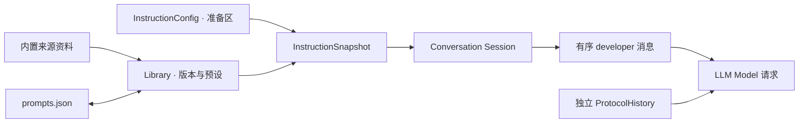

# 提示词版本、组合与会话快照

`agentelier_prompts` 拥有提示词材料及组合的数据语义。它不依赖 Bevy、UI、网络或 Runtime。`Library` 保存 `PromptRevision` 和命名 `PromptPreset`；`PromptRef` 以 ID 与版本引用确定的文本，版本包含语言配对、来源范围、性质、依赖、派生来源及 SHA-256。内置材料统一位于 UI Assets 的 `assets/prompts/`，包含原文许可及翻译说明。

编辑内置来源时建立新 ID 的派生版本，编辑可变条目时追加递增版本；两者均保留原版本和来源关系。加载时按 ID/版本合并内置资料，若磁盘中的同一来源版本与内置内容不一致则失败，不静默修复或覆盖原文件。保存前核对条目哈希、引用唯一性及所有预设引用，通过同目录临时文件、sync_all 和替换提交 `prompts.json`。

`InstructionConfig` 区分默认基础与指定版本覆盖，并维护有序补充版本。解析产生 `InstructionSnapshot`，它携带完整版本内容，不依赖提示词库继续存在。快照验证来源文本哈希与基础槽位一致性；`messages()` 是生成有序 Developer 消息的统一入口，保留槽位、版本和哈希。

Chat UI 通过数据目录就绪事件取得当前存储路径；Widgetry JobManager 执行加载、保存及导入，接收回复并确认 JobOutcome 后更新投影。当前同一时间只有一个文件操作，操作期间禁用编辑提交。读写失败显示错误并保留已有库；应用整体收尾沿宿主的辅助 Job 生命周期进行，不改变认证运行体系。

新建会话从准备区解析快照，通过 Conversation Bridge 逐字段传入 SessionSettings。Conversation 在创建时核对并固定快照，每轮生成请求克隆同一快照；重置复制旧 SessionSettings，重试复用同一设置。指令独立于 ProtocolHistory，每次只在请求前部注入一次，不随成功轮次累计。原有历史提交、失败展示、取消和任务回收语义保持原有边界。

TurnView 保留其请求所用的指令消息，Bridge 传递完整安全投影。Chat UI 的反射状态保存 JSON 形式的会话快照及最近请求指令，供用户查看和 BRP 只读核对；该 JSON 不参与网络请求构造。诊断不包含凭据、账号认证头或加密 reasoning 原文，日志不输出提示词及聊天正文。

项目 `AGENTS.md` 的最近采集状态与所选请求的保存材料在同一核对入口独立展示，来源不构造成 PromptRef，也不加入基础或补充槽位。自动项目正文按实际发布记录作为 user 项进入请求，固定基础与 supplements 保持 developer。发现机制见[项目上下文](project-context.md)。

核对页按会话、Turn 与实际请求序号选择记录，显示保存的固定基础、项目发布类型、窗口、完整包装正文、来源路径／作用目录／摘要／原文及实际组装顺序。沿用通过相邻请求引用相同发布身份表达，清除与压缩后重新发布保留各自类型；最近采集失败不会覆盖所选历史材料。发送事实缺失明确标为未记录，不等同于未发送。

请求选择与来源展开状态保存在 ChatState 及按会话隔离的展示状态中，切页重建后恢复；不拥有第二份协议历史，也不读取项目磁盘。来源与正文使用 WidgetryReadOnlyTextField，内容更新仅调用公开 Headless API，保留导航、选择、复制和内部滚动。BRP 只反射安全材料与有序项类型，不公开推理密文、认证头或图片 Base64。
