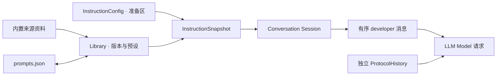

# 提示词版本、组合与会话快照

`agentelier_prompts` 拥有提示词材料及组合的数据语义。它不依赖 Bevy、UI、网络或 Runtime。`Library` 保存 `PromptRevision` 和命名 `PromptPreset`；`PromptRef` 以 ID 与版本引用确定的文本，版本包含语言配对、来源范围、性质、依赖、派生来源及 SHA-256。内置材料统一位于 UI Assets 的 `assets/prompts/`，包含原文许可及翻译说明。

编辑内置来源时建立新 ID 的派生版本，编辑可变条目时追加递增版本；两者均保留原版本和来源关系。加载时按 ID/版本合并内置资料，若磁盘中的同一来源版本与内置内容不一致则失败，不静默修复或覆盖原文件。保存前核对条目哈希、引用唯一性及所有预设引用，通过同目录临时文件、sync_all 和替换提交 `prompts.json`。

`InstructionConfig` 区分默认基础与指定版本覆盖，并维护有序补充版本。解析产生 `InstructionSnapshot`，它携带完整版本内容，不依赖提示词库继续存在。快照验证来源文本哈希与基础槽位一致性；`messages()` 是生成有序 Developer 消息的统一入口，保留槽位、版本和哈希。

Chat UI 通过数据目录就绪事件取得当前存储路径；Widgetry JobManager 执行加载、保存及导入，接收回复并确认 JobOutcome 后更新投影。当前同一时间只有一个文件操作，操作期间禁用编辑提交。读写失败显示错误并保留已有库；应用整体收尾沿宿主的辅助 Job 生命周期进行，不改变认证运行体系。

准备区解析基础、补充和协作配置，通过 Conversation Bridge 提交创建设置。Runtime 在普通 Root 的 Create、CreateAndSend 与 Reset 落盘前，从应用数据目录读取 `persona/origin.md`，由 Prompts 生成 Origin 槽位及 SHA-256。快照中现有基础覆盖在最前面，Origin 紧随其后，无基础覆盖时位于首位，补充与协作槽位依序跟随。新建会话缺少有效且非空的 UTF-8 正文时显示文件路径和失败原因，正文上限为 16 KiB。

Conversation 在创建时核对并固定快照。Reset 复制设置并替换 Origin 槽位，重试及恢复旧会话使用保存的快照。指令独立于 ProtocolHistory，每次只在请求前部注入一次。Origin 的本地文件独立于可编辑版本库，源文件更新时，已存储会话继续使用固定正文与摘要。

普通 Origin 聊天的情境指导在逻辑请求准备时选取，放在固定 Developer 指令之后、记忆和 Skills 材料之前。该片段随实际请求投影独立保存。请求核对页可读取它的正文、位置和内容摘要。选取情境以及保存结果的职责见[会话与协议历史](conversation.md)。

TurnView 保留其请求所用的指令消息，Bridge 传递完整安全投影。Chat UI 的反射状态保存 JSON 形式的会话快照及最近请求指令，供用户查看和 BRP 只读核对；该 JSON 不参与网络请求构造。诊断不包含凭据、账号认证头或加密 reasoning 原文，日志不输出提示词及聊天正文。

项目 `AGENTS.md` 的最近采集状态与所选请求的保存材料在同一核对入口独立展示，来源不构造成 PromptRef，也不加入基础或补充槽位。自动项目正文按实际发布记录作为 user 项进入请求，固定基础与 supplements 保持 developer。发现机制见[项目上下文](project-context.md)。

核对页按会话、Turn 与实际请求序号选择记录，显示保存的固定基础、项目发布类型、窗口、完整包装正文、来源路径／作用目录／摘要／原文及实际组装顺序。沿用通过相邻请求引用相同发布身份表达，清除与压缩后重新发布保留各自类型；最近采集失败不会覆盖所选历史材料。发送事实缺失明确标为未记录，不等同于未发送。

请求选择与来源展开状态保存在 ChatState 及按会话隔离的展示状态中，切页重建后恢复；不拥有第二份协议历史，也不读取项目磁盘。来源与正文使用 WidgetryReadOnlyTextField，内容更新仅调用公开 Headless API，保留导航、选择、复制和内部滚动。BRP 只反射安全材料与有序项类型，不公开推理密文、认证头或图片 Base64。
## Multi-Agent 协作指令

`prompts.json` 的 `collaboration` 定义新 Root 的默认委派策略，组合预设的 `config.collaboration` 可以覆盖它。配置接受 `"explicit_request_only"`、`"proactive"` 或 `{"custom": "策略正文"}`。缺省策略要求用户明确请求协作。自定义策略需要非空、有效正文，长度上限 8 KiB。

Root 在创建时将策略解析为独立的 `Collaboration` 指令，按固定顺序附在基础和补充指令后。该条目使用稳定来源标识和内容哈希，随 Session 的现有指令快照一同保存。旧 Session 从存档读取自己的原始快照。

提示词库提供 `general`、`research`、`implementation` 和 `review` 四个内置角色。`roles` 可声明自定义角色，每项有唯一 `id`、非零 `version` 和对提示词版本的 `instructions` 引用，可附带 `model`、`reasoning` 及 `allowed_tools`。未知角色、空配置及缺失的版本引用会返回配置错误。工具白名单必须是父级工具权限的子集。

子 Agent 指令快照只从 Root 继承基础和补充指令，再附加独立的 `SubAgent` 通用约束及 `Role` 指令。Role 指令包含解析时的完整正文与哈希，原任务通过自己的输入路径提交。角色声明和快照构造属于 Prompts，实际子 Agent 创建在 Runtime 接入。
