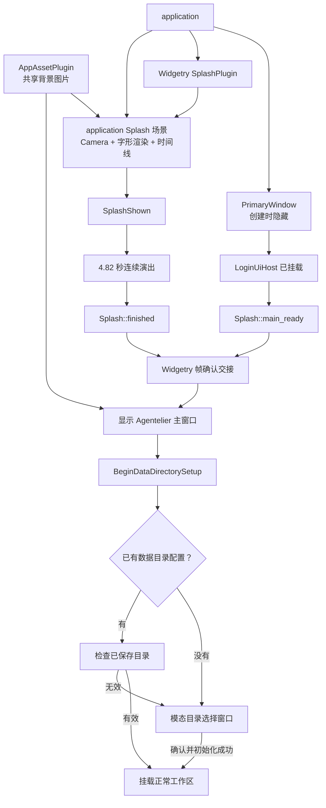

# Splash 启动演出与主窗口交接

启动窗口通过 Bevy 原生 WGSL 批量绘制数据海、涡流及由共享背景采样生成的人物字形。整段演出使用同一个时钟，交接前显示共享背景原图。

Splash 是 Agentelier 的启动阶段演出。它在主窗口正式显示前运行，最终收束到主窗口背景，再把显示权交给已经准备好的 Agentelier 工作区。

这个过程由两个部分共同完成：application 提供演出内容和播放状态，`bevy_widgetry::splash` 提供独立原生窗口、首帧呈现握手和主窗口交接。Splash 不属于 Agent、Bridge 或 Session 的业务状态，也不是主窗口中的一个独立页面。

## 整体设计

application 持有 Splash 的 Camera、场景实体、字形实例数据和时间线。Widgetry 只管理 Splash 原生窗口及其显示/交接状态。主窗口和 Splash 共用同一张背景图片，确保最后一帧与主窗口出现时的画面一致。

## 最终视觉设计

整段演出长 **4.82 秒**，由四个连续时间区段在同一个空间中完成。整体从暗绿色的数据世界，逐渐过渡到浅薄荷绿的 Agentelier 主窗口背景。

| 时间 | 画面 |
|---|---|
| 0.00–0.65s | 多领域知识碎片在暗绿色空间中自然流动，形成具有远近层次的数据海。 |
| 0.65–1.36s | 四个局部涡流逐渐活跃。各涡流的尺度、方向和密度不同，信息流在不同区域之间交错。 |
| 1.36–2.54s | 涡流分出细流，将字符沿曲线送入人物构图。眼睛、发束、衣纹和身体轮廓在不同区域交错显形。 |
| 2.54–4.82s | 字符笔画逐渐落定并取得背景对应位置的明暗；数据世界亮成浅薄荷绿，字符逐渐变为墨色并融入原始背景图。 |

四个时间区段只用于内部时间线组织和调试定位。正式 Splash 不显示阶段名称、中英文副标题、进度条、播放控制或其他开发辅助 UI。四个区段不是四段独立视频，动画在同一个连续空间中完成。

### 数据之海与多中心汇聚

数据之海的主要元素是有意义的信息碎片，而不是只有抽象圆点。碎片包含自然语言、代码、数学公式、化学式、物理符号和结构化数据。不同内容在长度、密度和排列方式上有差异。

第二个时间区段形成四个局部知识涡流。它们不是四个互不相关的独立对象，而是同一片数据海中的不同汇聚区域。涡流之间保留桥接信息流，最终共同参与人物成像。

### 由字形组成的人物

人物本身由文字、代码、公式和知识碎片构成。字符不只是均匀填充剪影，而是通过方向、密度、大小、亮度、留白和深度共同形成发束、面部、手部、服装和丝带结构。

最终人物形象以共享背景图中的字符少女为目标。背景图提供人物目标位置及明暗结构；字形在场景初始化时采样并生成目标单元，播放期间只更新实例状态。手部高光采样和字形汇聚共用图中的手部中心。角色不使用独立彩色 PNG 立绘作为最终图层。

### 从数据世界过渡到主窗口背景

最终背景从约 3.28 秒开始逐渐显现，到 4.82 秒完成。暗绿色数据场降低存在感，人物字形逐渐转为与背景相符的墨色和明暗，最后融入原始背景图。

这张 1920 × 1080 的图片同时是 Splash 的最终帧和 Agentelier 主窗口背景。它不是单独叠加的角色立绘，而是一张完整的浅薄荷绿工作区背景，其中的助手形象以低对比度字符水印融入画面。

## 主窗口背景与内容控件

主窗口使用同一张浅薄荷绿背景图。左侧导航、工具栏、消息内容、代码块、输入区和后台任务区域使用独立的浅色表面。背景人物只在未被控件占据的区域中提供视觉氛围；实际文字不直接绘制在密集字符水印上。

主窗口的颜色体系使用浅薄荷绿和柔和鼠尾草绿作为表面，森林绿作为按钮和强调色，深绿色作为正文文字。具体控件颜色以 `docs/design/ui/visual-system.md` 为准。

主窗口使用 1920 × 1080 的初始逻辑尺寸，UI Scale 由应用配置控制。系统限制窗口尺寸时，主窗口在隐藏期间向下适配到能容纳的 16:9 物理尺寸。Splash Window 采用该物理尺寸并排除普通 UI Scale，首帧显示前两个窗口对齐原生位置。Splash 和主窗口均使用居中 Cover 坐标映射。

## Bevy 原生场景与资源

正式 Splash 在同一个 Bevy App 中实时渲染，不播放预制 MP4，也不嵌入浏览器页面。不引入 GStreamer、视频容器、视频解码器或外部视频播放 Pipeline；动画的每一帧都由 Bevy 原生渲染路径实时生成。

- `AppAssetPlugin` 加载共享背景图片，供 Splash 和主窗口使用。
- application 创建 Splash Window 对应的 `Camera2d`，其 `RenderTarget` 指向 Splash Window Entity。
- 字形图集保存可复用的文字、数字、代码符号和数学符号纹理。
- 字形图集从 Widgetry 的内置字体生成。字形目标位置由共享背景图片的明暗与轮廓一次性采样生成。
- 字形实例通过 GPU 批量绘制，WGSL Shader 负责位置、方向、颜色、透明度、模糊和纹理采样。
- 时间区段边界只存在于内部时间线，不向 Splash Window 渲染文字标签。

字形和涡流的初始参数保存在 GPU 的同一批次中。application 每帧提供从 `SplashShown` 开始计算的 Bevy 实时时钟，WGSL 据此求出当帧的字形位置、方向与透明度。目标流畅度为 60 FPS，实际渲染帧率随显示器刷新率和设备性能变化，时间线长度由实时时钟决定。

## Widgetry Splash 会话

### 创建时隐藏主窗口

主窗口在 `WindowPlugin` 创建原生窗口时就设置为不可见。Widgetry Splash 不会因为安装插件或调用 `Splash::start` 而自动隐藏主窗口。

application 在主窗口 Entity 存在后调用 `Splash::start`，获得独立 Splash Window Entity。该窗口由 Widgetry 固定物理尺寸、移除原生边框并定位到主窗口所在的显示器。Splash 内容和 Camera 仍由 application 创建。

### 首帧显示与动画开始

场景和必要资源准备完成后，application 调用 `Splash::ready`。Widgetry 等待 Splash 的真实渲染帧完成呈现，再发送 `SplashShown`。动画从 `SplashShown` 开始计时，避免资源加载期间提前消耗演出时长。

### 主窗口就绪与演出结束

主窗口就绪和 Splash 演出结束是两个独立条件：

- `Splash::finished` 表示 4.82 秒演出已经结束。
- `Splash::main_ready` 表示主窗口基础 UI 已经挂载，可以进入窗口交接。

两者可以任意先后到达。主窗口先就绪时，Splash 继续播放；演出先结束时，Splash 保持最终背景帧，等待主窗口就绪。

主窗口基础 UI 包括 PrimaryWindow 对应的 Widgetry Window Root 和 `LoginUiHost`。`MainWindowReady` 不等待 `DataDirectoryReady`、ChatUiHost、Session 或用户交互。这样 Splash 完成后可以先显示主窗口，再开始数据目录初始化。

### 主窗口显示后再初始化数据目录

Widgetry 完成隐藏主窗口的有效帧确认、显示主窗口并确认显示后的新帧后，移除 Splash Window 并发送 `SplashCompleted`。

application 收到 `SplashCompleted` 后通知 login_ui 开始数据目录初始化。Splash 每次进程启动都会播放，不因已经保存数据目录而跳过。

login_ui 根据配置决定后续行为：

- **已保存数据目录：**开始现有 `DataEnvironment::open` 检查流程。检查成功后发送 `DataDirectoryReady` 并挂载 `HomeContent`。
- **没有已保存目录：**创建独立的 Widgetry Owned Window 作为目录选择窗口，并将 `WidgetryModalWindow { parent: primary_window }` 绑定到主窗口的原生 Window Entity。目录选择器作为这个模态窗口的内容。
- **已保存目录不可用：**保留现有失败信息和重试能力；用户选择重新选择时打开同一个模态目录选择窗口。

模态关系由 Widgetry Window 管理。主窗口继续显示在后面，但被模态窗口阻挡输入；用户确认目录并完成初始化后，目录选择窗口关闭，主窗口挂载正常工作区。

目录选择窗口继续使用现有 `WidgetryFileDialog`，不另造文件系统浏览器。窗口关闭和销毁由 login_ui 所有。用户取消选择时沿用现有启动取消语义，向应用提交正常 `AppExit::Success`，由既有 shutdown 流程收尾。

### 帧确认交接与资源清理

当 `Splash::finished` 和 `Splash::main_ready` 都满足时，Widgetry 等待主窗口隐藏状态下的有效帧，显示主窗口，再确认主窗口显示后的新帧。确认完成后 Widgetry 移除 Splash Window，并发送 `SplashCompleted`。

Splash 最终帧和主窗口背景使用同一张图片，因此交接不需要再叠加一段独立的跨窗口透明度动画。暗绿色到浅薄荷绿的视觉变化已经在演出内部完成。

收到 `SplashCompleted` 后，application 清理 Splash Camera、场景根、时间线和字形实例资源。Splash 只在进程启动时出现一次，托盘隐藏和恢复不会重新播放。

## 失败与退出处理

如果 Splash 创建、资源加载或渲染初始化失败，application 取消已创建的 Splash 会话并显式显示主窗口，随后仍然通知 login_ui 开始数据目录恢复或选择。`Splash::cancel` 只结束 Splash 会话，不负责显示主窗口，也不自动清理 application 创建的 Camera 和场景实体。

如果应用在演出期间收到 `AppExit`，application 清理 Splash 会话和场景资源，再交给现有 shutdown 流程。Splash 不持有 AgentHost、Runtime 或 JobManager 的业务关闭逻辑。
