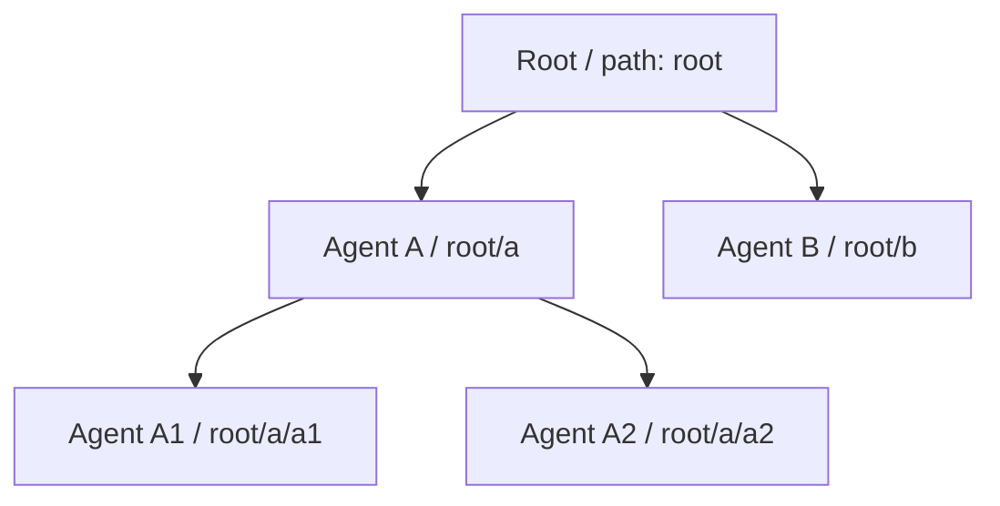
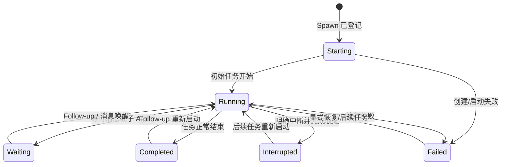

# Agent 身份、树形关系与生命周期

Agent Tree 不是 UI 中的一组标签，而是同一用户会话内多个独立执行主体的稳定关系。Root Agent 对应用户会话的主 Agent；每次 Spawn 创建一个新子 Agent，子 Agent 可以继续创建后代。路径表达树中的位置，Thread/Conversation 身份表达独立历史。两者都不能依赖当前 Runtime 是否驻留。

## 稳定身份与路径

每个 Agent 至少具有以下业务身份：

- `agent_id`：应用内稳定且唯一的 Agent 标识。
- `session_id`：所属用户会话 UUID。一个 Agent 不能跨 Session 迁移。
- `parent_agent_id`：父 Agent；Root 没有父节点。
- `agent_path`：从 Root 到当前 Agent 的稳定路径，用于模型工具定位和诊断展示。
- `role`：Agent 的职责标识。
- `thread_id` / Conversation identity：独立历史的身份，和 Agent ID 一一关联。
- `created_by_turn` 与 `spawn_call_id`：说明创建请求来源，便于幂等登记和结果追溯。

路径只用于定位，不代替权限检查。解析目标时必须先确认目标属于调用者所在 Session，并验证调用者是否允许访问该目标。禁止跨 Session 仅凭路径命中 Agent。

路径生成应由 Registry 原子分配。创建失败释放尚未提交的预留；已持久提交的身份不能被另一 Agent 复用。昵称仅用于易读显示，不能作为唯一 ID 或工具目标身份。

## Registry 的责任

当前已接入内存身份登记。Root 映射到现有 Session UUID，创建或重置须等初始存档确认后登记，打开同一会话沿用该映射。每次打开分配新的 Runtime 实例标识。子 Agent 的标识、路径及昵称可以在 Registry 预留、提交或释放，子 Agent 身份存档属于后续增量。

Registry 管理同一 Session 的 Agent Tree 索引：路径到 Agent、Agent 到父节点、子节点集合、角色与当前状态。它还负责预留 Spawn 名额、分配路径/昵称、维护总量和深度约束，并记录 Runtime 是否驻留的索引。

Registry 不拥有会话历史，也不保存 OS 进程或 JoinHandle。它通过 Agent Control 与 Conversation、Session Store 协作。恢复时先从持久化 Agent 图重建身份，再按需恢复 Runtime。

## 状态与驻留是两个维度

Agent 业务状态表达任务生命周期，例如 `Starting`、`Running`、`Waiting`、`Completed`、`Interrupted`、`Failed`、`Evicted`。实际状态集合在实施时需与 Codex v2 语义和 Agentelier 可持久化状态统一，避免把瞬时状态无限扩张。

驻留状态独立表达 Runtime 是否在内存中：`Resident` 或 `Unloaded`，以及创建/卸载过程中的过渡状态。一个已完成 Agent 可以仍然驻留以供后续消息使用；一个等待消息的 Agent 可以被卸载；一个正在执行的 Agent 不能被普通空闲卸载策略回收。

状态转换由 Agent Control 发起，Conversation 保存业务状态，Runtime 报告真实执行事实。Bridge 只接收安全投影，不自行推断状态。

## 生命周期

状态图表达业务可见生命周期；卸载不改变 Agent 的身份和已完成历史，也不应把 `Waiting` 伪装成 `Completed`。恢复失败要保留失败原因并阻止重复 Spawn。

## Root 与后代的关闭语义

Root 停止时，Agent Control 关闭该 Session 的新 Spawn 和新副作用接纳，向所有活动后代发出停止请求，等待真实执行句柄回收，再关闭 Mailbox 与会话存储。单个子 Agent 中断时，默认只中断该 Agent；若它拥有正在运行的后代，则按父子所有权递归协调后代，不能遗留失去管理者的活动子树。

## 需要保护的边界

- 不允许环、重复父节点、重复路径或孤儿节点成为已提交 Agent 图。
- 不允许通过更改 Agent Path 使一个子 Agent 访问其他 Session。
- 不允许 Runtime 卸载导致身份、历史或未消费 Mailbox 丢失。
- 不允许释放容量名额早于真实 Runtime 退出确认。
- 对不确定的创建/关闭结果保留可检查的状态，不盲目重试可能产生重复副作用的操作。
