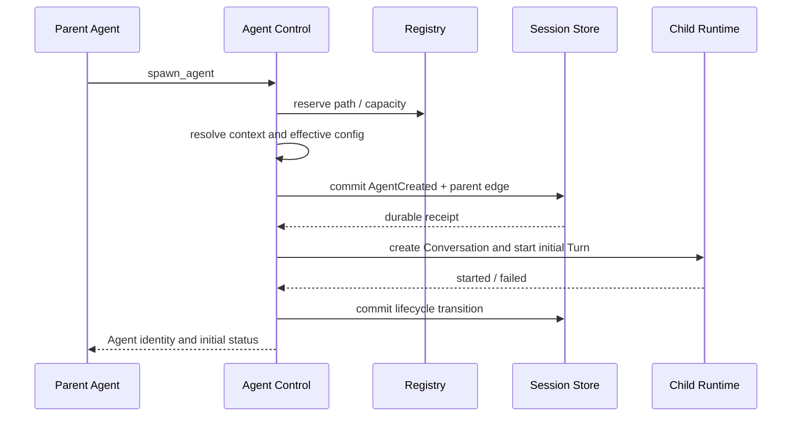

# 创建子 Agent 时如何形成独立上下文

Spawn 同时创建一个新的协作身份、独立 Conversation 和独立执行环境。它不是把父 Agent 的 Runner 复制一份，也不是让子 Agent 直接共享父 Agent 的可变历史。创建流程必须先确定继承边界，再登记身份，最后启动执行。

## Spawn 的输入与结果

模型通过 `spawn_agent` 提供任务说明，可选指定 `task_name`、Agent Role、模型和推理强度，以及上下文 Fork 模式。工具调用结果返回可用于后续协作的 Agent 标识/路径和必要状态；不向用户显示内部 Thread 技术细节。

Spawn 需要固定创建来源：调用者 Agent、当前 Turn、原始工具 call ID、Session、父路径、任务名称、角色、Fork 模式和请求覆盖项。相同调用的重复处理必须能够识别，不能创建两个子 Agent。

## Context Fork

本次保留 Codex v2 的两类上下文启动方式：

- **Full History Fork**：子 Agent 从父 Agent 的指定历史边界继承上下文，适用于需要完整背景和已有对话约束的任务。
- **Fresh Context**：子 Agent 使用独立的新历史，只接收 Spawn 提供的任务说明及被明确选中的项目/会话上下文，适用于任务边界清晰、上下文较重或希望减少无关信息的情况。

Fork 是创建时的历史初始化方式，不意味着后续共享历史。子 Agent 从创建之后拥有独立历史。需要明确 Fork 的历史截止位置，避免父 Agent 在 Spawn 后继续追加的内容被意外混入子 Agent。

Conversation 从已确认来源调用的冻结请求构建子 Agent 配置。Full History 截取该请求所见的协议前缀，并保留其项目发布来源。请求窗口已经被压缩替换、前缀不一致或存在开放工具调用时，准备失败。Fresh Context 从同一步骤的有效项目材料重新生成初始发布。Fork 记录父 Thread、Turn、请求序号、调用 ID 和请求及历史摘要。

## 配置继承顺序

子 Agent 从父 Agent 在调用 Spawn 时的有效执行配置形成快照。设计顺序为：

1. 读取当前调用步骤的模型与推理设置，而不是父会话早期的陈旧设置。
2. 继承当前工作目录、执行身份、沙箱/权限、审批策略和适用的环境绑定。
3. 按 Fork 模式构建历史及指令来源。
4. 应用显式模型/推理覆盖（仅在模型能力验证通过后）。
5. 应用 Agent Role 允许的职责与能力收窄。
6. 冻结该子 Agent 的有效配置，供冷恢复重建。

权限规则是单调收窄：子 Agent 不能获得父 Agent 当前没有的文件、网络、工具或审批权限。Role 的配置覆盖只能降低能力或改变职责，不得越权。运行时临时授权不能通过一个宽泛角色配置持久放大。

配置快照保存冻结的账号与工作区绑定、工作目录、模型与推理选项、指令、Skills 目录以及实际工具声明。工具注册从父目录筛选并适配子模型契约，MCP 来源随原工具声明保留。执行沿用当前 Windows 桌面账号与现有工具审批边界。角色工具白名单超出父级会使准备失败。长期记忆和独立的转写请求材料由父任务自身持有。

## Fork 与 Role 的优先关系

Full History Fork 应忠实继承父 Agent 的历史背景。角色指令若要覆盖，需要明确地作为子 Agent 自身的配置层追加，并保持系统/开发者指令层级规则。Fresh Context 则以角色指令和 Spawn 任务为主。若 Codex 对 Full History Fork 的某些角色覆盖有限制，Agentelier 应保留其防止历史与指令冲突的动机，但以 Agentelier 的提示词快照和请求组装规则表达，不机械复制内部配置对象。

## 创建的可靠顺序

若持久化身份提交失败，不启动子 Agent。若提交后 Runtime 启动失败，保留创建失败状态和原因，释放未占用的运行资源，但不伪造“从未创建”。

`spawn_agent` 调用沿用工具执行提供的父 Thread、Turn、请求序号及 call ID。已登记的同一来源返回原身份。Session JSONL 先记录 `AgentCreated` 及配置和初始历史，再接纳执行轮次。子 Agent 通过现有 Turn Runner 执行独立的模型和工具循环，工具权限仍由父级工具目录和 Role 决定。

## 模型覆盖

默认继承父 Agent 模型。显式覆盖必须从 Agentelier 当前模型目录中解析，验证该模型支持 Multi-Agent v2、具有可用推理等级，并满足用户的模型策略。不能接受任意自由文本 slug。推理强度必须属于该模型的支持列表；没有明确值时使用该模型目录给出的默认值。

验收环境中的模型策略另有固定要求：Root 固定 `gpt-6.2-sol`；子 Agent 只能选择实际目录中 GPT-6 及以上、非 Astra 级别模型。该验收策略不等于生产环境永远固定这些模型。

## 失败与边界

- 父 Agent 不存在、已关闭或不属于当前 Session：拒绝 Spawn。
- 超过总量、并发或深度限制：在创建任何持久身份前返回可解释错误。
- Fork 边界不可读取或历史损坏：拒绝以不完整历史冒充 Full History Fork。
- 模型不支持 Multi-Agent 或推理等级不兼容：拒绝覆盖，保留父模型默认路径。
- 角色不存在、配置无法解析或企图扩大权限：拒绝该角色配置，不静默回退为更宽权限。
- 创建结果不确定：先查询 Agent Tree 和持久化事实，不重复 Spawn。
