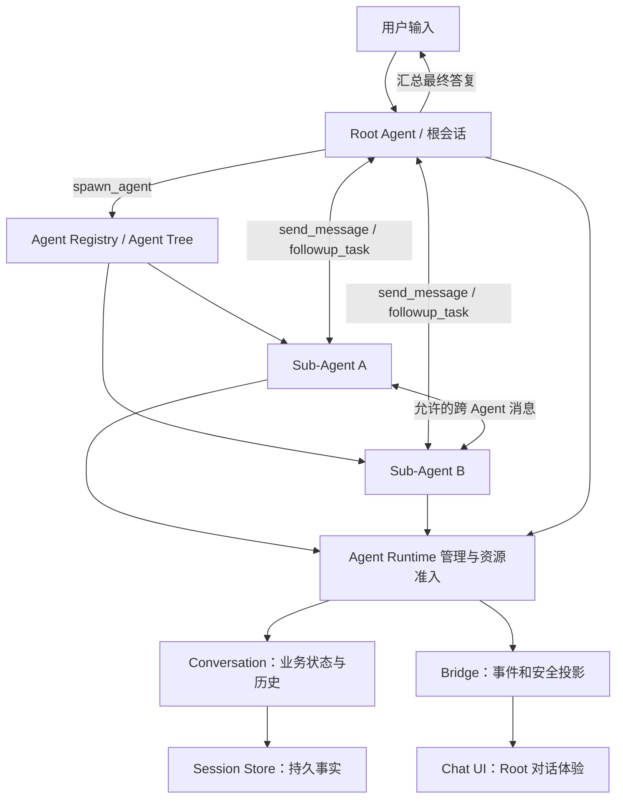
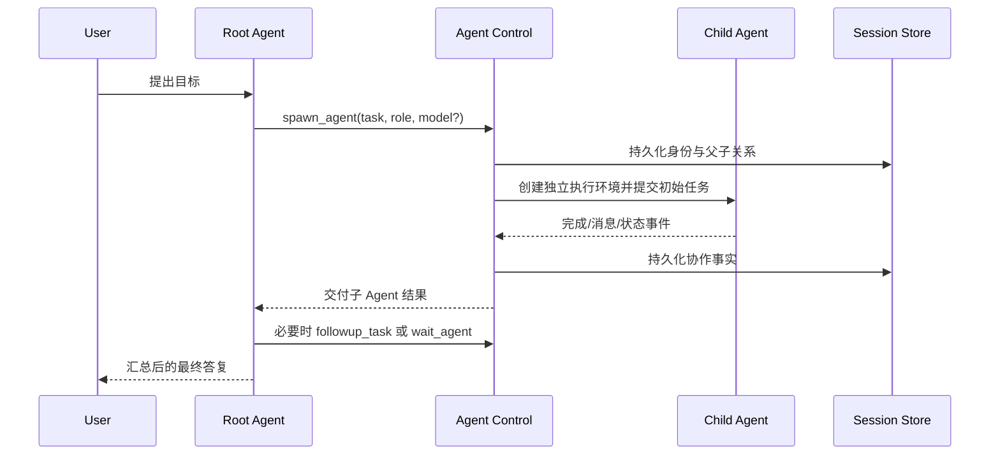

# Multi-Agent v2：从单个执行任务扩展为协作 Agent 树

Agentelier 的每个会话可独立推进一轮用户任务。多个会话可同时运行。Multi-Agent v2 在各会话内提供一组由本会话 Root Agent 管理的独立 Agent。Root 决定是否拆分任务、创建子 Agent、分配工作、交换信息、等待结果并完成汇总。用户在聊天区与当前会话的 Root Agent 交互。

这不是把多个模型请求并行发出去那么简单。每个子 Agent 都有自己的身份、会话历史、执行状态和生命周期；它们又必须共享同一个用户会话的资源预算、权限边界、消息协调和最终关闭过程。因此设计把身份与运行时分开：Agent Tree 表示谁是谁、从哪里派生；Runtime 管理它是否正在运行以及实际资源；Conversation 保存业务状态；Session Store 记录可恢复的事实。

图中的双向消息表示逻辑通信能力，不意味着子 Agent 可以绕过控制层直接修改其他 Agent 的会话。所有消息、任务触发和生命周期操作都必须经过统一 Agent Control。Root 负责用户目标的最终解释与结果整合；子 Agent 的输出首先交付给其父 Agent，只有 Root 决定的最终答复呈现为普通用户回复。

## 设计的主要边界

### Agent 身份不是 Runtime 句柄

Agent 的稳定身份包括 Agent ID、所属 Session、父 Agent、Agent Path、角色和创建来源。运行时句柄、Tokio JoinHandle、CancellationToken、Mailbox watch receiver 等只在当前进程内有效，不写入持久化数据。Agent 可以在没有常驻 Runtime 的情况下继续存在于 Agent Tree 中，稍后按原身份恢复。

### Root 是用户任务入口，子 Agent 是内部执行者

一个用户会话仍然只有一个 Root 前台 Turn。子 Agent 拥有独立 Turn Runner，不占用 Root 的前台输入槽。Root 的 Stop、会话删除和应用关闭必须协调整个 Agent Tree；单独中断一个子 Agent 则只影响目标及其必要的后代清理，不应误停 Root 或兄弟 Agent。

### 消息投递与任务唤醒是不同操作

`send_message` 只投递消息，不主动启动空闲 Agent；`followup_task` 投递后还会触发目标 Agent 新一轮执行。Mailbox 保留尚未消费的消息，Wait 通过活动通知等待，不靠高频轮询。这个差别是 v2 协作语义的关键。

### 工作目录保持共享

本次不引入 Git Worktree。Root 和子 Agent 默认使用会话固定的同一工作目录，文件修改即时共享。Agent 的任务分配应考虑文件冲突；Worktree、分支隔离和独立构建缓存不属于本次范围。

## 设计主题的阅读顺序

1. [身份、树形关系与生命周期](01-agent-identity-and-lifecycle.md)：Agent ID、路径、父子关系、状态及创建/结束语义。
2. [创建、上下文与配置继承](02-spawn-context-and-config.md)：Spawn、Fork、角色覆盖、权限和运行配置如何从父级形成子 Agent。
3. [消息、Mailbox 与六个协作工具](03-messaging-and-tools.md)：队列消息、唤醒、等待、取消和结果交付。
4. [模型目录、角色与协作指令](04-models-roles-and-prompts.md)：模型能力筛选、模型覆盖、角色与 Root 的委派策略。
5. [独立执行、资源准入与驻留](05-runtime-admission-and-residency.md)：并发、总量、深度、Runtime 驻留与卸载恢复。
6. [持久化、恢复与模块集成](06-durability-and-integration.md)：Agent 图、消息和任务事实如何落入现有 Conversation / Session Store，以及 Bridge/UI 如何投影。

执行顺序与设计阅读顺序不同，见 [执行方案总览](../../../plans/multi-agent-v2/00-overview.md)。

## 正常协作过程

初始任务不能在 Agent 身份和父子关系尚未可靠登记前开始执行。结果也不能只存在于一个临时 UI 事件中：它必须先成为 Conversation 可接受的业务事实，再交给父 Agent 的下一次请求。

## 核心不变量

- 一个 Session 只有一个 Root Agent；Root Path 固定为根路径，所有子 Agent 都有唯一父节点和唯一稳定路径。
- Agent ID 与 Runtime 实例 ID 分离；卸载 Runtime 不删除 Agent 身份。
- 子 Agent 不继承高于父 Agent 的权限。角色只能进一步收窄能力，不能扩大权限。
- 每个 Agent 的历史和执行状态独立；Agent 间通信通过 Mailbox/Control，不共享可变 Conversation 对象。
- 所有 Agent 共用 Session 级资源预算和关闭边界。
- 工具结果、消息和任务状态通过单一业务写入路径提交；UI 投影不是权威状态。
- 不因模型输出、超时或取消请求就推断副作用已回滚；终态必须依据实际执行与回收回执。

## 明确排除

不建设完整 Rollout Trace、App Server 协议兼容、Telemetry、Analytics 或 Git Worktree。基础协作事件记录仍是恢复所需的持久事实。GUI 不展示完整 Agent 树控制台；必要的开发诊断可以通过日志、运行状态检查和 BRP 完成，不向普通用户暴露协作内部操作。
