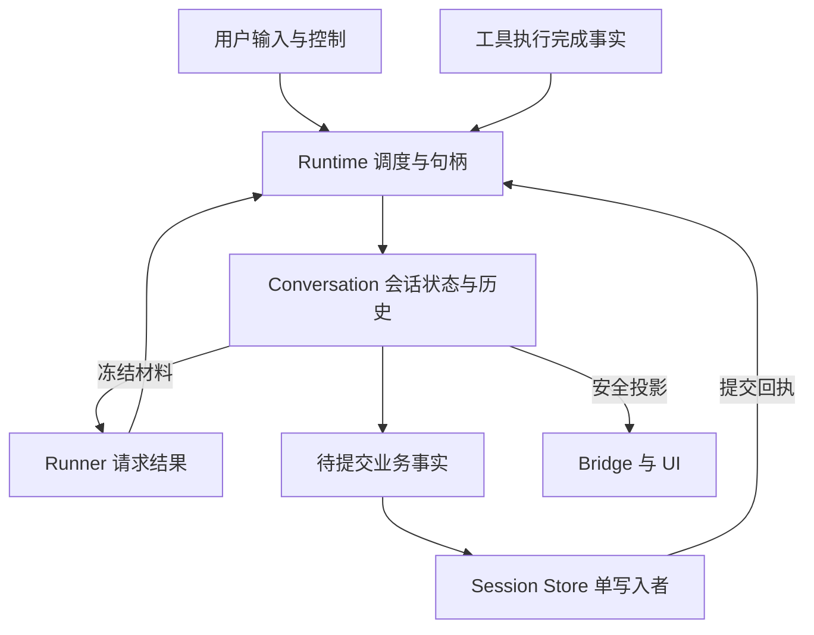
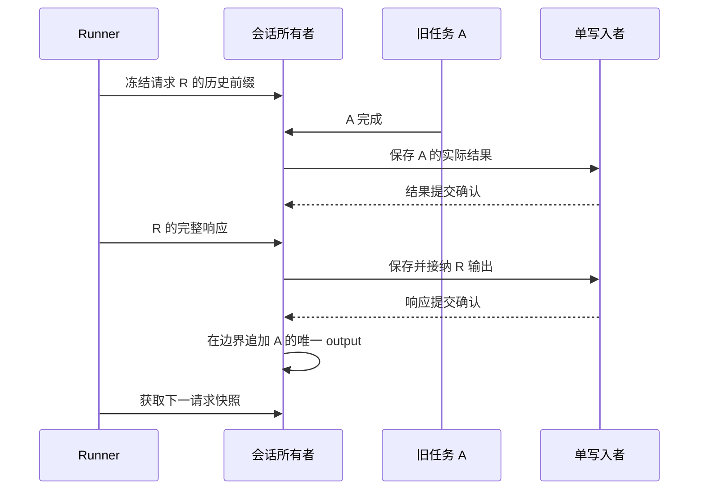

# 结果怎样进入唯一的会话历史

## 先固定谁能修改历史

跨 Turn 后，前台和后台会同时产生事实。若继续让 Runner 带走整份会话、结束时整份归还，后台已经保存的新结果可能被较旧快照覆盖。目标结构把会话权威状态始终留在 `agentelier_conversation`；Runtime 按会话串行调用其业务转换，Runner 只持活动 Turn 的局部执行状态和冻结请求材料。

Runtime 负责 I/O 等待、执行句柄和控制接纳，Conversation 决定身份、状态转换、历史追加和可否继续。Store 负责实际文件提交。它们共同形成单一业务写入顺序，不建立第二份共享可变历史，也不让工具直接操作 UI 或存储日志。

`ActiveTurn` 不再作为整个 SessionView 的搬运容器。前台进度是针对 Turn 的事实或受版本校验的局部更新；任务进度按任务身份归并。名称、Queue、旧任务结果、当前正文各自更新自身字段，不能用整份旧快照覆盖其他来源。

等待磁盘回执期间，Runtime 继续接纳控制和凭据事件。相关业务提交保持有序；接到取消信号可以先停止尚未开始的派发，已经进入提交的记录仍等待实际回执。提交未确认时不通过猜测释放状态或重新写入。

## 任务身份不随当前 Turn 改变

每个工具调用都保留以下关联，原生异步调用另有应用分配的稳定任务 ID。

| 身份 | 用途 |
| --- | --- |
| 会话 UUID | 隔离历史、任务、进程与附件 |
| 原始 Turn ID、请求序号 | 说明工作由哪次用户任务和响应产生 |
| 原始 `call_id`、输出项 `id` | 分别关联协议结果及校验响应项 |
| 应用任务 ID | 供查询、等待、取消和 UI 稳定定位；会话内永不复用 |
| 本次执行实例身份 | 识别当前进程中的真实执行，拒绝旧句柄或旧通道的迟到回报 |
| 来源契约与调用上下文引用 | 固定工具来源、参数、目录、原始用户陈述、记忆纪元及能力 |

UI 物理行号、当前 operation 和当前 request_index 都不是任务身份。原任务完成于 Turn 3，也不会把来源改成 Turn 3。恢复后沿用保存的任务身份，运行句柄重新从“无”开始；它们不可从存档复活。

## 一项任务有几条相互关联的状态

执行状态与交付状态分别表达，避免一个“成功”承担过多含义。

| 维度 | 状态与含义 |
| --- | --- |
| 执行 | 已登记、等待准入、运行、取消中、成功、失败、超时、已取消、未执行、结果未确认 |
| 资源 | 无活资源、仍持资源、正在回收、回收未确认 |
| 保存 | 结果尚未形成、已形成待保存、已持久提交、保存失败或未确认 |
| 协议 | 尚无对应 output、已唯一追加到历史 |
| 请求事实 | 尚未纳入请求、已纳入某冻结请求、已开始发送、该请求完整成功或结果未知 |

例如“执行成功，保存失败”意味着工作可能已经修改文件，但结果还不能交给模型。又如“结果已追加，尚未发请求”意味着输出已经可靠留在历史中，空闲界面仍应显示待处理。

这里的“已用于成功请求”仅表示包含该结果的请求得到了完整合法响应。它不把网络接纳推断成模型理解，也不宣称网络恰好交付一次。无状态重放本来就会再次携带以前的结果；必须禁止的是再次追加同一结果、再次启动同一调用或再次发送有副作用的进程输入。

## 响应、结果与用户输入的排序

每次请求由一个冻结历史前缀、已经接纳的本轮输入、项目与 Skills/记忆材料构成。记录其历史位置、覆盖项数和任务结果集合之后才开始 HTTP。冻结后，新输入和工具完成事实都先进入相应待处理区，不改在途请求的字节。

一个关键例子：请求 R 已发出，旧任务 A 此时完成。先保存 A 的结果事实；R 合法完成后，先接纳 R 的原始输出，再在边界把 A 的结果追加到历史。不能把 A 的结果插到 R 输出前面，伪装成 R 已经看过它。

如果 R 失败、停止或缺少合法完整输出，就保留已经确认的历史前缀，不安装 R 的非法输出；随后仍在这个合法边界归并 A。不能永远等一个不会再到达的 `response.completed`。失败前台的展示与已提交协议历史继续分开保存。

一个边界内，已经确认的结果按业务提交序号追加；已接纳的 Steer 按接纳序号应用。请求记录说明本次究竟包含哪些项，不通过到达线程的偶然先后推测。Queue 尚未实际启动的输入不进入协议历史。用户输入是否被接纳、是否进入请求、是否形成可继续的完整步骤仍然是独立事实。

## 从结果到下一次请求

工具只回报结果事实。Conversation 校验来源与当前任务状态；图片先由 Store 提交为本会话附件，再确认工具结果；边界追加 `function_call_output` 时核对原始调用仍存在、结果尚未追加、任务与载荷一致。完成这个步骤后才允许构造使用它的请求。

一次追加失败不能让 UI 或 Runner自行补一份结果。重复通知由账本当前状态去重；相同身份但不同结果必须阻断该会话后续执行并显示冲突。完成通知只是唤醒信号，每次进入请求、等待和收尾边界都重新检查账本，避免一次通知丢失导致永久悬挂。

若结果已在历史中，而承载它的请求断流或超时，保留该结果及请求未知事实。后续请求重放相同历史，不重新调用工具。原用户任务已产生副作用或已保留步骤时，原有整 Turn Retry 限制继续生效；界面的“处理已完成结果”也不等于重跑原任务。

## 前台空闲时怎样续接

前台正常结束不消费尚未就绪的结果。后台完成后仍依同一路径保存并追加，只是不自动启动模型请求。用户看到“已保存，待处理”的计数，可以继续输入，也可以点击“处理已完成结果”。

这里限制的是后台完成触发的聊天续接；已经显式接纳的 Queue 仍按原规则执行，既有长期记忆后台任务沿用各自设置和计量，不被混计为一次聊天续接。

该按钮产生独立的结果续接触发身份，选择当时尚未进入成功请求的结果，启动一个普通的单活动 Turn。它不伪造新的用户话语或授权；没有待处理结果时不发请求。按钮与发送同时发生时，由同一接纳边界确定一个活动 Turn，另一动作得到明确回执，不能偷偷启动第二个。

活动 Turn 中的结果在下一个合法请求边界可见，通常由现有模型循环继续处理。已有完整 final、没有同步依赖和已接纳 Steer 时，可以正常结束；恰在 final 边界到达的后台结果转为可见的待处理项，而不是强迫 final 后再开一轮。显式 Queue 在原有正常结束和真实回收边界后启动，并自然携带当时已就绪的结果。
