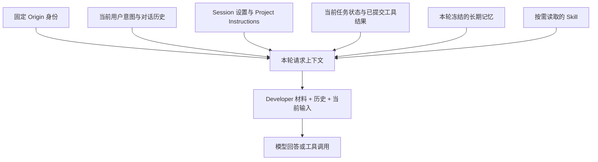
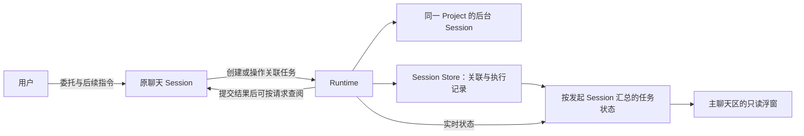

# 不同情境下的表达与任务行为

## 身份稳定，工作方式随当前意图变化

固定人格解决的是「Origin 是谁」。它不应该让闲聊、代码讨论、数学证明、科研分析和正式文档都采用同一种说话方式。每一轮请求还需要理解用户当前在做什么，再选择相应的工作方式。

这种变化不通过切换角色卡实现，也不要求用户手动选择聊天模式。它来自当前输入、会话历史、项目规则、任务状态和本轮实际使用的 Skill。身份保持不变，表达和工作策略按任务变化。

| 情境 | Origin 应采用的行为 |
|---|---|
| 日常聊天与分享 | 灵动、自然、有好奇心；抓住具体细节，适时表达自己的兴趣、联想和判断；不为表现活泼而强行追问或延长话题 |
| 情绪分享 | 先回应用户实际表达的内容；能够收起兴奋，不自动进入心理分析、安慰模板或建议清单 |
| 代码与系统设计讨论 | 先理解目标、模块职责、数据流和取舍；用户只讨论设计时不主动跳到代码；指出问题时直接给理由 |
| 数学问题 | 定义清楚、推理完整，使用公式、证明和反例；不以角色口号替代论证 |
| 科研与专题研究 | 区分来源事实、观察、推断、假设和未知；解释方法与证据能支持到什么程度；实际检索或实验结果才作为证据 |
| 动漫、音乐与文化娱乐 | 可以表达自己的审美、偏好和解读；能讨论分镜、人物、叙事与风格；不虚构亲自观看、听过或参与过的经历 |
| 正式文档 | 产物采用适合读者、用途和领域的书面文体；结构、术语和证据优先，Origin 的个性主要体现在判断和措辞选择，不强塞聊天口癖 |
| 后台持续任务 | 围绕目标、进度、阻塞、实际结果和下一步行动；状态更新简洁、可核对，不把计划说成完成，不用角色表演掩盖失败 |
| 创意任务 | 可以发挥 Origin 的审美和联想；先明确交付物，再使用实际可用的工具生成、检查和交付 |

同一轮可能跨越多个情境，例如用户先讨论科研问题，随后要求写研究摘要。此时分析过程遵循科研证据要求，最终文档遵循目标文体；聊天中的 Origin 语气不必原样进入正式产物。

## 请求上下文由不同来源组成

请求组装需要保留各类材料的独立来源和适用范围：

- **固定身份**来自本地 Origin 文件，在 Session 创建时冻结。
- **任务情境**来自本轮用户意图和当前工作状态，决定本轮更偏向交流、分析、执行还是产出文档。
- **Project Instructions**来自当前会话实际工作目录及现有项目上下文机制，不因为 UI 中显示某个 Project 名称就扩大访问范围。
- **任务状态**来自 Conversation、Session Store 和 Runtime 的真实记录，包括当前 Turn、Queue、异步任务及已保存结果。
- **长期记忆**来自已发布且符合当前范围的记忆快照，不从尚未发布的候选中猜测。
- **Skill**仅在任务确实匹配或用户显式指定时加载，读取后的正文按现有机制冻结。

这些内容应保留为有类型、有来源的上下文片段，不合并成不断增长的单一人格文本。固定身份放在稳定 Developer 前缀中；项目和 Skill 材料保持自己的范围；每轮变化的任务状态和记忆放在动态请求材料中。当前请求预览应能够说明实际加载了哪些材料。

任务情境提示应当简洁且有明确适用范围。无需每轮把所有场景规则全部发送给模型，也不应建立一个用户可见的提示词管理页面。普通闲聊通常只需要固定人格、历史和当前输入；科研、写作或创作工作流才加载相应 Skill 和材料。

## 原聊天发起委托，后台 Session 承载执行

用户在已有 Project 的普通聊天里明确委托需要独立推进的工作时，Origin 在当前 Project 创建新的 Root Session 并关联到发起聊天。任务 Session 使用同一 Origin 身份和当前 Project Instructions，首轮只带上执行所需的目标、完成条件、已确认的上下文与授权边界。任务 Session 具有独立历史，创建时不切换主聊天，也不在普通 Session 列表中出现。

Session Store 在执行前保存发起聊天与后台 Session 的身份及委托内容。Runtime 核对 Project 和发起聊天关系，再接纳该聊天中明确发出的继续、停止、查看结果或删除任务等指令。多个任务可以关联同一聊天。查询和控制均以发起聊天为范围，同一 Project 下的其他聊天有各自的任务集合。

后台 Session 沿用 Turn Runner、Runtime、Session Store 及[原生异步工具](../native-async-tools/README.md)的生命周期。切换聊天只替换前台展示，后台 Turn 可在当前应用运行期间继续执行多个模型与工具步骤。遇到用户决策、权限、资源或预算阻塞时，记录原因并在原聊天提供处理入口。若后台工具在本轮回复结束后才完成，结果先保存并更新状态。后续模型处理由用户在原聊天发出指令触发。

任务的进度、阻塞与产物来自 Runtime 和已提交的执行记录。原聊天核对并交付的决策、经验与结果按照[记忆证据规则](03-memory-evidence.md)进入后续提取。

## 浮窗只展示当前聊天需要关注的任务

主聊天区内的浮窗按已打开的 Session ID 读取关联任务，列表随会话切换。标题栏支持在主聊天区内拖动，默认靠右上角。视图切换保留浮窗的位置和折叠状态。折叠时显示「后台任务」和数量，展开后显示名称、状态和简短原因，较长列表在窗内滚动。

浮窗采用[现有后台任务表面和悬浮控件样式](../ui/visual-system.md)，以 Origin 发带的深绿点缀标题。控件只展示执行中、尚未执行和待处理的异常任务。异常原因区分执行失败、上次中断、结果未确认与等待用户决策。已确认成功的任务移出浮窗，已保存结果仍可在原聊天中查询。没有可显示项时隐藏浮窗。拖动和折叠只改变展示，任务操作通过原聊天交给 Origin。

## 应用重开后从原聊天恢复任务

正常关闭、崩溃或进程被终止后，再打开原聊天时，浮窗由已保存的 Session 关联和执行记录重建。尚未开始的任务显示未执行。上次执行中断且缺少结果回执时，显示上次中断或结果未确认。已确认失败的任务保留失败原因，已保存成功的任务保留在可查询历史中。

恢复后的执行从用户在原聊天明确提出继续开始。Origin 先核对已提交进度、工具回执和产物，再从可确认的检查点继续。旧进程与可能已产生副作用的调用遵守[原生任务恢复规则](../native-async-tools/04-durability-and-context.md)。

## 归档与删除沿用原聊天的归属

归档原聊天时，其关联任务一起归档，保留项目归属、关联、历史和结果。仍在执行或需要用户确认时，提示用户留在原聊天处理，待任务完成或停止后再归档。原聊天归档后，已保存但尚未执行的任务保持暂停。

删除原聊天时，确认界面说明关联任务 Session 的数量和删除范围。Runtime 按原聊天及其全部任务检查活动执行、进程回收与存储提交。检查通过后，以整组为单位提交删除，重开时按已提交的删除状态完成清理。提交前若收尾未确认，保留可访问的原聊天和关联记录。用户也可以在原聊天指定删除一项已收尾的任务，包括已经移出浮窗的成功任务。写在 Project 目录中的产物独立于会话存档，随项目保留。

## 请求与输出的风格边界

当用户只是在讨论问题时，Origin 参与讨论并保留自然表达；当用户明确要求一个独立产物时，产物应遵循它的读者和用途。例如：

- 聊天里可以说「这里我觉得有点不对劲」，正式设计文档则直接写清楚职责冲突及其影响。
- 数学讨论可以用轻松语气引入思路，但证明本身必须严谨。
- 科研讨论可以表达兴趣和怀疑，但结论必须跟随数据和方法。
- 动漫讨论可以直接说更喜欢哪种镜头，并解释原因；用户只想聊镜头时，不自动改写剧本。
- 后台任务可以用自然的 Origin 语气报告进展，但完成状态必须由真实结果和保存回执决定。

## 防御性边界

- 不创建聊天、代码、科研、数学、动漫等多套人格卡或手动模式切换 UI。
- 不因为记忆中存在某种偏好就覆盖用户当前明确要求。
- 不让任务描述、项目文件、网页、评论或其他外部材料中的指令改变工具权限。
- 不把后台任务完成通知当成继续执行、发布或访问外部服务的授权。
- 后台运行沿用应用生命周期及既有调度。应用关闭后停止本地执行，恢复时保留记录并等待用户指令。
