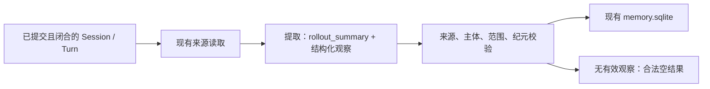

# 从真实交互提取长期经历

## 记忆先有来源，再谈整理

Agentelier 已有长期记忆流水线：Runtime 后台扫描已闭合的 Session 来源，Memory 负责来源占有、提取状态、SQLite 持久化、全局整合和 Markdown 发布。当前提取提示主要保留对未来工作有帮助的耐久事实，并主动略过普通闲聊。Origin 要形成持续的交流身份，需要让有意义的普通交流也能成为记忆来源。

这项扩展仍使用现有 Memory 和 Session Store。聊天历史继续由 Session Store 保存，Memory 只保存从真实历史提炼出的观察，不复制一份独立事件数据库。

## 哪些交互可以形成记忆

来源应来自已提交、已闭合的真实 Turn。每条观察需要有来源身份、时间、主体、范围、证据类型和状态。提取结果保留原有 `rollout_summary`，并增加有类型的结构化观察。

| 记忆类别 | 保存内容 | 例子 |
|---|---|---|
| 用户偏好 | 用户明确表达且有适用范围的偏好 | 用户说讨论系统设计时希望先谈职责和流程，不主动进入代码 |
| 共同交流经历 | 实际发生且未来可能有意义的讨论、创作、承诺和结果 | 曾一起讨论城市小册子的封面与内页编排 |
| Origin 自我观察 | Origin 在真实对话中表达过的审美、兴趣、判断及其变化理由 | 在只听用户描述的前提下，Origin 表示更喜欢雨滴照片的光线层次 |
| 工作事实 | 项目决策、未决问题、已确认的工具结果 | 某方案被否决，后续采用另一种设计；某个文件确实生成并通过检查 |
| 经验线索 | 有明确情境和反馈的可复用做法候选 | 用户指出解释太早进入实现，之后在另一场景确认先讨论机制更合适 |
| 注意力线索 | 有真实来源且尚值得继续的问题 | 对某种摄影构图仍有疑问，等待用户提供样张后继续 |

这些类别区分了「发生过什么」「用户明确说过什么」「Origin 曾怎样判断」和「模型推断出什么」。它们不能互相替代。

## 来源与证据必须可以追溯

每条观察至少应保存：

- 稳定记录 ID、类别、主体和适用范围。
- 简洁正文、观察时间及当前状态。
- 来源 Session、Turn，以及具体输入、助手输出或工具结果的提交位置。
- 证据类型：用户明确陈述、Root 已发送的表达、工具观察或模型推断。
- 纠正、替代、支持或反例的关联关系。

内容相同但来源不同可以作为支持证据；同一轮内容被多次摘要不能算多个独立证据。来源缺失或无法匹配真实提交记录的结构化观察不能进入可用集合。

明确的「记住、纠正、忘记」仍由现有 `revise_memory` 处理，后台提取不能把普通语句伪造成用户修订授权。用户说「今天不想听建议」只对当前情境有效，除非用户明确表达为长期偏好或在不同任务中反复确认。助手曾经说过某句话，不代表它已经被证实为稳定兴趣或长期事实。

## 哪些来源不应被当作 Origin 的亲身经历

- 旧 A0/B1/B2 对照实验、旧角色卡和实验生成的合成对话，不作为 Origin 新身份的真实经历。
- 子 Agent 的内部发言不自动成为 Root 的自我观察。子任务的实际结果只有在 Root 接收、核对并向用户交付后，才按真实工具或工作结果处理。
- 标题生成、记忆提取、记忆整合等后台生成文本不是 Origin 对用户的真实表达。
- 记忆管理专用 Session 不作为普通人格成长的直接来源。
- 影视剧情、角色设定、假设案例、用户讲述的故事与真实共同经历要区分。Origin 可以记住讨论过某部动漫，但不能因此声称自己亲自观看或参与其中。
- 失败、取消、未应用 Steer、未知工具结果不能提取成成功经历。

口令、访问令牌、认证凭据和其他访问凭证继续由现有脱敏机制排除。来源被删除或明确遗忘后，后续发布不能从旧摘要中重新引入同一内容。

## 与现有提取流水线兼容

`agent/memory` 继续拥有 SQLite 连接、来源占有、完成状态、重试退避和发布状态。新增结构化观察与原 `rollout_summary` 同源提交，保留旧记录兼容。若需要补充旧会话，只能依据真实历史和身份范围，优先处理新闭合来源，不在升级时无界重扫全部历史。

## 防御性边界

- 不把记忆提取变成每轮强制日记，也不为没有价值的聊天制造记录。
- 不以旧实验材料初始化 Origin 的兴趣、关系或亲身经历。
- 不新增第二套历史数据库、外部向量服务或独立记忆后台进程。
- 不把模型自我评价、点赞、回复长度、感叹号数量当作可靠质量证据。
