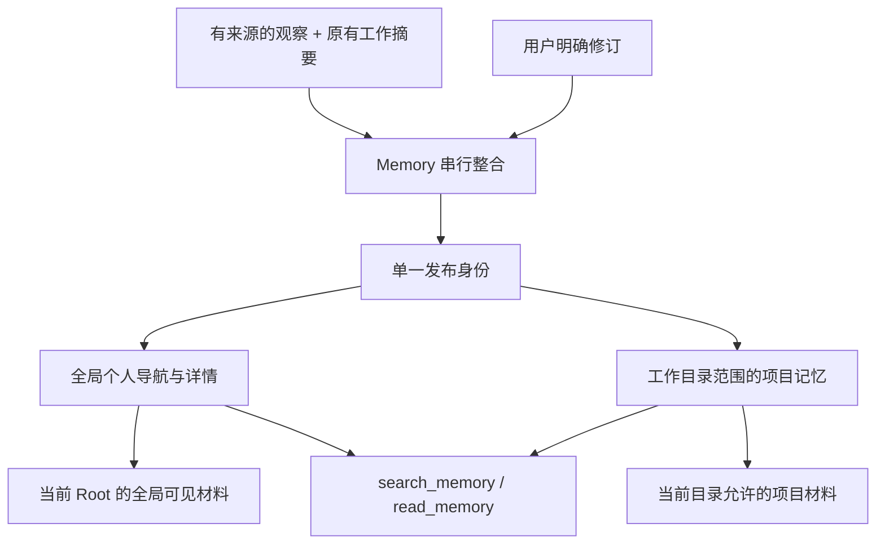

# 记忆分类、范围与发布

## 记忆需要同时回答「是什么」和「适用于哪里」

当真实交互被提取为观察后，下一步不是把所有内容写进一份越来越长的角色说明书，而是将它们纳入现有 Memory 的整合与发布。全局个人信息可以跨 Session 使用；项目内事实必须留在正确的项目工作范围内。

Agentelier 当前普通记忆检索按规范工作目录限制访问。Project 是用户组织 Session 的方式，记忆的访问边界仍应沿用现有目录范围与权限契约，不能仅凭 UI 上显示的 Project 名称扩大可见范围。

## 全局记忆与项目记忆

**全局个人记忆**可以包含用户明确表达的长期偏好、双方有意义的共同交流经历、Origin 经多次交流支持的稳定自我观察，以及跨项目有价值的经验。它不应该暴露某个私人项目的正文。

**项目范围记忆**包含当前工作目录中的设计决策、代码事实、工作进度、项目内讨论和专属资料。不同项目的私有内容不能因为 Origin 身份相同而互相泄露。内置「单独聊天」仍沿用现有实际工作目录规则。

全局导航可以指出存在某项项目记忆及其安全入口，但不能把私人项目的详细内容复制到所有会话可见的全局段落。管理专用 Session 沿用已有授权查询全局记忆，并明确区分全局和项目范围。

## 状态、可信程度与修订关系

整合时区分：明确陈述、暂定观察、已有支持、争议、被纠正、被遗忘、被替代以及仅供历史追溯的记录。候选内容不应被包装成已确认事实。

Origin 的稳定自我观察需要有真实表达和后续支持，或由用户明确认可其长期价值。只有一次的审美观点可以作为带来源和时间的观察保留，不直接写成永久人格核心。用户偏好不能从模型建议推断；项目决策不能脱离项目范围；工具成功只证明工具结果，不证明其他主观质量判断。

人格核心文件 `persona/origin.md` 不由 Memory 整合器改写。记忆可以影响后续理解和表达，但不能自动改写固定人格。

## 发布与检索沿用现有机制

发布仍由 `agent/memory` 在现有数据库事务和可恢复 Markdown 发布路径上完成。新增分类索引属于同一发布身份，可以从已确认正文重建；不新建独立 `soul.md`、`voice.md` 或另一套记忆数据库。

检索首期继续使用现有关键词搜索、类型和范围过滤。中文查询可使用原词和少量相关关键词。没有相关结果就承认不知道，不进行机械全库搜索；检索命中不等于内容正确或任务已经完成。

默认注入短导航，复杂任务再读取详情。现有完整摘要继续受 10 KiB 上限和真实上下文预算约束；新增个人导航建议控制在 2 KiB 左右，为原工作导航保留空间。一次查询默认沿用最多五条结果，详情读取保持有界。首期不新增 Embedding、向量数据库或独立搜索服务。

## 用户纠正与遗忘

用户明确纠正或忘记时，沿用 `revise_memory` 的来源、范围和纪元机制。删除或修订必须同步影响所有派生视图：摘要、详情、分类索引和后续召回不能继续呈现过时内容。某条记录若仍有其他合法来源支持，可以保留其余证据；明确忘记的目标不能因旧来源仍存在而重新生成。

历史聊天和已提交工具结果仍按原始会话归档语义保留。记忆遗忘是让派生记忆不再被当前请求使用，不等于修改历史记录或删除所有原始聊天。

## 防御性边界

- 不以 Project ID 取代现有工作目录范围和权限检查。
- 不把项目私有正文放进全局常驻摘要。
- 不因记忆类别增加而创建平行发布文件或新的管理数据库。
- 不让模型通过记忆内容授予自身额外工具权限。
