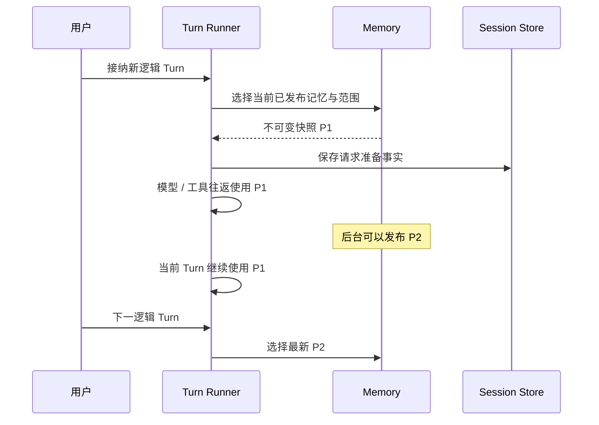

# 每轮请求如何使用一致的记忆快照

## 人格在 Session 固定，记忆在逻辑 Turn 更新

人格来源在 Session 创建时冻结，因为同一个聊天窗口需要保持稳定身份。长期记忆则会在后台逐步更新；如果一个 Session 很长时间不结束，继续只使用创建时的旧摘要会让后续交流无法看到已经发布的新经历。

因此，Origin 的普通逻辑 Turn 在接纳后、准备第一次模型请求时选择当前有效的已发布记忆，并冻结为本轮材料。这个选择与人格快照不同：人格不因每轮变化，记忆则可以在相邻 Turn 之间更新。

## 一轮中的所有请求使用同一份材料

新普通 Turn、实际启动的 Queue、主动 Retry 和新 Session 首轮，在各自合法接纳边界取得当时最新的已发布记忆。尚未整合发布的候选不能进入请求。

快照至少记录：

- 发布身份与记忆纪元。
- 全局个人导航和当前工作目录允许的项目范围。
- 实际注入的正文或索引摘要。
- 来源、顺序和内容摘要。

本轮正常的模型—工具往返都使用同一份快照。Steer 沿用原任务边界；认证重发复用已冻结字节。服务端 compaction 后仍需重新提供本轮固定材料，但不能重复追加到协议历史。旧 Session 读取旧请求快照；新逻辑 Turn 才选择新发布。

`search_memory/read_memory` 在普通任务中应绑定当前已选发布和范围，避免同一 Turn 的模型请求使用 P1，而记忆工具却悄悄读取 P2。活动任务持有不可变读视图；后台新发布不会改写正在执行的快照。

## 用户纠正是快照失效的明确例外

明确修订、来源删除或记忆重置可能使旧快照中的内容不再允许被后续请求使用。受影响的旧读视图必须失效，不能等待后台整合完成才停止召回。新请求准备时移除失效材料并记录失效原因；正在发送的请求无法撤回，已发送字节和历史事实仍保持原样。

若无法准确判断某个旧快照是否仍包含被纠正的内容，应保守停用相关派生记忆。记忆管理对话可以在移除失效材料后，依据真实修订回执报告「已保存」或「等待整合」；只有新的发布确认才表示新摘要已生效。

## 缓存、压缩与预算

稳定 Origin 身份保持在稳定 Developer 前缀。每轮变化的记忆、任务状态和当前上下文放在动态材料区域，不在固定人格里加入分钟时钟、实时心情或全局运行状态。不要在每次工具回执后重新拼接整份人格或记忆。

记忆材料不能挤掉不可省略的用户输入、工具配对、项目约束和任务状态。用实际请求与 usage 记录观察消耗；usage 缺失时保留未知，不制造精确 Token 数或固定百分比门槛。

当前活动任务完成、取消和回收后释放其快照引用。冷恢复依赖已保存的请求材料和结果事实；无法还原必要材料时应明确阻止续接，不根据摘要猜测历史。

## 防御性边界

- 不在每次工具调用后刷新记忆快照。
- 不让后台未发布候选进入普通请求。
- 不通过修改旧请求或历史记录实现遗忘。
- 不因 compaction 重新读取其他 Session 或跨项目的记忆。
