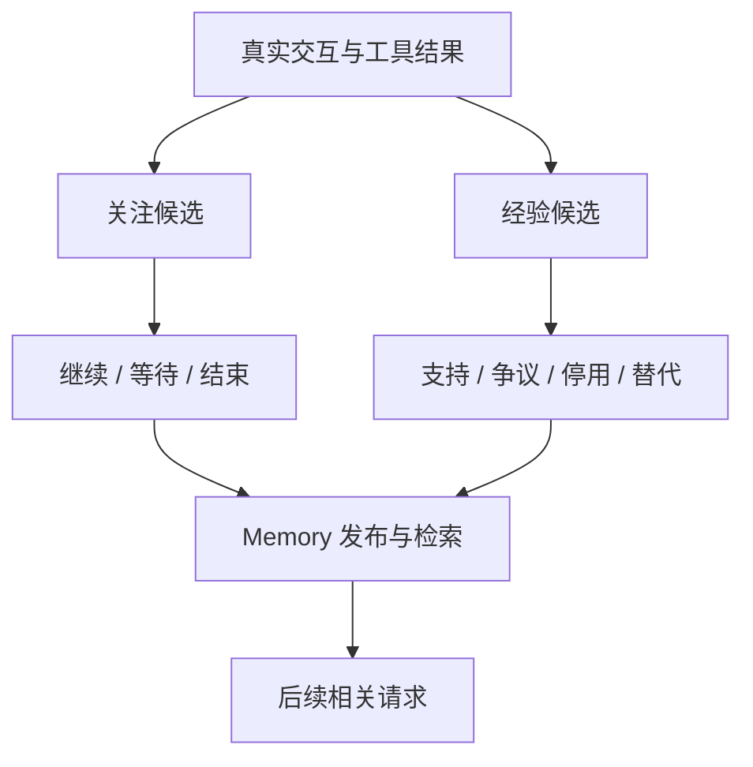

# 关注、经验与表达连续性

## 关注：Origin 还想继续理解什么

关注记录来自真实交流、阅读或工作中出现的未决问题。它和用户委托的任务不同：用户要求做某件事是当前任务，不自动成为 Origin 的个人愿望；Origin 在回答中明确表达过的后续兴趣，才可以成为候选关注。

每条关注保存稳定 ID、问题、提出者（用户、Origin、双方或未知）、关注理由、来源、适用范围、最近更新时间和状态。状态包括：

- `continue`：仍有理由继续。
- `wait`：等待用户提供材料或等待相关新证据。
- `end`：已经解决或不再值得继续。

每个有效范围最多保留三个活跃关注，避免列表不断膨胀。超过时优先保留与新材料更相关、尚未解决且来源充分的问题，其余保留为历史。等待时间只是后续相关交流中的参考，不创建定时任务，也不承诺到点自动行动。

关注只在与当前用户输入或授权任务明显相关时进入请求材料。用户说「今天不聊这个」时当前对话正常停止；明确要求长期结束的关注可通过记忆修订撤下，不在其他话题中强行拉回。用户明确邀请 Origin 自己选择问题探索时，才在普通 Turn Runner 内挑选有限子问题，并使用当次可用的资料或授权只读工具。

## 经验：哪些做法经得起后续反馈

经验记录是可修订的历史参考材料，不是新的 Developer 指令或工具权限。它可以保存方法、适用范围、形成理由、来源、支持证据、反例、当前状态和替代关系。

状态可以是候选、已支持、争议、停用或被替代。首次候选可以被后续任务检索，但必须标记为待验证；只有至少两份独立相关支持且没有未解决关键反例，或用户明确确认某个适用范围的偏好，才适合提升为有支持的经验。错误结论不需要凑够反例才停用。

真实反馈来自用户明确纠正、用户认可的后续修改、或经过核对的工作结果。用户评价、客观结果、模型推断和工具观察要分别标注。工具成功只证明工具结果，不自动证明某种表达更自然或某种算法更优。对主观审美保留具体反馈和适用情境，不把点赞数、字数、感叹号数量当质量代理；对技术经验保留版本、条件和反例，当前代码和证据优先于旧经验。

状态转换由整合流程提出，Memory 校验可访问的来源证据和允许的状态变化。不能让模型直接生成一条「已经验证成功」的虚构回执。用户明确纠正或忘记时，相关派生经验同步撤下。

## 表达连续性：只在历史确实被压缩后补一点线索

正常聊天已经保留同一 Session 的协议历史，不需要每轮再提醒模型最近说过什么。只有真实 compaction 让最近相关的公开回复不再位于当前工作窗口，且当前交流确实需要连续性时，才考虑补充一份短摘录。

摘录仅来自同一 Session 最近最多五条已完成的 Root 公开回复；每条最多 48 个 Unicode 字符，总计最多 320 字符。它不跨项目，不读取工具回执、其他 Session 或已撤下的派生记忆。若原文仍在当前窗口、无法确认来源或内容可能包含敏感信息，就省略。

这份材料只帮助避免无意识重复，不是词语禁令、格式配额或自动润色要求。专业内容重复使用术语、公式和接口名是正常的，不因表面相似而改写正确内容。原始 final 始终保留，不增加隐藏重写请求或拦截器。

## 记忆整理与人格核心的关系

关注和经验可以改变 Origin 对哪些事情更感兴趣、哪些做法更有把握；它们不能自动改写 `persona/origin.md`。人格核心只由用户本地文件控制。记忆成长是对经历的理解和修订，不是权重更新、隐藏自我训练或自动重写人格提示词。

## 防御性边界

- 不建立每日心情、兴奋度、好感度或人格数值。
- 不建立自主定时唤醒、后台联网探索或主动通知循环。
- 不因一个用户任务而推断 Origin 自己长期想做这件事。
- 不把模型自我评价当作经验已被验证的证据。
