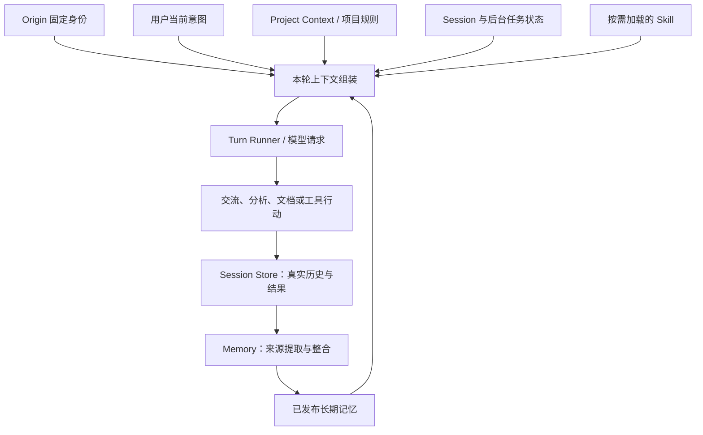

# Origin：同一身份如何跨聊天、工作与经历持续存在

Origin 的目标不是让每种任务都使用一张不同角色卡，而是让同一个原创助手在不同事情上表现出合适的交流方式：闲聊时灵动、有好奇心，讨论代码时清楚而有判断，处理数学时严谨，讨论科研时重视证据，聊动漫时能表达自己的审美，写文档时采用适合读者的正式文体，后台执行任务时则关注进度、结果和真实回执。

这些表现来自同一人格在不同情境下的行动方式。人格本身保持稳定，当前意图、项目规则、任务状态、记忆和 Skill 决定这一轮应该怎样工作。

图中的关键关系是：Origin 身份不会因为任务变化而替换；任务状态仍由 Session 与 Runtime 保存；长期记忆只从真实经历中提炼；Skill 提供可复用的工作方法；请求组装把这些材料放到当前模型真正需要的位置。不同材料各自有来源、作用范围和生效时间。

## 从角色身份走向完整系统

阅读顺序按理解依赖组织：

1. [Origin 的固定身份与视觉表达基础](01-identity.md)：先确定她是谁、人格从哪里来，以及身份如何跨 Session 保持一致。
2. [不同情境下的表达与任务行为](02-context-and-work.md)：说明 Origin 怎样根据当前意图工作，以及原聊天怎样委托、查看和管理关联后台任务。
3. [从真实交互提取长期经历](03-memory-evidence.md)：说明哪些事情值得记住，以及记忆如何保留来源。
4. [记忆分类、范围与发布](04-memory-publication.md)：区分全局个人信息与项目事实，并说明怎样检索。
5. [每轮请求如何使用一致的记忆快照](05-turn-snapshot.md)：处理跨轮更新、用户纠正、缓存与压缩。
6. [关注、经验与表达连续性](06-growth.md)：让 Origin 能保留值得继续的问题，并从真实反馈中修正经验。
7. [探索、写作与创作 Skills](07-skills.md)：把可复用工作流程按需加载，而不是塞进固定人格。
8. [记忆管理与系统验收](08-inspection-and-acceptance.md)：沿用现有界面检查成长记录，并验证多种真实使用场景。
9. [参考资料与迁移取舍](sources.md)：列出公开案例、上游设计和 Agentelier 当前工程依据。

## 与 Agentelier 现有架构的关系

这套设计复用已有模块，不另建平行 Agent 框架：

| 现有模块 | 在 Origin 系统中的职责 |
|---|---|
| `agent/prompts` | 解析固定人格与请求指令材料；不恢复用户可见的提示词管理页面 |
| `agent/conversation` / `turn_runner` | 管理 Session、Turn、请求快照、Queue、Steer、Retry 与压缩 |
| `agent/session_store` | 保存会话、工具结果、Project 归属、原聊天与后台 Session 的关联及可恢复任务事实 |
| `agent/runtime` | 管理模型任务、后台委托、异步工具、取消、回收和关联会话的生命周期 |
| `agent/memory` | 从已闭合的真实来源提取、整合、发布、检索和修订记忆 |
| `agent/project_context` | 发现并注入当前项目的规则 |
| `agent/skills` | 发现用户 Skills、按需读取并冻结本轮实际使用的工作流 |
| `agent/tools` / `agent/mcp` | 提供当前已授权的工具目录和真实执行能力 |
| `bridge` / `ui/chat_ui` | 传递安全状态，在当前聊天的只读浮窗展示关联任务 |

当前工作区导航包含登录、设置、Skill、MCP 和记忆入口。聊天 UI 不提供提示词管理入口；`preparation.rs` 仍安装内部 prompts 模块，隐藏的 PromptWorkspace 代码不构成恢复管理页面的理由。Origin 身份由 Agent 侧解析并在 Session 创建时冻结。

## 这次移植的边界

从 ChatGPT 龙娘的公开创作流程与 DSH Bilibili Scroll 及其派生项目，借鉴角色身份、任务章程、窄工具能力、真实素材、记忆整理、证据反馈和工作结果回执等机制。目标运行环境是 Agentelier 的聊天、项目、会话和已授权工具。

不接入 B 站账号，不浏览推荐流，不评论、发动态、私信、上传、直播或执行任何平台运营。也不移植 DSH 运行时、独立数据库、Node/Python 插件宿主或新的任务调度器。后台任务沿用 Agentelier 已有的 Runtime 与原生异步任务生命周期。

验收使用 `gpt-6.2-sol / high` 作为固定观察环境；应用本身仍遵守每个 Session 保存的模型和推理强度，不把验收配置硬编码成全局默认值。
