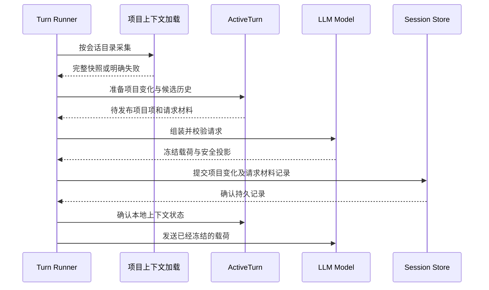

# 把项目规则放进模型请求

读取到项目规则之后，仍需回答一个问题：下一次请求应该把它放在哪里？这里采用稳定的基础前缀，以及按变化追加的项目上下文。两者分别管理，不把项目文件塞进创建会话时固定的 `InstructionSnapshot`。

## 两类指令，不等于请求只有两段文字

现有请求以 `store=false` 发送固定基础快照、当前工作窗口的原始协议项和工具定义。普通用户输入、助手输出、加密 reasoning、工具调用及工具结果都由客户端保存并按序重放。本方案保留这个协议路径。[当前请求实现](sources.md#local)

| 请求材料 | 在本方案中的位置 |
| --- | --- |
| 基础指令，以及已有的有序补充条目 | 稳定的 `developer` 前缀，来自会话创建时的快照 |
| 自动读取的项目规则 | 有专用内部类型的 `user` 上下文项 |
| 用户消息、助手协议项、工具调用与结果 | 保持原顺序的协议历史与本次待发送输入 |
| 工具定义、模型与推理设置、Inline 压缩阈值 | 继续通过现有请求参数提供 |
| 当前工作目录 | 沿用现有会话设置与工具描述，不新建环境配置系统 |

项目规则采用 `user` 角色与 Codex 的项目指令包装一致。基础和项目的不同角色由程序确定，文件正文不能自行改变角色。[Codex 项目消息](sources.md#codex)

## 先看一段会话怎样增长

用 B 表示固定基础前缀，P1 表示第一次采集到的项目规则，U1 表示用户输入，O1 表示对应的完整输出及封闭工具结果。下面是逻辑顺序，不要求它们各自只有一个协议项。

| 时刻 | 请求中的逻辑顺序 |
| --- | --- |
| 第一次提问 | B，P1，U1 |
| 规则未变，继续提问 | B，P1，U1，O1，U2 |
| 规则变成 P2 后继续 | B，P1，U1，O1，U2，O2，P2 替换通知，U3 |

第二次请求仍包含 P1，因为它属于当前协议上下文；不会再额外追加第二份 P1。第三次请求保留已经发送过的 P1，在末尾增加 P2 的完整正文，并明确 P2 替代此前自动注入的项目规则。

旧规则仍作为历史事实存在，但不再作为当前有效规则。整个活跃窗口中的旧版本都参与实际上下文计量，直到正常压缩将它们移出工作窗口。

## 为什么不直接替换请求前面的 AGENTS.md

OpenAI 的推理续接文档说明，修改 reasoning 项之前的请求前缀，可能使后续 reasoning 项被丢弃，并降低前缀缓存复用。项目规则更新应当尽量表现为新增上下文，而不是改写过去已经发送的输入。Codex 也为项目指令变化提供了替换和移除通知。[推理前缀](sources.md#protocol) · [Codex 更新机制](sources.md#codex)

因此，项目状态可以独立于基础配置管理，但已发送的项目文本必须进入可原样重放的协议序列。这是在“动态更新”与“历史连续”之间需要保留的实际结构，不需要进一步建立自然语言规则引擎。

## 一份项目上下文表达完整的当前状态

项目上下文项包含项目边界、会话目录、按根到叶排列的来源标题、每份文件的作用目录与原文。包装文字只说明来源和适用关系，不总结、改写或推断文件里的规则。

范围说明应表达：更深目录的规则用于其对应子树；当前用户的直接要求不能被一份自动载入的项目文件悄悄替代；任务涉及未自动载入的下级目录时，应按需查阅那里的规则。基础快照中的更高层约束仍然适用。程序不据此逐句裁决冲突。

项目状态变化有四种正常结果：

| 先前状态与本次采集 | 发给模型的变化 |
| --- | --- |
| 从未注入，首次取得非空规则 | 追加完整项目上下文 |
| 有效文本及范围未变 | 不追加新的项目项 |
| 有效文本或适用范围改变 | 追加完整新规则，并说明替换先前自动注入的项目规则 |
| 以前有规则，现在确定为空 | 追加移除通知，说明先前自动注入的项目规则不再适用 |

替换和移除只针对客户端自动注入的项目规则，不删除用户普通消息，不把工具输出或用户粘贴的同名段落当作待撤销对象。首次成功取得空快照时不需要发送一条空指令。

变化判断使用确定性的模型可见内容摘要，并包含作用范围与顺序。采集时刻、文件修改时间、界面展开状态等不进入正文或摘要。相同内容保持相同表示；A 改成 B 后再改回 A，仍是一次新的状态发布，不能因为历史里出现过 A 就省略更新。

## 内部身份必须独立于文本标记

`ProtocolHistory` 增加能够识别的项目上下文项，记录其项目快照引用、发布身份和确定的模型可见文本。发送给 API 时仍是正常的 `user` 消息，内部身份不冒充新的 API 角色。

这类项的摘要也与普通 User 项区分。用户自己输入“AGENTS.md instructions”，不会因文本长得相似而被程序分类成项目规则；恢复和压缩也不依靠搜索正文标题来判断状态。

同一个项目快照保存完整文件内容及来源，摘要只用于比对，不替代原文。恢复旧请求的核对信息时使用当时保存的文本，不重新打开今天的文件来解释昨天的请求。

## 在发送之前冻结一次请求材料

项目读取由 Runner 在请求边界发起。取得完整快照后，Conversation 形成待追加项目项与候选历史；LLM Model 根据基础快照、候选历史和工具定义组装并校验实际请求。组装结果同时提供不可变发送载荷和安全核对投影，避免界面与发送侧各自重新拼接一遍。

项目变化和请求准备记录可以沿现有单写入者顺序提交。若项已经落盘而请求准备记录失败，保留已提交事实，但不发送 HTTP 请求；不要求把整个文件系统读取和网络调用包装成一个大事务。

项目项在本地提交，不等于服务端已经收到请求。核对状态区分“材料已准备”“开始发送”“获得响应”及失败，不能把磁盘快照或准备记录称为模型已经遵守的规则。

新的项目项放在尚未发送的请求尾部，并尽量位于本次新输入和待应用 Steer 之前。已经保留的用户消息、工具项或 reasoning 不为重新排序而移动。普通输入仍遵守原有提交规则：没有成功步骤的失败请求，不因多了一条项目项就把用户消息伪装成成功对话。

一次请求的载荷冻结后不再读取文件。认证恢复导致的同一次 HTTP 重发继续使用同一份字节；用户主动重试则属于下一次逻辑请求，重新检查项目文件。下一章展开这些边界。
