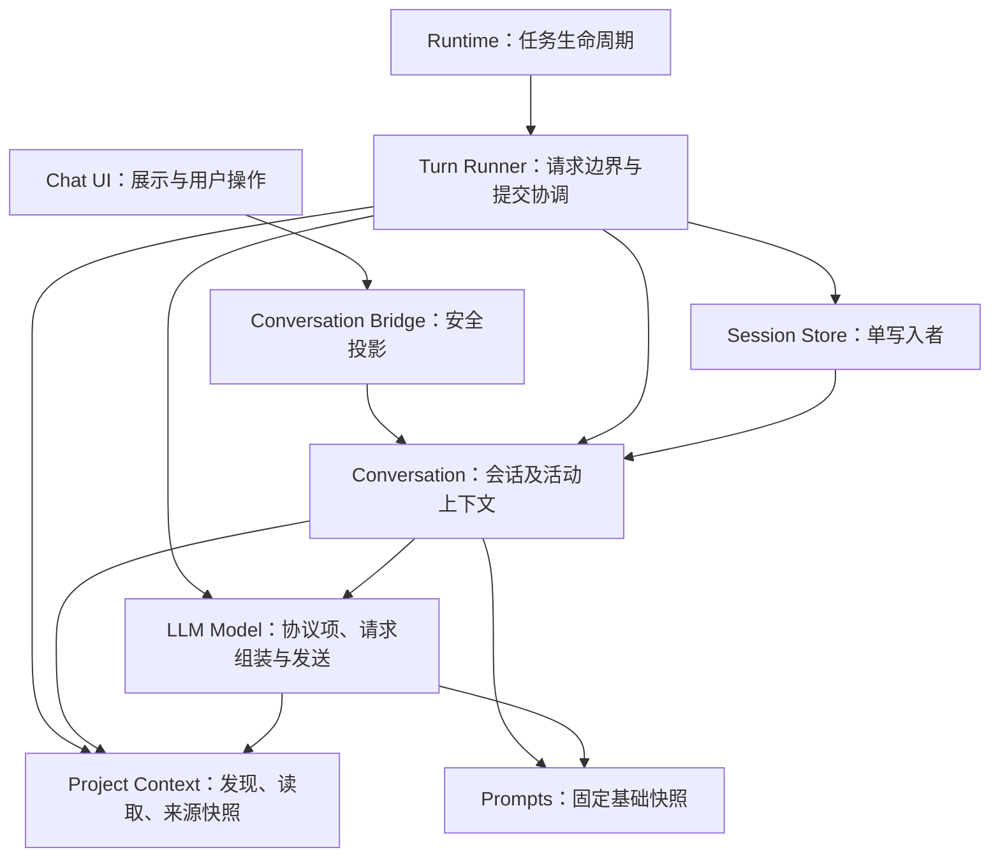

# 模块职责、请求核对与验证

前面的机制需要放进现有的所有者关系中：Conversation 管理会话状态，Runner 独占活动记录并推进任务，LLM Model 负责协议与发送，Session Store 负责持久提交，UI 只展示投影。项目指令不另起一套执行系统。

## 把文件发现放在一个真实的业务边界里

增加一个职责完整的 Agent 库 `agentelier_project_context`，位于 `crates/agent/project_context/`。它只负责项目边界发现、有界文件读取、来源快照、确定性文本表示与变化比较。它不管理提示词版本库，不发送网络请求，不拥有会话或存储线程。

现有 Prompts 继续拥有可编辑的基础材料、版本与组合预设。项目文件是外部工作环境的一部分，随请求重新采集，不伪装成提示词库中的 `PromptRef`，也不为了复用旧界面把它们塞进基础或补充槽位。

箭头表达必要的直接依赖或业务调用，不是实施顺序。Store 继续通过 Conversation 定义的事件保存数据，Conversation 不反向依赖 Store；Agent 与 Bridge 不依赖 Bevy。工具库不需要反向引用项目上下文。

新增库服务于当前明确的文件发现职责，不预设通用指令 Provider、插件注册表、多环境抽象或策略引擎。库入口、Workspace 依赖和 Windows x64 编译期检查遵循现有工程规范。

## 四种状态不能混成一个字段

| 状态 | 所有者与含义 |
| --- | --- |
| 固定基础快照 | `SessionSettings.instructions`，保持原生命周期与消息顺序 |
| 最近成功采集的项目快照 | 执行侧会话状态；包含目录、来源、原文、摘要以及成功为空的结果 |
| 已提交的项目上下文状态 | 当前协议历史对应的发布身份、内容摘要及窗口身份，决定是否需要追加更新 |
| 某次请求实际采用的材料 | 请求身份关联的不可变记录；基础引用、项目快照引用、角色、顺序和安全投影 |

采集失败另有明确状态，不能用空数组替代。第一次请求前是“尚未采集”，不能显示成“项目没有规则”。活动任务运行时，这些可写状态随 ActiveTurn 交给 Runner 独占，Conversation 和 UI 不同时维护另一份可变权威副本。

快照摘要用于比对和核对。来源路径、完整正文、渲染后文本必须能够随历史记录恢复，不能只留下一个哈希后再从当前磁盘补读。

## 顺序提交，而不是靠界面还原历史

在 Conversation 的事件语义中增加项目上下文提交和请求准备记录；名称可随最终类型设计调整，但两种职责需要区分。

**项目上下文提交记录**保存当前完整项目快照、可选的协议项、发布身份以及所接续的历史边界。首次成功为空也保存可引用的来源状态，但不生成空消息。真正增加协议项时才改变可重放历史，必须在确认落盘后安装到活动记录；没有协议变化的空快照记录不推进历史覆盖边界。归档的项目项使用专用类型，恢复时校验正文摘要、作用范围和身份，不靠文本标题猜测来源。

**请求准备记录**将 Session、Turn、请求序号与已经校验的发送材料关联起来。基础全文已由会话初始设置保存，项目全文由对应发布记录保存，请求记录引用这些材料，并保留安全的顺序摘要与载荷摘要。每次请求都能核对自己的来源，不因后续更新而被覆盖。它记录的是构造事实，不是服务端接收确认。

没有变化时不追加项目项，也不重复保存一份新的项目全文；请求记录继续引用同一份快照。协议归档按原有完整历史方式保存，不另建通用内容寻址存储或独立项目指令数据库。

项目提交会推进权威历史的覆盖边界；纯请求核对记录只推进日志外层序号，不应误改压缩使用的 `source_sequence`。队列、名称等独立元数据也继续保持原有覆盖语义。

发生中断时，恢复以最后确认的权威记录为准。只有请求准备记录而没有完整响应，不得把待发送用户输入当成成功步骤。恢复显示能够使用当时快照，不要求原项目目录仍存在；真正继续执行时才重新验证目录和规则。损坏记录沿既有错误路径处理，不清空会话或提示词库。

## 核对界面展示“这次用了什么”

复用现有会话请求核对入口，增加项目来源与逐请求选择，不建设另一套提示词编辑器。界面至少能回答这些问题：

- 这次请求用了哪份固定基础快照，以及哪些已有补充条目？
- 自动加载以哪个会话目录为起点，项目边界在哪里？
- 哪些 `AGENTS.md` 按什么顺序进入了项目快照，各自作用于哪个目录？
- 最近一次采集成功、为空还是失败？所选请求实际采用的是哪一次成功快照？
- 项目上下文是首次发布、沿用、替换、清除，还是压缩后的重新发布？

正文可以展开、选择与复制，使用现有 `WidgetryReadOnlyTextField` 的公开内容 API；路径展示复用路径显示库。BSN 负责构造，持久组件保存选择和展开状态，页面切换不重置正在执行的请求，也不触发另一条指令读取链。[Widgetry 使用依据](sources.md#ui)

自动项目项不渲染成用户亲自发送的聊天气泡，不占用输入框草稿或待办身份。需要在时间线上提示更新时，用运行状态说明而非伪造用户消息。普通 User 项和自动项目项在协议核对摘要中分别显示。

显示“最近成功采集”而不是未经检查的“磁盘当前内容”。如果新一轮读取失败，明确标出失败及没有发起新请求；旧快照仅作为历史材料继续可查。查看过去的请求必须读保存的材料，不能临时读取已经改变的文件。

安全投影来源于模型层实际使用的同一组装结果，再经 Bridge 显式转换。UI 不解析气泡构造请求，BRP 也不直接改权威状态来伪造成功。

## 验证按可观察行为闭合

下面这些场景分别归入执行方案中的对应增量，不建立独立的“最终验收阶段”。验证使用真实应用、必要静态检查和 BRP，不编写 Unit Test、Integration Test、Benchmark、Example 或专用验证程序。

| 场景 | 需要确认的事实 |
| --- | --- |
| 根目录、中间目录、当前目录均有文件 | 顺序、原文、来源与作用域一致，兄弟目录和项目外文件不进入自动链 |
| 没有 Git 标记或没有规则 | 仅检查会话目录；空快照与未采集可区分；默认基础请求行为不变 |
| 首次请求和连续不变请求 | 基础前缀不变，项目项只首次追加，工具声明与原始协议项保持完整 |
| 编辑、新建、删除或清空规则 | 下一逻辑请求产生一次正确替换或清除，旧请求的核对材料不变 |
| 只改变 Shell 的临时 workdir | 自动链不切换，不按命令文本猜测范围 |
| 不可读取、无效 UTF-8 或超过 32 KiB | 不发送该次模型请求，不静默截断、不使用旧快照，不错误清除规则 |
| Stop、Steer、工具批次和后续 Queue | 生命周期仍封闭；目录规则只在请求边界更新；副作用不被误称撤销 |
| 主动 Retry 与内部认证重发 | 前者重新采集，后者重用冻结材料；不因自动项目项错误拒绝合法 Retry |
| 重开会话与源目录已删除 | 历史仍可查看；继续时按真实文件状态刷新或失败，不自动执行旧工具 |
| Inline 压缩成功或提交失败 | 成功安装后下一请求明确发布一次；失败不提前变更窗口与发布状态 |
| 上下文预算与请求字节预算 | 项目正文及包装只按实际输入计入；历史旧版本仍计量；超限不裁剪历史 |
| 来源查看、复制、切页和切会话 | BRP 实际输入及截图、只读状态能确认结果，不串会话，不显示敏感载荷 |

错误和成功的判断以实际请求材料、执行状态和存储回执为依据，不仅看模型回答有没有提到某条规则。对服务端行为的核对只使用返回的真实事件，不伪造压缩项或 reasoning 项。

GUI 验证使用当前工程配置对应的 `bevy_brp_mcp` 与真实应用，遵守 Custom Pointer 的接纳、完成和 UI 结果分离；结束时执行 release 并确认 inactive。不要因参考库自身包含测试程序，就把它们的验证方式搬进本项目。[BRP 使用依据](sources.md#ui)

## 保持原有工程边界

执行环境仍是 Windows x64、DX12 和 PowerShell 7。文件读取、网络执行和存储各由其现有执行所有者负责，不把模型任务交给 Widgetry JobManager，也不在 Runtime 的通用路由中堆积项目规则业务。

普通日志只记录请求身份、来源数量、摘要、大小和错误类别，不记录完整提示词、项目正文、聊天正文、凭据、加密 reasoning 或图片 Base64。需要查看原文时使用受控的请求核对投影与会话存档。

涉及实际修改时维护任务进度记录；新增库或依赖关系落地时同步总体架构，生命周期、协议、存储和 UI 改动分别同步对应模块文档。代码注释与提交信息遵循现有英文要求，普通设计说明使用中文。按实际影响执行格式、编译及 Clippy 检查，不为每个增量机械重复全仓验证。

验证不主动退出、重登、切换账号、清除凭据或切换数据目录。需要认证错误分支证据时，使用实际可观察结果与静态控制流核对，不通过破坏登录状态制造场景。项目规则是模型工作上下文，不是新的工具授权或沙箱配置入口。
