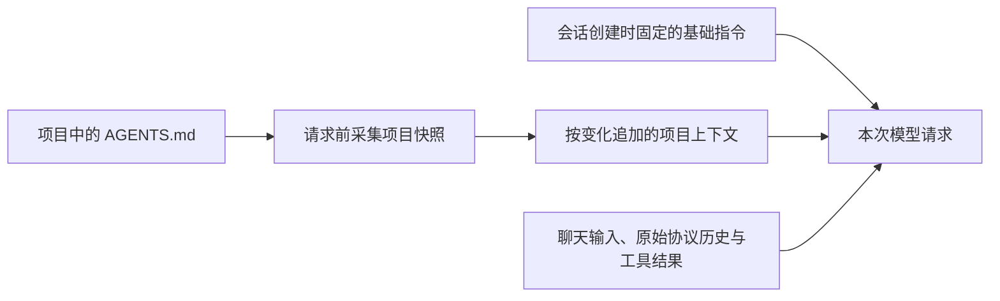

# 项目感知与指令系统

当前已实现本设计的文件发现与核对展示部分，实际边界见[项目上下文](../modules/project-context.md)。下文的请求注入、动态发布、持久材料引用及压缩恢复仍为后续设计，不代表当前运行行为。

打开一个项目后，模型应当收到这个项目的工作规则；项目规则改变后，后续请求应当使用新内容。与此同时，同一会话的基础行为不应随着提示词库的编辑而悄悄改变。

这套设计只增加项目 `AGENTS.md` 的自动发现与运行期管理。基础指令沿用现有会话快照，项目指令在模型请求边界重新读取。程序判断来源、范围和更新时机，模型理解规则正文；不把自然语言规则做成一套冲突解析器。

图中只有两类持久指令来源。聊天消息、工具定义与工作环境仍是请求材料，并不会因为减少指令分类而被省略。

## 保留什么，收掉什么

基础指令保持现有 `InstructionSnapshot` 的生命周期：创建会话时确定，后续请求与重试复用；编辑准备区只影响新会话。现有 Developer 补充条目继续留在这份快照内，本次不删除、不扩展，也不另建补充指令系统。现有默认空配置仍保持原请求行为，不凭空补入一份“默认基础提示词”。这些行为来自当前提示词与请求实现，见[依据与取舍](sources.md#local)。

新增的项目规则只读取项目范围内名为 `AGENTS.md` 的文件。不读取用户主目录的全局规则，不增加 Thread Instructions、备用文件名、`AGENTS.override.md`、Skills、MCP、远端环境或多项目管理。更细的目录规则仍属于同一类项目来源，而不是新的指令层级。

项目指令使用 `user` 角色，基础快照继续使用现有 `developer` 消息。文件来源和协议角色分别保存，避免把“用户编辑的文本”误当成天然的低权限或高权限内容。

## 从读取文件到保持上下文连续

先确定哪些文件适用，再解释这些内容如何进入请求，之后讨论更新、恢复和压缩，最后把机制落到已有模块中：

1. [从会话目录确定项目规则的范围](01-loading-scope.md)
2. [把项目规则放进模型请求](02-request-context.md)
3. [更新、恢复与压缩中的指令生命周期](03-lifecycle-and-compaction.md)
4. [模块职责、请求核对与验证](04-architecture-and-observability.md)

[依据与取舍](sources.md)列出实际参考的源码、工程约束与外部文档。[执行方案总览](../../../plans/project-instructions/00-overview.md)按独立交付目标组织实施顺序。

其中一个重要取舍是：**项目指令独立于基础快照管理，但已经发送的项目上下文项要保留在协议历史中。** 更新时追加替换或移除通知，不重写旧请求前缀；内容不变时不重复追加。这样同时满足动态更新、请求可追溯和原始推理项的连续重放。
