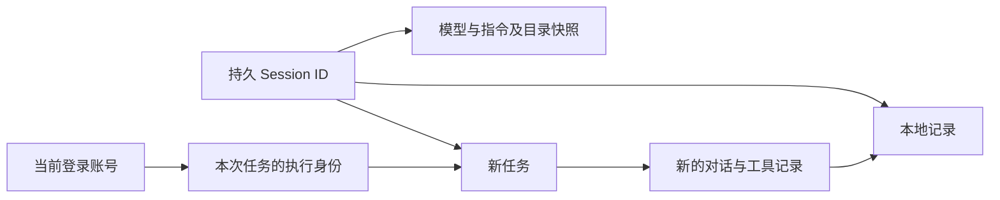

# 一份本地会话，多个可切换的执行账号

用户点击侧栏里的一个标题，是在打开一份本地工作记录。这个动作不需要决定使用哪份旧凭据，也不应该触发任何模型请求。只有用户发送新消息时，当前登录账号才参与执行。

## 会话身份不再来自一次程序运行

现有 `SessionId` 使用进程内计数，`SessionSettings` 包含 `account_subject`，账号同步会删除身份不匹配的会话。持久化后，会话身份需要跨重启稳定，账号身份则移到任务执行范围。[现有身份边界](sources.md#现有结构与约束)

本阶段用稳定的 UUID 标识存档。标题只是显示名称，不能用作文件名、查找键或删除依据。Turn、用户输入、Steer 和 Queue 条目保留各自的身份；会话内序号恢复后从已保存的最大值继续分配。Connection 的 `operation_id` 仍然属于本次运行，恢复记录不会重新启用过去的操作 ID。

登录账号不是这个结构中的存档所有者。同一份 Session 可以先由账号 A 执行一轮，下一轮改用账号 B；标题、Session ID 和原有时间线不变。

## 新建会话不再意味着丢弃旧会话

新建使用准备区选定的模型、推理设置、提示词组合和工作目录。创建成功后写入会话初始快照，再成为当前会话；创建失败保留原会话和草稿。

新会话最初显示“新会话”。首次接纳普通用户消息后，用首个非空文本片段生成本地标题，不为命名额外请求模型。用户重命名后，后续消息不覆盖该名称。

现有 Reset 的“沿用设置创建空白会话”语义继续保留，但不再删除旧会话。它复制当前会话的完整设置快照，创建新身份和空工作上下文；旧记录仍留在列表里。新建采用准备区，Reset 采用旧快照，这个差别不能被界面合并掉。

持久化的设置包含模型 slug、推理选项、完整 `InstructionSnapshot`、工作目录及实际使用的工具契约信息。恢复时不重新解析今天的提示词库来替换昨天的指令；指令仍在请求前部注入一次，不累计进入协议历史。[指令快照](sources.md#现有结构与约束)

## 打开历史只恢复数据

数据目录准备完成后，就可以读取本地会话列表；这件事不依赖认证成功。启动时默认打开排序第一条记录，没有记录时进入现有的新建准备区。打开只加载记录和恢复展示，不发送“继续”，不执行 Queue，也不启动工具进程。

点击另一条会话时，Runtime 返回目标的驻留投影或加载目标会话的存档。打开成功后切换选中状态和右侧内容。请求与回执按 Session ID 和操作身份关联，加载失败时保留当前内容。

草稿和阅读位置按 Session ID 在本次运行中保存。已被接纳的用户输入和待办按本地历史设计持久保存。

多个会话可以同时运行。生成、执行工具和保存结果各自归属原会话。切换显示时原任务继续，停止只作用于当前会话的活动任务。删除仍需等待目标任务收尾。

## 账号变化只结束旧的执行资格

创建和打开存档不再要求“当前账号等于创建账号”。模型请求仍需要认证，而且一次任务的执行身份保持固定：开始时捕获当前账号，普通生成、工具反馈后的模型请求和远端压缩都使用这份任务身份。

用户退出或切换账号时，沿用现有取消、回收和凭据门控。旧任务先停止并归还可信记录，随后才允许新身份执行。账号变化不清除 Session、时间线、压缩检查点或列表，也不自动恢复待办。正常 Token 续期不会制造新的执行身份。

现有的限制分布在 Conversation、UI 发送判断和模型请求校验中，不能只去掉侧栏过滤。原先针对会话创建者的比较改为针对本次任务身份的校验；正常认证恢复仍不能在一个请求的重试过程中换成另一个主体。[现有发送与请求校验](sources.md#现有结构与约束)

新账号需要重新取得自己的模型目录。原会话的模型不可用、推理档位不支持或服务拒绝请求时，保留原会话并显示实际原因，不静默换模型，也不把这类错误解释为会话属于另一个账号。存档中的旧能力数据用于回看，下一次请求的能力与窗口预算以当前模型目录为依据。

加密 reasoning 和 compaction 项按协议原样保存、续接，不在客户端解密。跨账号继续不增加本地归属拦截；服务拒绝某个协议项时仍走真实错误路径，不能通过悄悄删除记录来宣称恢复成功。

## 待办和中断不会偷偷变成新任务

Queue 中尚未开始的消息不进入模型上下文。已接纳的条目保存内容、顺序和输入身份。切换视图时驻留会话保持队列状态。重启、退出登录或账号变化后，以暂停状态恢复，等待用户明确继续。

Steer 仍区分已接纳、已应用和未生效。已经实际用于请求的输入保留在工作上下文中；已接纳但尚未应用的输入作为未生效记录恢复，不因重启而自动应用。恢复后的下一次正常发送建立新的任务身份，并使用已有历史继续。

这保持了一个清楚的边界：会话可以长期存在，任务和进程只在一次执行中存在。恢复记录的具体规则见[让一次任务留下可恢复的记录](02-local-history.md)。
