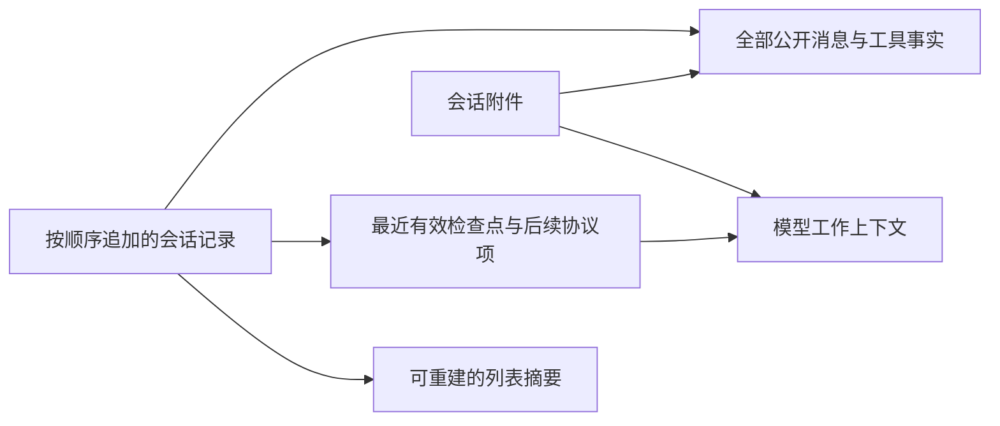
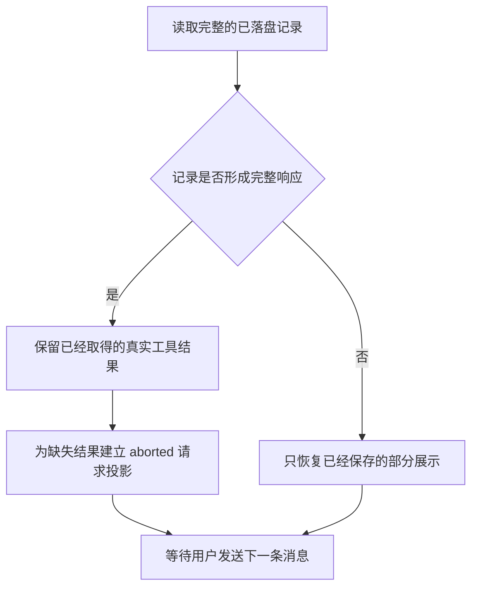

# 让一次任务留下可恢复的记录

保存聊天气泡只能恢复界面，不能恢复一个会调用工具的 Agent。下一次请求还需要知道调用的身份、参数、结果、公开消息阶段，以及用于续接的不透明协议项。当前 `ProtocolHistory` 已经保存这些材料，本阶段给它增加持久化边界，而不是从 UI 文本重新拼历史。[现有协议记录](sources.md#现有结构与约束)

## 一份存档承载两种读取方式

用户阅读需要完整时间线，模型请求需要当前工作上下文。这两种读取都来自同一份权威记录，但选择的内容不同。

这里的完整记录指应用已经接纳的输入、完整模型输出和工具现有的有界结果。命令输出仍按原工具限额截断并带截断标记；会话保存不会恢复从未被工具保留的 stdout，也不把每个 SSE 字节都写入存档。

## 沿用已经选择的应用数据目录

存储根取自本次启动建立的 `DataEnvironment`。应用配置位于可执行文件旁，`codex-oauth.json` 由 Login 管理，`prompts.json` 由 Prompts 管理。会话存档位于所选数据目录中的 `sessions/`，独立于项目工作目录及其他客户端的数据。[数据环境](../mechanisms/application-data.md)

| 会话内路径 | 保存什么 | 权威关系 |
| --- | --- | --- |
| `sessions/<session-id>/session.jsonl` | 初始设置、用户输入、协议输出、工具结果、任务终态、名称变更、压缩检查点等 | 会话事实来源 |
| `sessions/<session-id>/summary.json` | 标题、创建时间、最后活动时间、最后已索引记录序号、删除状态 | 可由记录重建的列表摘要 |
| `sessions/<session-id>/attachments/` | 已发送图片的不可变副本及所需元数据 | 日志引用的会话附件 |

这种组织借用 Codex Rollout 的追加记录与恢复思路，但不引入它的整套 SQLite、全局输入历史、云端存储或长期记忆目录。[Rollout 记录器](sources.md#codex-的存档与恢复)

目录名称使用 Session ID，不使用标题、账号、项目名称或本地化时间。索引摘要只加速列表，不参与构造模型请求。日志比摘要更新时，按记录补齐摘要；摘要丢失时重新生成，不能把索引损坏误判为会话内容丢失。

## 记录要保存原义，而不是一份显示截图

持久记录采用带类型和递增序号的结构。初始记录保存稳定身份、完整设置快照和必要的格式识别信息。格式标识只用于识别本程序支持的记录，不建设旧版本兼容和迁移框架。

记录内容分为几类：

- 用户消息及其输入身份，Steer 的接纳与应用状态，以及 Queue 的入队、移除、开始和暂停事实。
- 完整模型输出，包括助手消息的 ID、内容、`phase`、函数调用顺序和不透明 reasoning；保留协议项原义，不合并成假助手消息。
- 工具实际开始及返回的事实，包括 `call_id`、参数、真实状态、有界结果、补丁部分完成情况和独立的进程清理记录。
- 每次已封闭步骤、任务终态，以及取消或失败时已有的公开展示内容。
- 后续章节定义的压缩检查点、覆盖边界、替换工作历史与使用量依据。

工具目录的声明、参数和结果必须能够与该次执行对应。恢复历史可以展示旧工具名称与声明；之后执行仍由当前程序支持的工具实现承担，不从存档加载任意代码。工具契约不兼容时，停止续接并报告原因，而不是把历史调用静默翻译成另一工具。

## 让写入跟随执行边界

采用 Codex 的单写入者、追加命令、Flush 确认和关闭等待思路。记录写入通过有界通道交给存储工作者，文件操作不阻塞 Bevy 主线程，也不阻塞负责凭据协调的 Runtime 命令循环。[Rollout 写入生命周期](sources.md#codex-的存档与恢复)

创建会话先确认初始记录可写。模型完整响应确定后，先保存其调用批次，再启动工具；工具开始事实在产生副作用前确认写入，每个实际结果取得后独立保存。完整输出与匹配结果封闭后，保存步骤提交边界。这样程序在第二个工具执行中退出时，第一个工具的真实结果不会只存在于尚未封闭的内存批次里。

流式增量继续服务于显示，不逐 token 刷盘。正常失败或 Stop 收尾时保存当前展示快照；进程突然结束时，恢复以最后完成写入的记录为准。

会话切换、终态交付和关闭都需要可观察的写入确认。写入失败时停止启动新的工具和请求，保留内存中的已有结果，显示“记录保存失败”；已有副作用不能回滚成“未执行”。关闭流程等待任务回收和存储工作者结束。不能只把写入请求放进队列就宣告记录已保存。

## 图片必须保存当时实际发送的内容

当前 `view_image` 把文件解码、调整尺寸和编码后，以不可变 `ImagePayload` 进入协议历史。持久化保存的应是这份实际发送载荷，而不只是原始文件路径。[图片历史边界](sources.md#现有结构与约束)

附件按发送内容摘要命名，并保存实际 MIME、尺寸、编码字节数、摘要以及原始路径的说明信息。先完成附件文件的写入与确认，再追加引用它的协议记录。已有同摘要附件需要核对内容，不能只因为文件存在就复用。

同一会话内部可以复用相同附件，不建设跨会话全局附件库。恢复只通过会话内部引用读取附件，检查路径范围、摘要、尺寸和格式；原始项目文件被移动、删除或覆盖，不改变已经保存的工具结果。

单图读取、像素和编码限额沿用本地工具设计。16 MiB 的图片累计预算作用于当前模型工作上下文；压缩前的完整附件继续留在磁盘，不计作每次请求都携带的图片。完整请求的工作上下文按模型 token 窗口与压缩策略管理。

## 中断后重建事实，不重新执行事实

Codex 会在恢复历史的请求投影中，为缺失结果的工具调用补充 `aborted`，而不是重新运行该调用。这里采用相同方向，并保留本项目已经存在的完整响应校验和步骤封闭边界。[历史规范化](sources.md#codex-的存档与恢复)

例如一份完整响应包含工具 A、B、C：A 的结果已经落盘，B 已记录开始但没有结果，C 尚未开始。恢复后继续保留 A 的实际结果；B 显示执行结果未确认；C 显示未执行。请求投影为缺失结果补足明确的中断占位项，与原 `call_id` 配对。这个占位项不是工具真实返回值，不能在界面上显示成成功，也不说明文件副作用已被撤销。

正常完成的步骤不重复执行。未完成的模型响应不伪装成完整协议输出；已记录的接受、应用和提交身份避免恢复时重复插入同一用户消息。Queue 以暂停状态恢复，旧 `operation_id`、取消令牌、任务句柄和 PowerShell 进程会话不恢复。

恢复后的请求仍需遵守 call/result 配对。规范化只修补当前请求投影，不覆盖原始存档，因此用户能区分真实结果和恢复产生的中断说明。模型需要继续操作时，根据这些事实重新检查当前文件状态，而不是由存储层执行旧工具参数。

## 会话文件异常怎样影响当前会话

读取按完整记录边界进行。末尾未完成的一行与中间结构损坏分开处理：前者保留此前有效记录并呈现中断状态；后者阻止继续写入或请求，显示具体损坏位置。未知格式、序号冲突、附件缺失和摘要不符都保留可读信息，不自动覆盖原文件。

末尾残缺记录需要继续写入时，先在会话目录保留原文件，再通过临时文件提交有效前缀和中断说明；只有替代文件已提交、写入者重新接管后才开放续接。中间损坏不进入这条自动修复路径。

这些失败限制在受影响的 Session。列表仍可显示其条目和错误，也能打开其他有效会话。文件读写失败不会重置账号、提示词库或整个数据目录。

删除在[界面设计](04-session-interface.md)中定义为独立的用户动作。压缩、退出账号、新建会话和恢复错误都不是删除动作。
