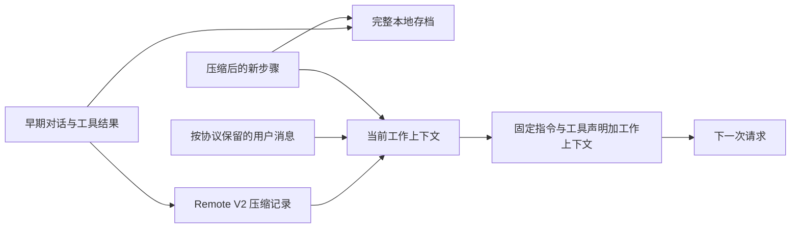
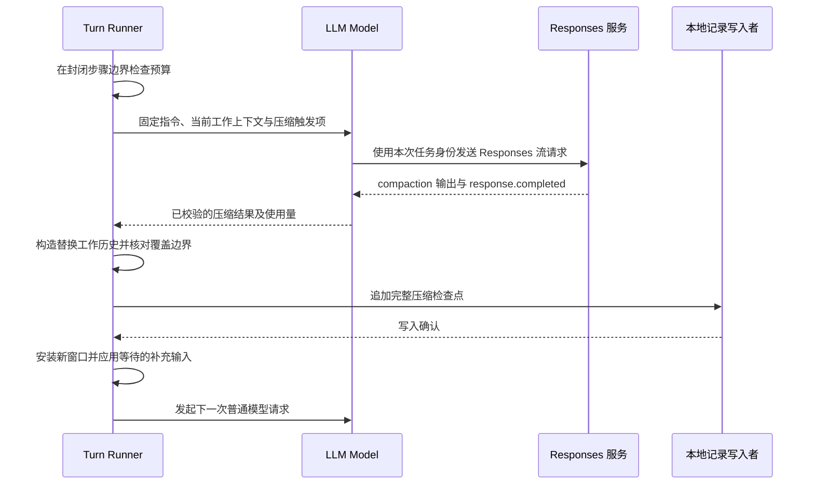

# 历史越积越长，模型每次需要带走多少

本地存档可以继续增长，模型的一次请求却有窗口上限。上下文管理不是限制用户能保存多少条聊天，而是在每次请求之前，确定哪些已保存材料构成当前工作上下文，以及这份上下文是否需要压缩。

## 从完整历史得到一个工作窗口

最初没有压缩检查点时，工作上下文由已提交协议历史构成。第一次压缩成功后，工作上下文改为“压缩记录、按协议保留的消息和之后新增的历史”。完整存档不随之删除。[Codex 的检查点恢复](sources.md#codex-的窗口与-remote-v2)

存档中的旧工具结果仍能显示，模型请求却不再把这些结果连同压缩记录重复发送。固定 `InstructionSnapshot` 继续由请求构造层在前部注入一次；压缩不能把它替换成当前提示词库里的新版本，也不能把同一指令每轮累积进历史。

## 窗口大小来自当前选定模型

现有模型目录只传递模型身份、推理档位和图片能力，还没有上下文窗口与自动压缩参数。本阶段把对应模型元数据贯通到模型层、会话执行设置和安全展示中。

采用 Codex 的字段语义和预算规则：优先使用 `context_window`，缺失时才使用可解释的 `max_context_window`；有效窗口比例采用模型提供的 `effective_context_window_percent`，未提供时沿用 Codex 的 95%。自动阈值采用明确的 `auto_compact_token_limit`，并以完整窗口的 90% 为上限；没有明确阈值时从窗口计算 90%。有阈值而没有窗口时，可以判断触发阈值，但不能据此编造完整容量或剩余百分比。[窗口参数与规则](sources.md#codex-的窗口与-remote-v2)

例如，只有当实际模型目录给出 500,000 token，且没有覆盖默认比例时，才得到 475,000 的有效窗口和 450,000 的自动阈值。500K 是这个例子的输入，不是整个客户端的默认值。恢复会话后刷新当前账号能使用的同一模型能力，旧能力快照保留作记录，不凌驾于当前目录。

缺失、非法或互相矛盾的数据应保留明确的“未知”或错误语义。若既没有可用窗口，也没有可用自动阈值，就不能把该模型当作已经具备完整的自动上下文管理能力；保留历史浏览，发送前说明缺少哪项能力。若现有目录没有提供必要字段，应先核对该请求链路的真实返回和 Codex 的模型元数据来源，不凭模型名称猜数值，不擅自更换服务地址。

## 当前上下文占用，不是累计花费

一段会话已经累计消耗一百万 token，并不意味着当前请求含有一百万 token。上下文预算跟踪的是这一次工作窗口中的内容，累计用量只能另作执行记录，不能拿来触发压缩。

计量参考 Codex 的“最近一次服务端用量依据，加上之后新增项的本地估算”。模型完成响应中的使用量形成锚点；新用户消息、工具结果以及尚未计入锚点的协议项追加估算。失败请求是否提供可用使用量，按真实响应处理，不凭失败状态清零。压缩或恢复改变工作窗口时，旧锚点与旧项索引不能直接套到新窗口上。[ContextManager 的计量边界](sources.md#codex-的窗口与-remote-v2)

计量覆盖指令、工具声明、消息、工具结果及必要的多模态和不透明项。缓存命中的输入仍然占上下文；Base64 长度、JSON 字节数和加密文本长度不是对应的模型 token 数。不能将它们用一个字符除数当成精确计量。没有服务端依据的部分标为估算，并保留来源和覆盖边界。

图片同时计入编码预算和模型输入成本。压缩改变当前工作上下文，单图、工具结果和网络响应限制分别适用。

## 自动触发放在下一次请求之前

本阶段使用任务内、前台等待的自动压缩，不增加投机式后台压缩任务。它仍然属于同一活动任务，只是阶段从“请求模型”切到“压缩上下文”。没有手动按钮、斜杠命令或持久化的调试入口。

每次普通模型请求前检查当前工作窗口，包括新一轮输入已经准备好的边界，以及同一任务完成工具批次后的下一次请求边界。达到自动阈值或有效窗口边界时，先压缩，再发送普通请求。不会在一组工具调用还缺结果时切换上下文，也不会在工具产生副作用的中途替换历史。

待发送用户输入在接纳后就有持久身份。压缩失败时保留该输入，后续恢复按输入身份去重；压缩不能让用户的最新要求消失，或在下一轮重复出现。压缩等待期间仍接收 Stop 和可靠的 Steer 回执；已接纳的 Steer 留在待应用区，结果安装后、下一次普通请求前按原顺序应用。它们不被算进压缩请求已经覆盖的历史。

Queue 仍只在旧任务终态、资源回收及历史归还之后启动。压缩失败、停止或触限导致当前任务未正常完成时，队列暂停。压缩不会创建第二个活动任务，也不会刷新任务的请求或工具预算。

## Remote V2 的往返不是一次普通摘要对话

Codex 的 Remote Compaction V2 在 Responses 输入中加入请求控制项 `compaction_trigger`，读取服务端返回的 `compaction` 项。它不是给模型追加“请总结以上内容”，也不是把公开的 `/responses/compact` 接口名称直接替换进当前链路。[Remote V2 请求与完成判定](sources.md#codex-的窗口与-remote-v2)

模型层必须收到合法完成事件，并取得恰好一个可用压缩项；缺失、重复、提前断流或协议结构错误都不安装结果。压缩响应中即使出现其他工具内容，也不能经过普通工具分发器执行。请求触发项只控制这次请求，不作为可重放的普通历史保存。

服务返回的不透明载荷原样保留，不在客户端解密、改写或转成展示摘要。按 Codex Remote V2 的保留规则，从既有用户消息等适用项中选择需要继续显式携带的内容；参照其 64,000 token 的保留预算和原顺序组织。只适配本项目实际存在的用户输入、固定指令、四工具历史和图片，不引入子 Agent、Hook、音频或外部工具的配套系统。也不把“保留最近若干条”自行当成整个 V2 协议。

## 一个检查点同时说明结果和覆盖范围

压缩检查点保存替换工作历史、压缩前覆盖到的会话记录序号、新窗口身份或序号、响应身份、模型身份及服务实际提供的压缩兼容信息、使用量依据。`comp_hash` 等信息有返回才保存，不自行推导。

候选结果只安装到它实际覆盖的会话和历史代次中。等待期间接纳但未被请求覆盖的新输入，保留在边界之后，不被旧结果覆盖。先写入完整检查点并取得确认，再替换内存中的工作窗口；存储失败保留旧窗口和候选诊断，不宣告压缩成功。

取消与提交竞争时，以检查点是否已经提交为界：提交前取消保留旧窗口；提交后即使用户停止，也先收敛内存中的窗口状态，再发布终态。不能让磁盘已经记录新窗口，内存却带着旧窗口继续执行。无法归还可信一致状态时，阻止继续发送并重新加载记录。

再次打开会话时，从最近完整检查点恢复替换历史，再重放其后的有效记录。压缩开始但没有成功检查点时，继续使用此前窗口。所有旧公开记录仍从完整存档展示，不因为工作窗口切换而从聊天区消失。

## 失败保留原状态，而不是另换一种压缩

压缩使用现有认证获取、请求身份校验、取消和网络错误路径。Remote V2 的协议细节参考 Codex，已有的 401 恢复边界、429 不自动重试、请求与响应大小限制继续成立，不照搬上游所有重试选项。

工具循环可在同一任务内跨压缩边界继续推进。失败、重复得到不可用窗口或始终不能容纳下一次请求时，要结束这次任务并保留材料，不能自动无限压缩，也不能删除历史后继续宣称成功。

当前服务链路不支持 Remote V2、当前账号拒绝载荷、模型无权访问或压缩失败时，显示真实错误，不切换到本地摘要、不增加人工压缩入口，也不静默换账号或模型。跨账号共用存档的规则不变；涉及不透明载荷的实际续接，使用用户授权的账号切换验证，不能用客户端可读文件替代服务真实接受的证据。
