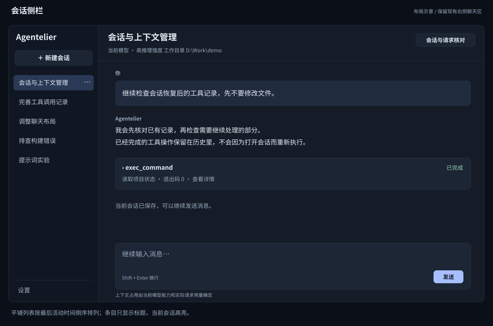
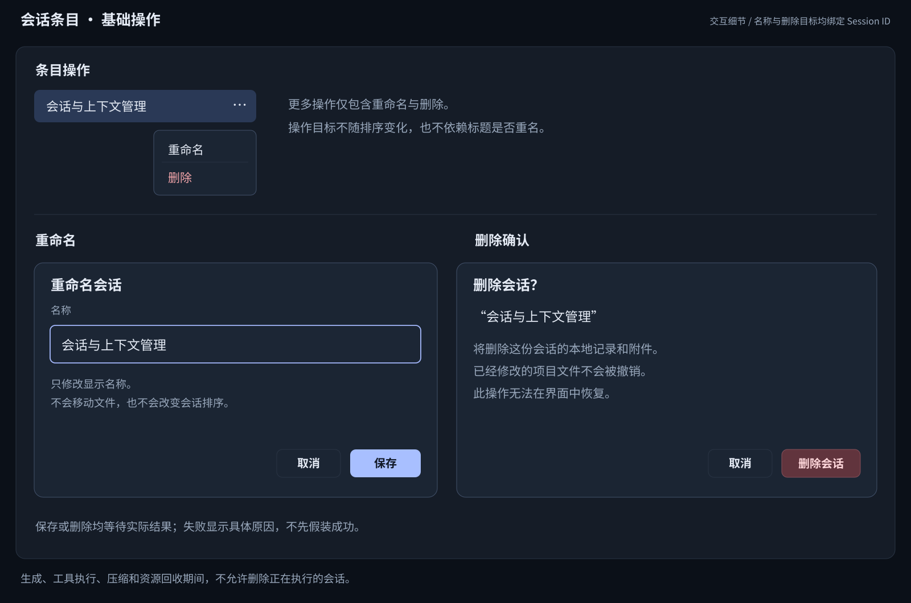

# 侧栏负责找会话，右侧继续做事

这次界面只解决多份本地会话的选择与基础管理。左侧是固定显示的平铺列表，右侧沿用现有聊天页面。列表不承担项目管理、账号管理或上下文调试面板的职责。

## 从一个当前会话开始

图中为布局示意，消息和工具内容是展示样例。颜色和间距沿用现有主题，图不要求重新制作整个聊天页。

侧栏顶部放应用名称和“新建会话”。下面直接显示会话条目，没有搜索框、“最近”“今天”等标题，也没有项目副标题、账号标记、置顶区或归档区。当前会话使用选中底色，条目以标题为主要内容；长标题省略显示，完整名称可以通过现有提示方式查看。

点击条目请求打开对应 Session。条目的身份是稳定 Session ID，不是标题、列表位置或临时行实体。右侧标题、时间线和设置摘要在目标加载成功后一起切换；失败时保留原会话，不先清空聊天区。

## 时间排序只反映真实活动

所有条目按最后活动时间倒序排列。新建记录以创建时间参与排序；接纳新的普通用户输入、Steer、待办输入以及任务终态等业务活动更新活动时间。打开记录、展开卡片、滚动、重命名和读取索引不算新的对话活动。压缩属于内部维护，不单独把闲置会话推到顶部。

流式 token 不逐次重排列表。活动更新在明确的业务记录边界生效；相同时间使用稳定身份作次级顺序，避免列表跳动。重排不改变选中的 Session，也不把“第一个可见行”误当成当前会话。

会话摘要由后端返回已经确定的排序字段。UI 可以投影列表，但不能用文件修改时间或消息气泡位置重新定义活动顺序。

## 右侧沿用现有聊天区

右侧继续保留当前模型与推理设置、工作目录说明、会话与请求核对、正文、工具卡片、Queue 和输入区。目录可以出现在当前会话设置摘要中，但不进入左侧分组或分类。账号与数据目录继续通过现有设置入口管理。

“正在自动压缩上下文”显示在现有任务状态区，不是可以点击的压缩入口。窄窗口仍保留输入区和停止入口，长代码行在现有内容区内横向滚动，不把侧栏挤压成无法点击的窄条。

## 重命名和删除放进条目操作

条目的更多操作只提供重命名和删除，不增加置顶、归档、分享、分支或项目移动。

重命名使用现有文本控件与确认交互。打开编辑时保存目标 Session ID，提交非空名称，成功回执后同步列表与右侧标题；取消或保存失败保持旧名。正文允许中文和正常标点，换行等不适合单行标题的输入在标题层处理，不改变聊天原文。重命名不会移动文件目录，不更新对话活动时间，也不再次触发自动取标题。

删除必须确认目标名称，并说明只删除该会话的本地记录和附件，不撤销已经修改的项目文件。确认过程中目标始终由 Session ID 固定，列表重排不能改变被删对象。删除取消不做任何文件操作。

删除先持久记录删除状态，再退出正常列表并清理该会话自己的日志、摘要和附件。清理可将目录移入同一存储根的内部待删除名称，避免删除到一半又被扫描为有效会话；该位置只是待完成的内部操作，不是用户回收站。清理失败记录实际残留并允许完成清理，不让旧摘要把会话重新展示出来。

当前打开的会话删除成功后显示空白准备区，不自动对另一份历史发送消息。其他会话删除不会改变右侧内容。正在执行、压缩或回收的会话不能删除；等待用户停止且执行侧确认回收后再处理。

## 多份记录仍然只有一个执行者

当前任务运行期间，不通过点击另一条记录隐式取消，也不另起并行任务。新建、切换和删除的替换动作在执行侧串行裁定，界面显示“当前任务结束后可切换”或等价说明。正常阅读和当前任务的 Stop、Steer 继续可用。

空闲时切换会话，会暂停并保存原会话尚未开始的队列。与 Queue 自动出队发生竞争时，由 Runtime 的单一决定为准：若下一任务已经启动，切换被明确拒绝；若切换先被接纳，旧队列保持暂停。不能让 UI 和队列各自认定自己获得了执行权。

草稿、阅读位置和工具展开状态以 Session ID 分开保存在本次运行的 Chat UI 状态中。切回来恢复的是这份会话自己的状态，而不是上一个会话留下的输入框文字。发送回执仍要匹配草稿修订，不能把用户刚编辑的新内容清掉。

## 少量状态足以解释发生了什么

没有会话时显示新建准备区。正在打开时只提示加载状态；打开失败保留旧内容。存储失败、历史损坏、模型不可用和中断恢复分别显示具体原因，不统一成“登录失败”。

上下文占用通过现有状态或会话核对区域展示，区分服务端依据与估算；未知容量不显示假百分比。自动压缩期间显示任务阶段和可用的 Stop，成功后回到普通任务流程，不增加手动压缩按钮。历史中的中断工具显示实际结果或未确认说明，不能装成仍在运行的进程。

## 使用现有 Widgetry 组合

侧栏列表采用 Widgetry 的稳定条目身份、有限高度滚动和公开选择接口。模型项、投影顺序与虚拟行实体是三个对象；离屏行复用后，事件目标仍须解析为当时绑定的 Session ID。[ListView 的身份与运行状态](sources.md#widgetry-与-brp)

UI 通过 BSN、Scene 和 SceneList 组合，持续状态放在 Component 或 Resource，Props 只负责初始化。输入、确认、按钮、滚动和菜单内容组合复用现有公开能力，不修改 Widgetry 内部编辑器或行状态。新列表不成为协议历史的权威，也不读取认证文件。

验证要覆盖实际点击、长列表滚动、重排后选择、重命名取消、删除确认、生成中拒绝切换，以及快速切换导致的迟到回执。截图与安全 ECS 投影共同确认界面，不以请求被接纳或没有崩溃代替结果正确。
