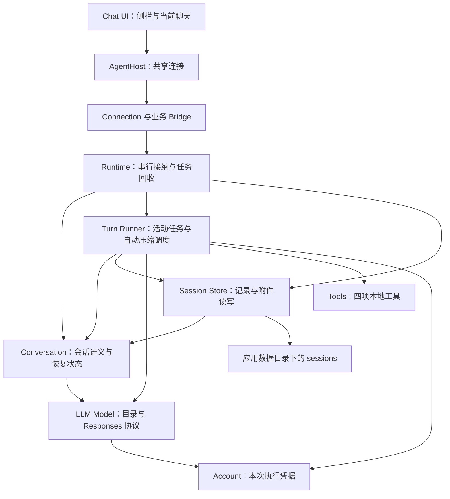
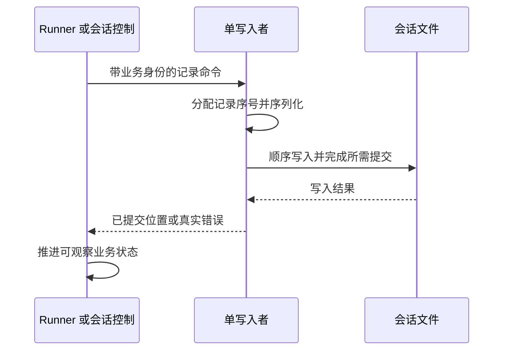
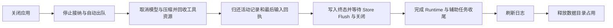

# 把存档和自动压缩接回现有执行链

前面已经区分了三件事：会话决定记录意味着什么，存储保证记录可以重读，模型层解释服务协议。这里按这三种职责扩展现有结构，不把“多会话”做成 UI 自己管理的一套后台。

## 现有所有者继续成立

当前的 `Conversation` 管理会话业务，`Turn Runner` 独占活动记录，`Runtime` 管理任务生命周期，`LLM Model` 处理模型网络协议，`AgentHost` 和 Bridge 传递安全投影。本阶段保留这条分工，并增加独立的 `agent/session_store` 存储能力。[当前架构](sources.md#现有结构与约束)

图中的箭头表示依赖或调用方向，不表示每条消息都经过图上所有节点。Store 依赖 Conversation 提供的持久记录语义；Conversation 不反向调用 Store。这样不会因为恢复需要会话类型，就形成 Conversation 与存储之间的循环依赖。

## 会话业务、文件机制和协议编码各归其主

Conversation 定义持久 Session 身份、设置快照、业务事件及恢复后的状态规则。空闲时拥有当前打开会话；活动时仍把可写工作上下文交给 Runner。多会话目录只保留轻量摘要，不要求把全部历史和图片常驻内存。

Session Store 负责会话目录、追加记录、摘要更新、附件提交、读取和删除收尾。它保存业务记录，不决定一条失败回复是否进入模型上下文，也不决定何时压缩。记录的文件封装和单调序号由同一写入者生成，确认回执带回实际提交位置；活动任务记录与会话队列控制不能各自分配一套冲突的磁盘序号。

模型协议项的编码、解码和合法性归 LLM Model。它需要提供面向持久化的受控表示，保留原始协议字段及类型化工具载荷；不能为了序列化而把内部协议暴露为可反射的 UI JSON。图片的不可变载荷和元数据仍由 Tools 的数据契约表达，Store 负责将其落盘并核对读取结果。

持久记录序号与工作上下文代次分开使用。一个 Queue 接纳记录可以晚于压缩开始，但尚未进入模型上下文；安装压缩结果时要根据实际协议覆盖边界与待应用输入判断，不能仅凭文件末尾序号就覆盖整个会话状态。

## 写入者与活动任务怎样协作

Store 以一个有界、串行的写入入口接收同一会话的记录，实际文件 I/O 在可等待的工作任务中执行。Runtime 持有工作者生命周期，Runner 或会话控制路径提交不可变记录并等待真实确认。等待不能占住 Runtime 的命令循环，凭据刷新、Stop 和可靠输入回执仍然能够推进。

正常停止不会丢弃已经交给写入者的命令。取消与写入完成竞争时，先收敛本次写入结果，再决定任务终态；不把取消请求解释为“磁盘没有发生变化”。写入者保管自己的文件资源直到队列收尾，UI 页面销毁不能关闭它。

同一个应用数据目录已经有 `.agentelier.lock` 的单实例占用。本阶段复用这个根环境，不新增第二套登录目录或后台 Tokio，不在 UI 里建立另一个会话写入器。摘要、重命名、删除和当前任务写入也经过相同业务身份与串行裁定。

## 请求与安全投影的边界

LLM Model 扩展目录能力、响应使用量、Remote V2 请求控制项和压缩输出解析。它通过 Account 获取当前会话的可用凭据，凭据文件和会话列表分别由 Login 与 Session Store 管理。普通生成和压缩共用当前已采用的 Responses 请求链路，协议不支持时沿真实错误返回。

Runner 在完整工具步骤之间检查预算、请求压缩、构造候选工作历史，并在检查点写入确认后安装。它保留本次任务的执行身份，不能沿用旧会话创建者作为发送门槛。Conversation、UI 和模型请求中的旧账号相等判断都要对应调整。

Bridge 增加列表摘要、打开结果、名称变化、删除结果、保存状态、上下文计量和压缩阶段等安全投影。凭据、图片字节和加密 reasoning/compaction 原文不进入 ECS 反射或日志。既有有界控制通道、独立 Stop 路径、不可合并的开始与终态回执继续保留。

UI 持有当前选择和按 Session ID 区分的草稿与阅读位置。列表项重排和页面切换只改变展示，不能反向构造模型请求。打开请求、终态和队列开始回执都核对 Session 与 operation 身份，避免旧结果污染新选择。

## 关闭时，先留下最后一段事实

账号已经开始的凭据刷新沿原所有者完成提交，不受聊天等待者取消影响。Store 关闭加入现有收尾顺序，但不接管认证文件。数据目录位置本次运行保持固定，更改下次启动路径仍不自动搬运会话。

进程被强制终止时无法完成这条正常链路，恢复依赖已经完成写入的记录及中断规范化。磁盘写入确认不是工具副作用回滚机制；未取得结果的工具按记录显示未知或未执行。

## 实施和验证沿用工程约束

新增存储库按职责落在 `crates/agent/`，设置 Windows x64 入口检查，依赖在 Workspace 统一管理。继续使用当前锁定的 Bevy、Widgetry 和 BRP 组合，不因参考库有新接口就顺带升级或复制上游源码。`app/` 保持薄入口，`application` 不吸收会话业务。

UI 使用 BSN 和 Widgetry 公开 API。实际 GUI 验证使用 `bevy_brp_mcp`，结合截图、真实输入和安全 ECS 状态；验证完成释放 Custom Pointer 并确认 `inactive`。特殊键的现有逻辑键限制按 `docs/known_issues.md` 处理，需要时经 BRP 写入完整 KeyboardInput 消息，不直接修改编辑器状态。原生 IME 另做实机确认，不同时启动两个启用固定 Render 端口的实例。

本项目不编写测试代码、Benchmark、Example 或专门测试宿主。各实施增量用适用的 Cargo 静态检查、真实应用运行、调试边界故障注入和 BRP 验证。跨账号场景由用户明确授权或亲自切换账号后验证，不能为验收重置已有凭据、发起 OAuth 或更换数据目录。

本阶段不增加 Skills、MCP 工具接入、项目指令发现、长期记忆、多 Agent、云同步、分支回滚或任务断点执行。BRP 只是开发验证通道。新增设计材料与当前模块说明分开保存；实现某个增量后，再同步 `docs/design/architecture.md` 及受影响的会话、请求、数据目录和界面设计，不把尚未落地的行为写成当前事实。
