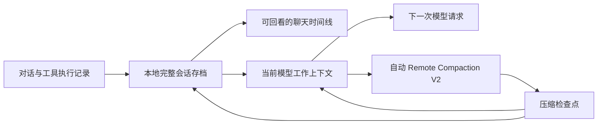

# 会话与上下文管理：从一次对话到长期续接

这一阶段要让一段已经开始的工作，在关闭程序、切换登录账号和多次压缩上下文之后，仍然能从左侧会话列表重新打开并继续。先弄清楚“保存的是谁的工作记录”，再讨论怎样恢复，最后才进入模型窗口和压缩机制。

## 从已有的内存会话开始

当前实现已经有多轮对话、类型化协议历史、工具调用与结果、固定指令快照、工作目录，以及 Stop、Steer 和 Queue。任务执行期间由 `ActiveTurn` 独占工作记录，任务真实回收后归还会话。这里延续这些职责，不重新建设一套 Agent 循环。[现有结构与约束](sources.md#现有结构与约束)

这一阶段改变的是记录的寿命和使用方式：

| 当前起点 | 本阶段目标 |
| --- | --- |
| 一个活动内存会话 | 多个本地存档、一个当前打开的会话 |
| 账号变化会清除当前会话 | 本地会话不归登录账号所有，任务使用当前账号 |
| 历史随进程结束而释放 | 对话、工具事实、指令快照和附件可以恢复 |
| 完整协议历史直接用于下一次请求 | 完整存档与模型工作上下文分别管理 |
| 超限时返回错误 | 根据所选模型的窗口自动执行 Remote Compaction V2 |

## 会话保存在本地，账号只决定怎样发起请求

同一应用数据目录中的所有 Session 共用一个列表，不按账号分目录、过滤或分支。退出登录不删除记录；重新登录后，新任务使用新账号的凭据。会话固定的模型、推理设置、指令快照和工作目录仍然保留。

界面采用固定显示的左侧栏和现有右侧聊天区。列表只有新建、选择、重命名、删除，按最后活动时间倒序排列。不加入搜索、日期分组、项目组织、账号分类或排序切换。

多会话存档不扩展成多任务并发。同一时刻仍只有一个执行中的任务，切换会话在任务结束并回收后完成。

## 保存全部记录，不等于每次全部发送

存档记录已经发生的事情。工作上下文是某一次请求使用的材料，压缩成功后可以缩小；用户仍能回看压缩前的消息和工具结果。恢复会话时，读取最近的完整压缩检查点与之后的记录，重建工作上下文，而不是把所有旧消息再次拼到检查点前面。

压缩仅采用 Remote Compaction V2，由客户端在请求边界自动触发。没有手动压缩按钮、命令或本地摘要备用路径。上下文容量来自所选模型的能力数据，不把 500K 写成全局常量。

## 沿着使用过程展开

[会话生命周期](01-session-lifecycle.md)先解释新建、切换、恢复及账号变化。理解了会话的身份，再看[本地历史](02-local-history.md)：哪些记录需要落盘，图片为什么要保存副本，中断后如何恢复工具事实。

[上下文与自动压缩](03-context-compaction.md)在完整存档之上说明窗口预算、Remote V2 往返和压缩检查点。[会话界面](04-session-interface.md)把这些行为落实为侧栏、状态和操作反馈，并附可编辑 UI 图。[架构衔接](05-architecture-integration.md)最后合并模块职责与生命周期。

实施增量见 [plans 总览](../../../plans/session-context/00-overview.md)。设计图与引用资料都随这组文档保存，正文中的“当前”指现有结构，“本阶段”指这里要建立的目标。
