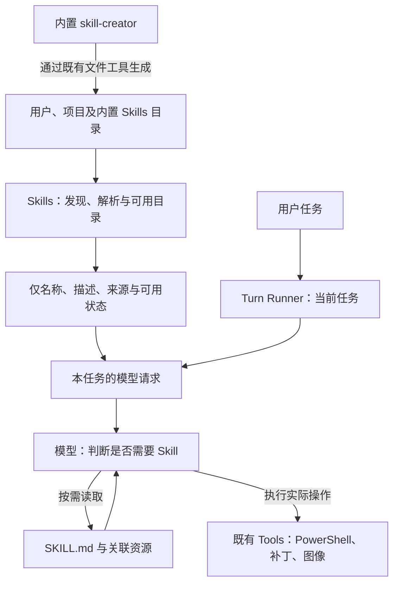
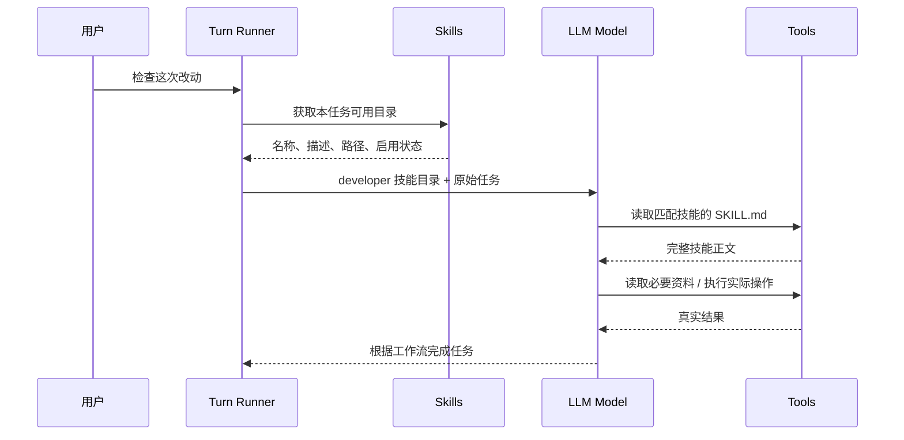
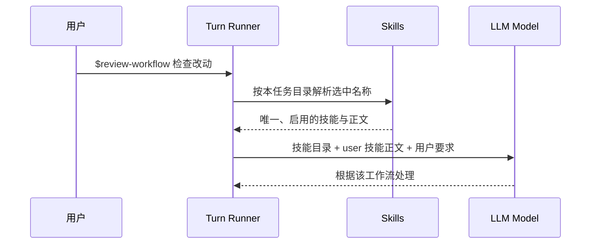
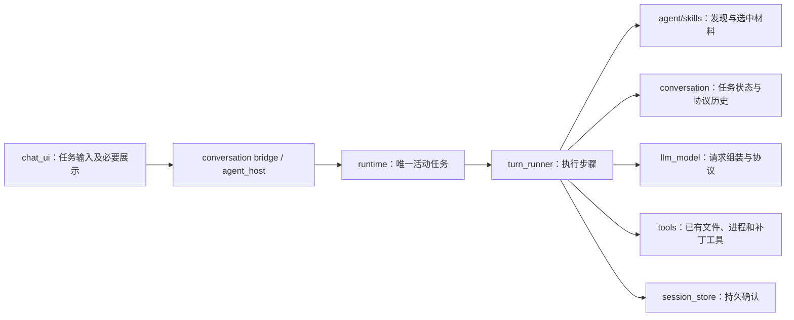

# Skills：可按需调用的工作流

Agentelier 需要让模型复用已经写好的工作方法，而不是把每种任务的操作规范长期放进基础提示词。Skills 提供了这个边界：一个 Skill 是带有名称和使用范围说明的指令目录，可同时附带参考资料、模板与执行脚本；Agent 根据当前任务决定是否读取和使用它。

**当前已实现来源发现、普通任务调用与显式 `$name` 选择；内置创建器部分仍为目标机制。** `agentelier_skills` 从项目路径链、用户 `.agents/skills` 与可执行文件旁 `skills/.system` 扫描，Runner 每任务发现，TurnView 保存可核对的目录和诊断。扫描只读 frontmatter 与可选元数据，不加载正文或执行脚本；无效可选元数据保留主技能，但限制为显式选择。单文件上限 256 KiB，frontmatter 与扩展元数据各 64 KiB，合计采集预算 4 MiB，扫描最多 2048 个目录项与 6 层深度。取消后等待阻塞工作结束。Runner 将允许隐式调用的目录以有界 developer 材料注入每次请求，不复制正文，不将目录累积进协议历史。模型使用原工具读取工作流与关联资源；请求事实保存目录文本、角色、索引和 SHA-256，存档恢复核对摘要。目录上限 256 KiB，超限明确失败；计量锚点保存当次任务材料估算，后续任务根据材料差值调整。显式名称按输入次序去重，重名、缺失、禁用和正文失效在请求前明确失败。选中正文与来源保存在 TurnView，每请求在原始历史之后以独立 user 材料提供，不累积到历史；恢复校验原文、摘要和请求关联，不读当前磁盘。单任务选中正文合计上限 1 MiB。Steer 含显式选择时拒绝接纳，要求经 Queue 或新任务边界处理；Retry 是新任务，认证重发仍只复用冻结字节。当前尚未提供内置创建器。本设计以 Agent Skills 的文件约定为兼容目标，以 Codex 的宿主 Skills 机制为行为参考；不定义 Agentelier 专有的 Skill 格式，不引入另一套执行引擎。



图中的 `Skills` 管理材料及其可用性，`Turn Runner` 仍拥有任务推进权，`Tools` 仍是唯一的本地操作入口。模型遵循 Skill 中写出的流程，但 Skill 自身不会自动获得新工具、权限、沙箱或外部服务。

## 从工作流文件到可发现能力

### 标准目录负责内容，而不是执行权限

最小 Skill 只需要一个 `SKILL.md`：

```text
review-workflow/
├── SKILL.md
├── scripts/           # 可选：实际执行所需的脚本
├── references/        # 可选：按需读取的说明材料
├── assets/            # 可选：模板和其他输出资源
└── agents/
    └── openai.yaml     # 可选：Codex 扩展元数据
```

入口文件使用 YAML frontmatter 描述何时适用，正文是 Markdown 工作流：

```markdown
---
name: review-workflow
description: Review a code change using the project's review rules.
---

# Review workflow

Read the project rules, inspect the relevant change, and report concrete findings.
```

`name` 和 `description` 是兼容所需的发现信息。模型最初只看到这些元数据；确认需要该技能后，才读取 `SKILL.md` 的完整正文；正文引用的 `references/`、`scripts/`、`assets/` 再按当前任务需要访问。没有关联资源的技能不需要创建空目录。

`agents/openai.yaml` 属于 Codex 扩展，而不是 Agent Skills 的最小必需项。它可以描述展示名称、图标、短说明、默认调用文本、依赖声明，以及 `policy.allow_implicit_invocation`。缺少该文件不妨碍加载 `SKILL.md`；其中可选展示元数据异常不应让有效的主文件整体失效。Skill 声明某个 MCP 工具依赖，也不意味着应用会安装或连接这个工具。

对标准文件应保留原始命名和相对引用语义，不把不同发行来源的 Skill 转写为 PromptRef 或专有 JSON。解析必须验证 frontmatter、关键字段、源路径和所需资源；不合法的单个目录应返回可解释的发现错误，不阻止其他有效 Skill 被使用。

### 同一技能可以来自不同作用域

目标覆盖三类实际来源：

- **项目技能**：沿会话固定的工作目录向项目边界查找 `.agents/skills/`，保留不同目录的作用范围。父级项目技能和更近目录的技能可以共存；目录作用域不能由某次工具命令的临时 workdir 改变。
- **用户技能**：读取用户主目录的 `.agents/skills/`，作为跨项目可复用的标准位置。应用还可以使用自己的数据目录保存由用户创建并明确交给应用管理的技能，但不能默默改写其他 Agent 的配置。
- **内置技能**：由应用提供并维护的只读系统技能，其中包括 `skill-creator`。用户自建或编辑的技能与内置技能分开存放，更新内置版本不覆盖用户文件。

Codex 还支持其历史配置目录、插件提供的目录和多种执行环境来源。Agentelier 首期只需要本机 Windows 文件系统和上述明确来源；**是否同时扫描旧版 `.codex/skills` 目录属于兼容补充，不作为最小标准的一部分**。不复制 Codex 的配置层栈、插件安装器或云端 Skill Provider。

每个被发现的技能保留来源、作用域、`SKILL.md` 的规范路径及可能的发现路径。名称相同不等于同一技能；按来源身份去重，显式按名称调用只有在唯一匹配时才成立。重名场景不能静默任选一个。符号链接及 Windows 路径的规范化、目录扫描深度、文件大小和读取失败需要有界处理，错误与来源相联系。

加载时生成可供本任务使用的目录快照。下一任务重新检查相关来源，使新增、修改和移除的技能能够被发现；同一任务内不因外部文件变化而暗中替换已经选定的正文。具体缓存策略可以比 Codex 简单，但必须保留上述可观察语义。

## 模型如何真正使用 Skill

模型有两条入口：自然任务匹配与用户显式选择。两条入口使用同一份发现结果，区别在于**谁决定选用**，以及**正文在什么时候进入上下文**。

### 任务匹配：先提供目录，再让模型按需读取

例如用户只说“检查这次代码改动”，若目录中有描述明确的 `review-workflow`，模型可以判断匹配，再利用已有 `exec_command` 读取对应 `SKILL.md`。如果需要脚本或资料，继续按说明读取和运行；执行过程仍走原有工具调用、结果、取消与归档路径。



Codex 的宿主路径模型主要复用已有文件读取与命令工具，并不会为每个 Skill 生成一个同名 Tool。Codex 还会识别读取 Skill 文档或运行其 `scripts/` 的命令，用来记录隐式使用；这类识别不是调用脚本的前置许可，也不替代实际工具结果。

可用技能目录及使用规则属于由宿主提供的 `developer` 调度信息。自然语言 Skill 正文并非 `developer` 基础指令：它来自磁盘文件，其实际内容和可信程度取决于来源。目录中显式标记为“仅显式调用”的 Skill 不参与自动匹配，但仍可在用户明确选择时使用。

### 显式选择：在请求前装入指定正文

用户使用 `$review-workflow` 选择技能时，运行侧先从有效目录中解析其身份，再读取完整 `SKILL.md`，将选中技能作为**单独的 user 内容**提供给本任务。模型不必再次猜测要选哪个技能。Codex 的结构化 Skill 选择也遵循类似的身份匹配，但当前聊天输入只有文本，最小实现先支持 `$name`，不为此新造一套输入协议。



同一条请求可明确选择多个互不冲突的技能，按稳定的选择顺序加载，避免重复注入同一来源；名称歧义、禁用、文件失效和正文读取失败有明确反馈。未知 `$name` 不应被悄悄解释成某个相似技能。普通自然语言提及一个名字可以帮助模型选择，但不能代替无歧义的显式身份解析。

### 两种入口共用当前任务，不改变固定会话指令

这里与现有提示词系统存在重要区别：

| 材料 | 当前所有者与作用时机 | 在请求中的角色 |
|---|---|---|
| 基础与补充 Prompt | `prompts` 解析，创建会话时固定 `InstructionSnapshot` | `developer` |
| 项目 `AGENTS.md` | `project_context` 按逻辑模型请求采集，按变化发布 | 独立 `user` 项 |
| Skills 可用目录 | Skills 根据当前任务环境生成 | 宿主 `developer` 调度内容 |
| 选中的 Skill 正文 | Skills 按本次选择读取，属于本任务 | 独立 `user` 内容 |
| Skill 脚本与资源执行结果 | `tools` 实际读取或执行，Runner 持有 | 正常工具结果与协议历史 |

Skill 不是 Prompt 预设，不写入 `InstructionSnapshot`，也不被项目 `AGENTS.md` 的采集器递归吞入。用户完成一个任务后，下个任务依然根据当前输入和技能目录重新选择；不建立“本会话永久绑定某 Skill”的隐形开关。

在同一任务的模型—工具多次往返中，已明确选中的技能必须保持有效：后续模型请求应得到相同的选中说明，不能因为前一次请求结束就丢失，也不能在每轮重复追加为新的聊天历史。运行侧保存本任务选中技能的来源与完整正文快照，请求准备时只注入一次当前请求所需的技能内容，并和原有 `store=false` 原始协议历史并列。网络发送前仍沿用当前 `PreparedGeneration` 冻结字节、准备记录和认证重发规则。普通工具读取技能的结果则按原有 function_call / function_call_output 保留，不伪造技能调用记录。

为了让会话存档可核对，选中技能的来源、内容摘要、请求中的角色与注入次序应随实际请求准备事实记录；对需要在存档中复原当时请求材料的显式技能，还需保存对应的已用正文，而非日后读取同路径的新版文件。文件改变不会重写历史请求、消除已经执行的工具事实或让 Retry 重跑既有副作用。

## Skills 放在现有执行架构的什么位置

Skills 是独立的 Agent 业务职责。它负责来源发现、标准解析、目录合并、启用策略、选择和正文读取；**不负责**执行命令、生成网络请求或持有业务会话。实现上可以按照实际依赖建立 `agent/skills` Crate，接口只传递技能的身份、有效元数据及所需文本，不使它反向依赖 UI、Runtime 或 Bridge。



这是目标业务协作图，不表示各 Crate 必须照图新增互相依赖。实际依赖保持 UI → Agent/Bridge、Bridge → Agent、Runtime → Runner；`conversation` 仍定义 ActiveTurn 和历史，`llm_model` 仍只负责 Responses/SSE，`tools` 不因 Skills 变成动态权限系统。

任务开始时的发现可以利用当前已固定的 `working_directory` 和已有项目边界判定，但技能扫描和 `AGENTS.md` 正文采集必须是两个独立过程。磁盘读取遵循现有可取消、可回收工作边界；原始数据只由拥有该职责的业务层读取。Skills 结果由 Runner 带入请求准备，Model 只消费已确定的目录和材料，不反过来读取本地技能文件。

当前 UI 没有单独的 Skills 管理页，也不需要为了创建 Skill 加一个编辑器。用户可直接写 `$skill-name`，自然语言任务可由模型匹配；需要核对时，复用已有的会话／请求核对方向展示已发送的技能目录、显式选择、来源与摘要。仅当实际增加可观察 UI 行为时，才由 `chat_ui` 和相应 Bridge 管理其安全投影；不把磁盘发现放进 Bevy ECS。

## `skill-creator` 如何让系统自己扩充工作流

Codex 已把创建技能这件事做成了内置 `skill-creator`：它自身是普通 Skill，约定了如何决定工作流范围、初始化目录、编写 `SKILL.md`、组织可选资源和检查结果。系统不必为“创建技能”发明第二套配置格式或图形编辑器。


内置文件从 Codex 的 `codex-rs/skills/src/assets/samples/skill-creator/` 参考完整目录与相对引用移入应用内置资源，保留适用许可和来源信息；与 Codex 的整体配置或插件管理代码解耦。应用只负责让 `skill-creator` 成为一个可发现的系统 Skill。它依然通过 `exec_command`、`apply_patch` 等普通工具写文件，不拥有额外的后台安装权限。

Codex 样本附带 Python 初始化、`openai.yaml` 生成和快速验证等辅助脚本。Windows x64 的 Agentelier 只保证 PowerShell 7，并不保证 Python 与 PyYAML 已安装。可执行辅助脚本应按当前环境检查依赖；缺失时不能假装执行成功，但仍可依据 Skill 指令通过文件工具直接创建和检查规范文件。生成到用户或当前项目的可写技能目录，不在内置 `.system` 目录写用户内容，也不自动覆盖已有 Skill。

“Skill 创建成功”与“Skill 已在正在运行的任务中启用”是两个不同事实。新文件经过验证并可被下一任务的目录发现后才成为可选能力；若用户在当前任务中继续要求立即使用，应明确加载新文件，而不是依赖旧目录快照自动改变。修改既有 Skill 同样遵循文件实际写入、校验和后续重新发现的生命周期。

## 运行边界与异常行为

- **文件指令不能提权。** Skill 可以提出使用工具的步骤，但不会绕开现有工具权限、任务停止、账号保护、工作目录约定或命令执行的实际限制。未经明确授权的外部安装、凭据操作或文件覆盖不应由 Skill 本文自动授权。
- **自动发现不自动执行脚本。** 在发现阶段只解析有界元数据；只有任务实际需要时，模型才通过正常工具调用读取正文和执行被选用的脚本。第三方 Skill 的指令按来源对待，不能提升为系统规则。
- **缺失依赖说清楚。** `agents/openai.yaml` 的工具依赖只提供描述；当前没有 MCP 动态安装能力时，依赖 MCP 的技能需要明确提示当前不可满足，而不是在目录发现时隐式启动服务。
- **错误不污染会话。** 无效文件、丢失目录、读取失败、重名歧义或脚本失败分别报告真实来源；没有成功读取的技能不标记成已执行。当前工具失败按普通工具结果及任务终态处理，已发生的副作用仍按照原有 Runner/Store 记录。
- **限定实现范围。** 本次不建技能商店、远端插件市场、自动下载器、Code Mode、额外 MCP 系统、自动沙箱、永久会话 Skill 锁定或专用技能编辑器；不改造 `bevy_widgetry`、`bevy_brp` 两个参考库。

实际验证遵守项目约束：使用编译检查、真实应用、现有日志、协议／请求核对和必要的 BRP 操作，不为 Skills 接入编写 Unit Test、Integration Test、Regression Test、Benchmark 或 Example 程序。若只修改 Agent 后台逻辑而无 GUI 可观察变更，不额外制造 GUI 自动化场景。开发调试不得主动退出登录、重置凭据或切换数据目录。

## 主要参考

- [Agent Skills 标准](https://agentskills.io/specification)：`SKILL.md` 及资源目录约定。
- [Codex Skills frontmatter 与元数据](https://github.com/openai/codex/blob/main/codex-rs/skills/src/parser.rs)、[扩展字段](https://github.com/openai/codex/blob/main/codex-rs/skills/src/metadata.rs)：所需与可选字段及校验边界。
- [Codex 发现与作用域](https://github.com/openai/codex/blob/main/codex-rs/ext/skills/src/host_roots.rs)、[扫描](https://github.com/openai/codex/blob/main/codex-rs/ext/skills/src/loader/discovery.rs)：目录来源和扫描机制。
- [Codex 技能目录与正文角色](https://github.com/openai/codex/blob/main/codex-rs/ext/skills/src/fragments.rs)、[显式选择](https://github.com/openai/codex/blob/main/codex-rs/skills/src/selection.rs)、[调用记录](https://github.com/openai/codex/blob/main/codex-rs/skills/src/invocation.rs)：匹配、加载与隐式识别。
- [Codex 内置 skill-creator](https://github.com/openai/codex/blob/main/codex-rs/skills/src/assets/samples/skill-creator/SKILL.md)：创建和维护 Skill 的普通工作流。
- 现有模块依据：[提示词](../modules/prompts.md)、[项目上下文](../modules/project-context.md)、[会话](../modules/conversation.md)、[模型请求](../modules/model-request.md)、[工具调用](../tool_call.md)、[整体架构](../architecture.md)。
- UI 与验证边界参考：[bevy_widgetry](https://github.com/slc90/bevy_widgetry)、[bevy_brp](https://github.com/slc90/bevy_brp)，Skills 接入不修改这两个库。

该目标机制按四个独立功能增量落地：[实施方案](../../../plans/skills/00-overview.md)。
