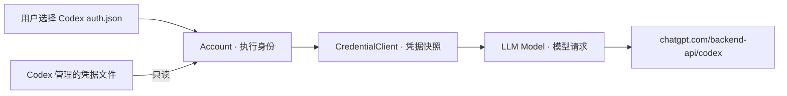

# 从 SIWC 迁移到 Codex OAuth

当前模型请求按选定来源访问第三方 Sign in with ChatGPT（SIWC）的 `api.openai.com/v1`，或使用用户选择的 Codex 外部凭据访问 Codex 后端。Login 管理 SIWC 的固定发行者、动态注册的客户端身份、`chatgpt.tokens.use.direct` 授权、受保护文件提交及按需续期，也负责只读解析 Codex 文件。迁移继续沿用同一个 Account 和 CredentialClient，使 Codex OAuth 成为唯一登录来源。

Codex OAuth 由官方 Codex 客户端签发，模型服务使用 `https://chatgpt.com/backend-api/codex`。该授权已经在独立实验中用于 GPT Image 2 和 GPT-6 Astra 的跨回合异步调用。服务、授权主体和工作区共同决定执行身份，邮箱只作为账号摘要展示。

目标结构中，Login 解析外部文件，Account 管理当前选择并交付凭据。LLM Model 借助 CredentialClient 发送请求，Runtime 和 Turn Runner 使用执行身份，Bridge 和 UI 消费安全摘要。

## 接替现有行为后下线 SIWC

过渡期保留 SIWC 模型目录、HTTP/SSE、`store: false`、完整历史重放和 `gpt-6.2-sol` 的 `additional_tools` 异步路径。请求由用户显式选择的来源决定，失败时保留所选来源。Codex 先接替目录与普通对话，再验证凭据生命周期、同步与原生异步工具、后台模型消费者以及旧会话恢复。

[下线 SIWC](../../../plans/subscription-media/04a-retire-siwc.md)在接替能力验收通过后进行。移除 SIWC 的浏览器登录、订阅授权、续期、远端撤销和专用路由。原数据目录中的 SIWC 凭据文件留在原位，启动时跳过它。已保存的本地历史、附件、工具记录和长期记忆仍可阅读。旧会话仅在模型、历史协议、工具契约和身份兼容时接续执行，否则显示原因并提供新建会话的入口。

## 本地文件与刷新所有权

最小可落地的 Codex 来源是**用户在界面中指定一个现有 `auth.json` 的本地绝对路径**。Agentelier 对文件执行只读解析：识别 `auth_mode=chatgpt` 或相容的官方 ChatGPT 认证表示、`tokens` 中的会话信息和所选工作区身份，拒绝 API Key 模式、缺失或不一致字段、不可读取文件。路径只作为本机配置保存，不从磁盘搜索其他凭据，不把 Token 复制进 SIWC 的认证文件。

切换来源必须由用户主动进行。当前前台任务与尚有在途工作时，遵从现有任务停止、执行身份和存储收尾机制，不能让旧 Turn 在中途变成另一条服务路径；已保存的本地聊天历史仍可阅读。旧会话继续执行前，按当前来源重新核对模型权限、历史兼容性与账号身份，失败就保留历史并展示实际错误。

**外部文件的刷新所有权属于写入它的 Codex 客户端。** Agentelier 不回写、轮换或撤销其中的 Token；当文件由外部更新时，可重新读取并确认身份。若会话已过期且文件没有更新，界面提示通过官方 Codex 登录环境恢复授权，随后重试；不能以失败为由自动切换到 SIWC 或擅自打开授权网页。用户在 Agentelier 中“断开这一来源”只清除本程序对路径的选用，不等于撤销外部账号授权。

这一方式与**由 Agentelier 自己发起 Codex 浏览器 OAuth、维护独立 Refresh Token**是两件事。后者需要确认第三方可用的客户端授权方式与续期责任；它不属于当前已验证的只读文件路径，不能在方案中假定已获开放权限。

## 路由必须跟随身份和任务冻结

一次任务开始时，以当前 CredentialClient 获取的授权来源、账号/工作区、认证生命周期以及模型配置共同形成执行身份。模型目录、连接验证、聊天 Responses、图片生成必须从同一来源派生服务地址与可用能力。

- Codex 来源使用 Codex 服务域的模型和 Responses 路由。新建 `gpt-6-astra` 会话使用 Responses WebSocket，按同连接上已确认的上一响应续接，并按原 `call_id` 回传结果。其他 Codex 模型和旧平铺会话保留 HTTP 路径。
- 图片生成以现有 Function Tool 契约调用 Codex Images 服务。
- 模型能力按实际服务目录、协议响应与实测结果判断，不通过 `gpt-6` 字符串前缀推断。现有工具目录冻结、调用身份校验、持久化回执和跨 Turn 结果交付继续生效。

路由选定后，账号自动续期或认证恢复只能在同一来源和同一主体内发生。外部文件重新读取发现账号、工作区或授权来源变化时，本次业务拒绝继续，以免一次工具调用跨主体执行。重放请求使用此前冻结的字节和会话协议身份，而非重新生成可能不同的请求。

## 用户能看到的区别

过渡期账号区区分 SIWC 和 Codex OAuth。迁移完成后账号区保留 Codex 凭据文件的选择、替换、断开和安全摘要。断开后进入未连接状态，外部授权仍由 Codex 客户端管理。模型准备区在凭据有效时读取可用目录，并为断开、文件缺失或失效显示对应状态。

例如，用户选择 Codex OAuth 文件并启动生成图片，任务使用同一冻结来源取得普通模型回复，再调用 Codex Images；运行途中外部 Codex 账号切换，旧任务不能拿新账号的 Token 继续调用。这个边界复用已有 ExecutionIdentity 的思想，而不是在媒体工具中私设账号校验。

## 失效与协议边界

原始 Token、完整授权地址、图片 Base64、音频字节不进入 ECS Reflect、Bridge 投影或日志。文件读取错误、外部续期尚未完成、401、额度限制、模型不可用和服务协议不符分别展示，不自动改账号、不暗中重试有副作用的请求。

Codex CLI 负责凭据签发和更新。Agentelier 可使用有效的外部文件发起模型请求，此时无需持续运行 Codex CLI。Agentelier 自行发起 OAuth 登录和续期属于另一项设计，前提是确认可用的客户端授权方式。
