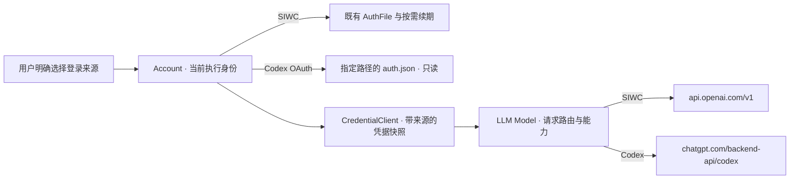

# 凭据来源与模型路由：同一账号执行所有者，两条授权路径

## 为什么只换请求地址还不够

现有 Agentelier 的 Login 实现第三方 Sign in with ChatGPT：固定发行者、动态注册的客户端身份、`chatgpt.tokens.use.direct` 授权、受保护文件提交与按需续期。Account 持有唯一认证记录；LLM Model 只通过 CredentialClient 取得凭据，并直接请求 `https://api.openai.com/v1/models` 和 `https://api.openai.com/v1/responses`。

Codex OAuth 实验使用的是**另一种已经由官方 Codex 客户端取得的授权**。官方 Codex 根据 ChatGPT 认证模式将模型服务指向 `https://chatgpt.com/backend-api/codex`。该凭据可以生成 GPT Image 2，且已经在独立实验中通过 GPT-6 Astra 的跨回合异步调用。两个授权体系不能靠交换 URL、复用相同账号邮箱或复制 Access Token 来等同。

因此新增的不是第二个独立 Account，而是**一个显式的凭据来源选择和与之绑定的服务路由**。

来源由账号所有者解释和维护。Model 不直接打开 JSON 文件、读 Refresh Token 或缓存另一份账号；Runtime、Turn Runner、Bridge 和 UI 也不接触原始 Token。

## 已验证路径如何成为可选择的账号来源

最小可落地的 Codex 来源是**用户在界面中指定一个现有 `auth.json` 的本地绝对路径**。Agentelier 对文件执行只读解析：识别 `auth_mode=chatgpt` 或相容的官方 ChatGPT 认证表示、`tokens` 中的会话信息和所选工作区身份，拒绝 API Key 模式、缺失或不一致字段、不可读取文件。路径只作为本机配置保存，不从磁盘搜索其他凭据，不把 Token 复制进 SIWC 的认证文件。

切换来源必须由用户主动进行。当前前台任务与尚有在途工作时，遵从现有任务停止、执行身份和存储收尾机制，不能让旧 Turn 在中途变成另一条服务路径；已保存的本地聊天历史仍可阅读。旧会话继续执行前，按当前来源重新核对模型权限、历史兼容性与账号身份，失败就保留历史并展示实际错误。

**外部文件的刷新所有权属于写入它的 Codex 客户端。** Agentelier 不回写、轮换或撤销其中的 Token；当文件由外部更新时，可重新读取并确认身份。若会话已过期且文件没有更新，界面提示通过官方 Codex 登录环境恢复授权，随后重试；不能以失败为由自动切换到 SIWC 或擅自打开授权网页。用户在 Agentelier 中“断开这一来源”只清除本程序对路径的选用，不等于撤销外部账号授权。

这一方式与**由 Agentelier 自己发起 Codex 浏览器 OAuth、维护独立 Refresh Token**是两件事。后者需要确认第三方可用的客户端授权方式与续期责任；它不属于当前已验证的只读文件路径，不能在方案中假定已获开放权限。

## 路由必须跟随身份和任务冻结

一次任务开始时，以当前 CredentialClient 获取的授权来源、账号/工作区、认证生命周期以及模型配置共同形成执行身份。模型目录、连接验证、聊天 Responses、图片生成必须从同一来源派生服务地址与可用能力。

- SIWC 保留现有模型目录、HTTP/SSE、`store: false`、完整历史重放与 `gpt-6.2-sol` 的 `additional_tools` 异步路径。
- Codex 来源使用 Codex 服务域的模型/Responses 路由。已有实验对 `gpt-6-astra` 的异步工具调用使用同一 WebSocket 跨回合回传 `call_id`；实现时应为实际可用的连接和续接方式建立明确适配，而不能把 SIWC HTTP 的全部字段原封不动套上去。
- 图片生成调用 Codex Images 服务；不将它误认为 SIWC 支持的原生 `image_generation` 托管工具。
- 模型能力按实际服务目录、协议响应与实测结果判断，不通过 `gpt-6` 字符串前缀推断。现有工具目录冻结、调用身份校验、持久化回执和跨 Turn 结果交付继续生效。

路由选定后，账号自动续期或认证恢复只能在同一来源和同一主体内发生。外部文件重新读取发现账号、工作区或授权来源变化时，本次业务拒绝继续，以免一次工具调用跨主体执行。重放请求使用此前冻结的字节和会话协议身份，而非重新生成可能不同的请求。

## 用户能看到的区别

账号区域显示当前**授权来源及安全的账号摘要**，允许主动选择“现有 SIWC”或“指定 Codex 凭据文件”。Codex 文件路径可修改或断开；不会出现把外部文件“退出登录”后远端账号被撤销的误导性反馈。模型准备区展示所选来源实际可用的目录与错误，图片生成仅在可用来源下交给 Agent。

例如，用户选择 Codex OAuth 文件并启动生成图片，任务使用同一冻结来源取得普通模型回复，再调用 Codex Images；运行途中外部 Codex 账号切换，旧任务不能拿新账号的 Token 继续调用。这个边界复用已有 ExecutionIdentity 的思想，而不是在媒体工具中私设账号校验。

## 失效与协议边界

原始 Token、完整授权地址、图片 Base64、音频字节不进入 ECS Reflect、Bridge 投影或日志。文件读取错误、外部续期尚未完成、401、额度限制、模型不可用和服务协议不符分别展示，不自动改账号、不暗中重试有副作用的请求。

外部路径只读提供了明确的临时产品边界：**Codex CLI 不需要为了模型请求持续运行，但负责其凭据的有效期与更新**。若未来要求 Agentelier 在没有其他客户端的情况下独立完成 OAuth 登录与续期，需要另行确定获得授权的正式认证路线，不能把只读文件适配器当成那项能力已经完成。
