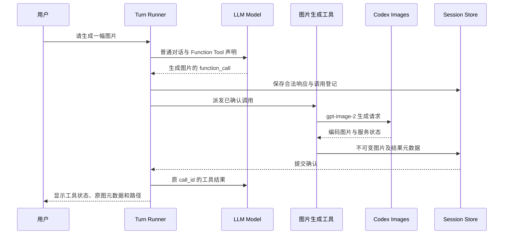

# 图片生成：普通 Agent 工具调用产生持久媒体结果

## 为什么不把图片生成塞进普通模型回复

已通过的实验调用 `https://chatgpt.com/backend-api/codex/images/generations`，指定 `gpt-image-2`，收到 HTTP 200 和可解码的 PNG；官方 Codex 也是通过独立的 Images 客户端执行 `gpt-image-2`，而不是让主聊天模型直接生成像素。

Agentelier 将 `generate_image` 声明为由主模型调用的 Function Tool。主模型通过原有工具循环选择调用，执行时使用本次任务绑定的 Codex OAuth 来源请求 Images，再将结果交给会话。

如果主模型与会话的工具契约允许异步，该调用可以沿现有异步任务机制跨 Turn 完成；如果实际返回同步调用，则遵循现有同步依赖屏障。图中没有另造“图片专用后台任务中心”。

## 工具做什么，不做什么

第一版只提供**文本提示生成一张图片**，目标图像模型固定为已验证的 `gpt-image-2`。调用输入至少包括生成描述；服务允许的尺寸、背景等选项可在确认实际兼容性后按需暴露，不能先照搬 OpenAI 普通 API 的全部参数。一次模型请求对应真实的一次生成结果，失败如实回传，避免因为认证或网络失败重复产生有副作用的结果。

工具目录只在具有 Codex 授权绑定的新会话中登记该工具。执行前通过 Account 获取可用凭据并核对原任务来源、主体与工作区。凭据断开或失效直接阻止发出请求。Images 服务判定工作区权限和额度，权限拒绝、额度限制、中断和取消分别返回终态。每次调用最多发送一次请求。工具成功需要完整解码和会话存储确认。

与 Codex 参考实现相比，本次不纳入图像编辑、参考图融合、GIF、多个候选结果、流式部分图、2.5/2.6 型号选择。那些是独立的可观察能力，不应因官方工具存在就一并移植。

## 原始图片与给模型看的图片不是同一个限额

当前 `view_image` 已有图片内容数组、摘要、不可变内存载荷和会话附件。供模型观察的图像最长边为 2048 像素，生成原图可能使用更高分辨率。

这里区分两种数据：

- **用户产物**：服务真实返回的完整编码文件，按原格式保存，不为适配模型上下文偷偷缩小或重编码；关联模型、提示、尺寸、内容摘要、所属会话/Turn、原 `call_id` 和生成完成状态。
- **模型回看材料**：如需要让主模型检查生成结果，再从已保存产物派生符合现有 `input_image`、图片编码预算与模型输入能力的有界图像；其损失不能反向覆盖原始产物。

原始产物与派生图像都必须以**文件内容快照**为准，不依赖随时可能变化的外部路径。Session Store 是结果的持久化所有者；本地文件引用不能在存档中退化成一段可丢失的文本路径，失败或取消也不能伪装成已生成产物。

原图接收静态 PNG 或 JPEG，单张编码上限 32 MiB，边长上限 4096 像素。会话目录中的同摘要原图只保存一份。

## 对话如何使用生成结果

用户说“生成一张白底红圆图片”后，模型调用工具。成功后的工具结果提供原图尺寸、格式、摘要和本地路径。恢复会话以日志中保存的附件描述符定位并校验同一份原图。

支持图片输入的模型收到同一 `call_id` 的 `input_text` 和 `input_image`。会话写入者从原图描述符重新读取并校验附件。最长边不超过 2048 像素的内容可直接作为视觉材料，较大的内容等比缩放。派生图与原件分别保存。工具结果日志在原调用下关联两个描述符，工作历史和 Compaction 恢复使用已保存的派生图。

图片输入能力明确不支持、派生失败或会话图片预算不足时，结果保留原图元数据并明确反馈原因。模型请求继续遵守图片预算和模型上下文窗口。

生成任务自动保存到应用数据目录。来源 Turn 的助手回复在结果提交确认后显示生成终态，成功时展示原图尺寸、格式和预览。重新打开会话时，Conversation 从已核对的 `ToolReturned` 恢复附件身份。后台从 Session Store 读取原件，生成最长边不超过 512 像素的显示资源。预览像素经独立回执交付，显示资源随回复内的图片块回收。

助手回复里的生成图片提供 Widgetry 另存为入口。Runtime 在核对会话和调用后，将已验证的原件字节写为应用数据目录之外的新文件。导出以同目录临时文件提交，已存在的目标返回失败。结果反馈应用到原图片块，重新打开会话也可从已确认的原图发起导出。

## 与现有模块的边界

`agentelier_tools` 提供 Function Tool 契约和结果语义，`agentelier_llm_model` 负责服务协议与错误分类，Account 交付冻结来源的可用凭据，Runtime/Turn Runner 管理任务与取消，Conversation 管理调用与结果身份，Session Store 保存附件，Bridge/Chat UI 展示状态和产物。没有必要新增总媒体 Agent Crate。

工具的最终成功条件是**合法函数调用、完整实际图片、持久保存确认、可恢复关联**四者同时成立；相关 GUI 变化使用 BRP 在真实应用中验证。
