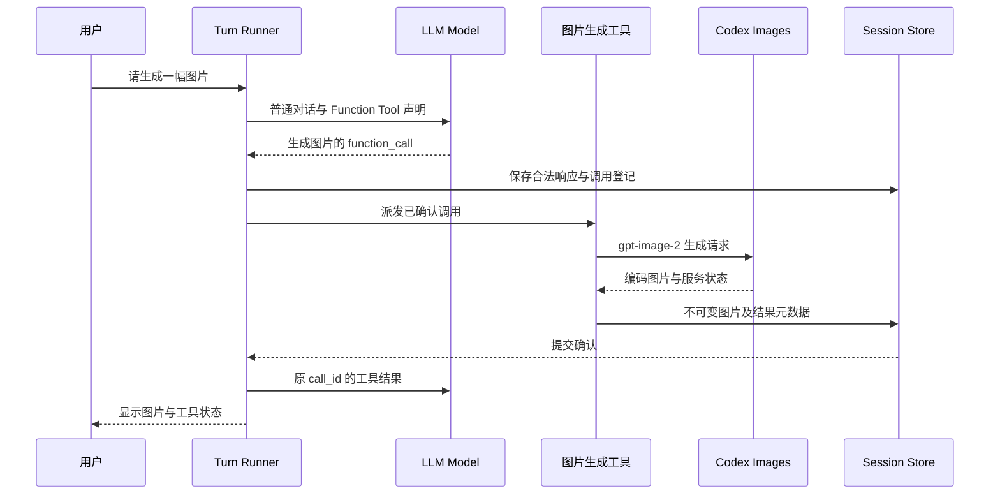

# 图片生成：普通 Agent 工具调用产生持久媒体结果

## 为什么不把图片生成塞进普通模型回复

已通过的实验调用 `https://chatgpt.com/backend-api/codex/images/generations`，指定 `gpt-image-2`，收到 HTTP 200 和可解码的 PNG；官方 Codex 也是通过独立的 Images 客户端执行 `gpt-image-2`，而不是让主聊天模型直接生成像素。

因此 Agentelier 应把图片生成当作**一个由主模型调用的本地 Function Tool**：模型仍通过原来的工具循环决定是否生成，工具内部按当前任务的 Codex 授权请求图像服务，然后将结果交给会话。这样不需要 SIWC 不支持的托管 `image_generation` 工具，也不会改变已经落地的 GPT-6 原生异步协议。

如果主模型与会话的工具契约允许异步，该调用可以沿现有异步任务机制跨 Turn 完成；如果实际返回同步调用，则遵循现有同步依赖屏障。图中没有另造“图片专用后台任务中心”。

## 工具做什么，不做什么

第一版只提供**文本提示生成一张图片**，目标图像模型固定为已验证的 `gpt-image-2`。调用输入至少包括生成描述；服务允许的尺寸、背景等选项可在确认实际兼容性后按需暴露，不能先照搬 OpenAI 普通 API 的全部参数。一次模型请求对应真实的一次生成结果，失败如实回传，避免因为认证或网络失败重复产生有副作用的结果。

工具执行前检查当前冻结来源确实是可访问 Images 的 Codex 授权；SIWC 来源下应让模型知道工具不可用或从目录中不声明，而不是先尝试一个已知会返回 401 的请求。生成过程中可以观察开始、完成、失败和取消状态；完成后必须取得能被真实解码的图片，HTTP 200 本身不是成功证明。

与 Codex 参考实现相比，本次不纳入图像编辑、参考图融合、GIF、多个候选结果、流式部分图、2.5/2.6 型号选择。那些是独立的可观察能力，不应因官方工具存在就一并移植。

## 原始图片与给模型看的图片不是同一个限额

当前 `view_image` 已有图片内容数组、摘要、不可变内存载荷和会话附件；它的规范化编码图像限额为单张 4 MiB、最大边 2048 像素，会话图片结果总量也有限制。**图片生成的原始产物不能直接假定适合这些限制。**

这里区分两种数据：

- **用户产物**：服务真实返回的完整编码文件，按原格式保存，不为适配模型上下文偷偷缩小或重编码；关联模型、提示、尺寸、内容摘要、所属会话/Turn、原 `call_id` 和生成完成状态。
- **模型回看材料**：如需要让主模型检查生成结果，再从已保存产物派生符合现有 `input_image`、请求 32 MiB 序列化预算与模型输入能力的有界图像；其损失不能反向覆盖原始产物。

原始产物与派生图像都必须以**文件内容快照**为准，不依赖随时可能变化的外部路径。Session Store 是结果的持久化所有者；本地文件引用不能在存档中退化成一段可丢失的文本路径，失败或取消也不能伪装成已生成产物。

因为生成图片可能占用大量存储，需要为此类附件设定明确的格式、大小和累积预算。具体上限应在本地真实结果与服务响应的基础上确定，不直接复用 `view_image` 的输入上限作为原图上限。

## 对话如何使用生成结果

用户说“生成一张白底红圆图片”后，模型调用工具；成功时聊天时间线保留本次调用的提示与状态，并在同一任务下展示可查看、可另存为的图片。即使用户随后关闭应用或外部图片路径被修改，恢复该会话仍能看到同一份已确认产物。

如果用户之后问“刚才生成的图片是什么”，模型可以在现有图像输入能力允许时使用结果的回看材料；只要求保存或打开图片时不必强迫模型再读取一遍。模型无法读取图像时，仍可说明生成状态及保存位置，不应宣称自己已经检查画面内容。

用户主动导出图片时才写入选定的外部路径。生成任务的自动保存进入应用数据目录；导出失败不破坏会话中已存的原图。界面只消费安全元数据与可显示资源引用，不把完整图片 Base64 放入普通日志或反射状态。

## 与现有模块的边界

`agentelier_tools` 提供 Function Tool 契约和结果语义，`agentelier_llm_model` 负责服务协议与错误分类，Account 交付冻结来源的可用凭据，Runtime/Turn Runner 管理任务与取消，Conversation 管理调用与结果身份，Session Store 保存附件，Bridge/Chat UI 展示状态和产物。没有必要新增总媒体 Agent Crate。

工具的最终成功条件是**合法函数调用、完整实际图片、持久保存确认、可恢复关联**四者同时成立；相关 GUI 变化使用 BRP 在真实应用中验证。
