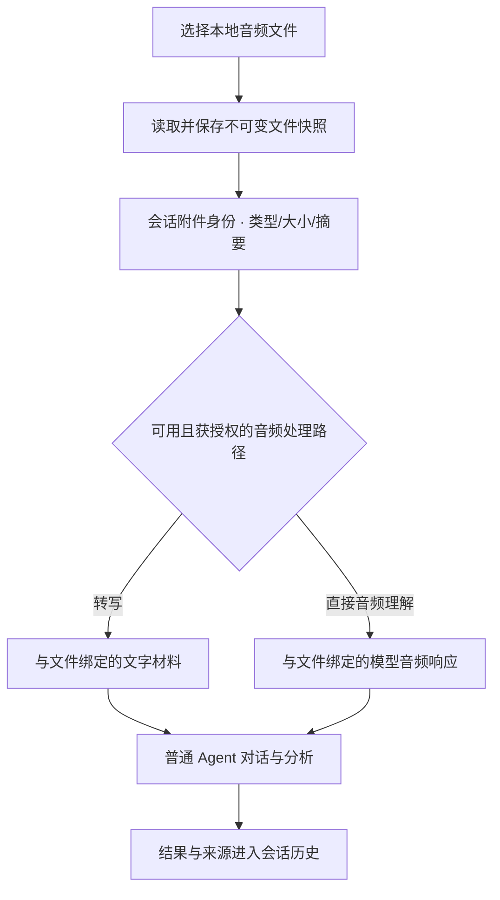

# 音频文件理解：先保留文件事实，再决定模型怎样听

## 文件理解与语音交互不是一件事

本次需求是：用户选取已经存在的音频文件，Agent 能够围绕文件做转写、内容总结和问答。它不是麦克风热键输入，不需要实时通话，不要求语音回复。把这些交互分开，音频文件可以沿用现有的会话附件、任务和文本回复体验。

图中的“转写”和“直接音频理解”不是已经同时可用的两个按钮，而是**两种不同能力边界**。语音转写足以支持会议、访谈、口头指令等文件的主题总结和问答；对于音乐、环境声、音色或语气，文字转写会丢失原始声学信息，必须有真正接受音频的模型路径才谈得上理解。

## 已知服务边界决定了不能直接照搬图片路线

迁移前的 SIWC 第三方授权公开限制排除了音频和视频输入、Files 上传 API 及转写 API。官方 Codex 的 `codex-rs` 已有 `InputAudio`、`LocalAudio`、工具音频结果载荷和转写请求实现。Agentelier 使用 Codex OAuth 调用音频服务的授权范围和可用性仍需实测。

对于完整音频文件理解，需要先明确其中一种能实际工作的处理路径：

- **经授权的 Codex 音频服务路径**：确认可用的音频输入模型或转写接口、上传格式和额度后，通过与模型请求同一执行身份发送。官方 Codex 中的 `/transcribe` 客户端代码是协议参考，不能只按函数存在就标为可用。
- **本地语音转写路径**：如果希望语音类文件在没有远端音频授权时仍可理解，可由本地转写模型生成有来源关联的文本，再交给当前 GPT 对话模型分析。具体模型、资源预算和离线支持策略**待确认**，不在设计中指定未讨论的模型。

两条路径的选择会决定“支持全部声学信息”还是“支持语音内容理解”。因此音频服务接入前必须明确目标行为；对于未得到授权的直接音频输入，界面显示不可用，不能冒充转写输出已经覆盖音频原貌。

## 为什么必须先固定文件快照

假设用户选择 `meeting.wav`，要求“总结会议的讨论事项”，然后把源文件覆盖成另一段录音。如果后续任务从原路径再次读取，模型可能在同一会话中分析两份不同的内容。

因此，文件选择器确认后先由 Agent 运行侧读取实际文件、核对格式与有界大小，并在 Session Store 中保存不可变音频附件。会话记录保存附件身份、原始文件名（仅用于展示）、MIME、内容摘要、尺寸或时长等可取得元数据以及所属输入/Turn。后续转写和提问都引用这份快照；不能因为文件路径仍然存在而重新解释其内容。

Widgetry FileDialog 显示 WAV 和 MP3 候选。后台按文件内容探测并解码音频，保存原始编码字节，单文件限制 20 MiB，同会话按摘要去重后累计限制 128 MiB。选择成功后先提交可恢复的草稿附件，下一次直接发送在同一 `Accepted` 记录中关联输入和附件；重试仍保留原输入附件。UI 只接收业务身份和显示元数据。格式、大小或存储失败由原草稿位展示，取消保留已有草稿。

## 从文件材料到模型回答

对语音类文件，首个可交付能力是转写。取得成功的完整文本后，将它作为**有来源的模型输入材料**提供给普通对话；Agent 再做总结、问答和提取。文本内容与原始音频附件要保留对应关系，不能把“转写文字”混同为用户亲自输入的事实。若服务仅返回文字，回答关于音色、背景噪音或说话情绪时应说明无足够声学依据。

对直接音频理解，只有在目标模型确实接收音频、服务端授权允许并能完成会话往返时，才构造音频输入材料。它与当前的 `input_image` 不同，必须独立保留正确的类型、容量、请求模式和错误语义。不能把音频简单 Base64 成字符串后放进普通 `input_text`。

音频输入或转写发生在已明确接纳的任务中。若它耗时较长，可复用现有原生异步工具调用和任务管理机制；若来源选择、用户取消或存档失败，按已有任务身份和保存回执停止续接，不能让未保存的结果自动进入下一次模型请求。

## 用户可观察的完成形态

文件选中后，聊天界面显示附件名称、类型、处理状态；转写成功后可以阅读文稿，并继续输入“总结重点”“列出待办”“这个人提到什么”等问题。恢复会话时，附件、文稿及已回答内容仍对应同一原始文件。源文件被移动、删除或覆盖不改变历史。

默认不增加录音控件、语音播放控制台、说话人实时头像、语音合成或麦克风权限。文件理解能力与未来麦克风 STT 不是同一实施目标；后者可以在需要时单独设计。

## 需要明确的能力边界

这次已有明确目标——音频文件可在会话中被分析；**尚未决定的是处理引擎和“声学理解”深度**。执行方案把这一前提放到真正需要发送音频或转写的增量中，要求使用实际授权与真实文件验证后选择服务路径，不因无法访问远端音频 API 而自动偷偷使用 API Key、切换账号或声称任务已完成。
