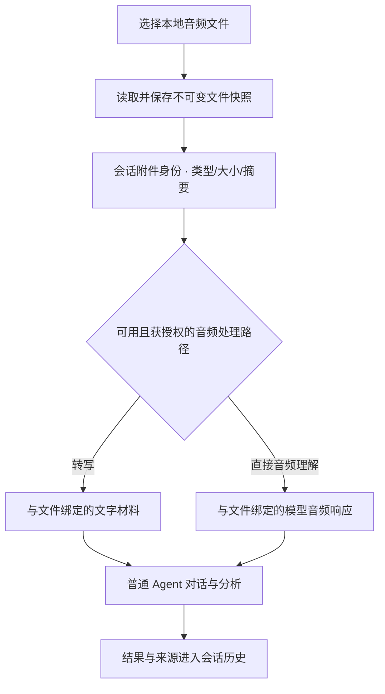

# 音频文件理解：先保留文件事实，再决定模型怎样听

## 文件理解与语音交互不是一件事

本次需求是：用户选取已经存在的音频文件，Agent 能够围绕文件做转写、内容总结和问答。它不是麦克风热键输入，不需要实时通话，不要求语音回复。把这些交互分开，音频文件可以沿用现有的会话附件、任务和文本回复体验。

图中的“转写”和“直接音频理解”不是已经同时可用的两个按钮，而是**两种不同能力边界**。语音转写足以支持会议、访谈、口头指令等文件的主题总结和问答；对于音乐、环境声、音色或语气，文字转写会丢失原始声学信息，必须有真正接受音频的模型路径才谈得上理解。

## 已知服务边界决定了不能直接照搬图片路线

迁移前的 SIWC 第三方授权公开限制排除了音频和视频输入、Files 上传 API 及转写 API。Agentelier 已用会话绑定的 Codex OAuth 工作区成功调用 `/backend-api/transcribe`，采用文件到文本路线。该路由依据[官方 Codex 客户端](https://github.com/openai/codex/blob/main/codex-rs/backend-client/src/client.rs)提交 multipart 文件并读取有界 JSON 文稿。

转写沿用当前凭据的授权边界。用户在音频卡片上发起或取消任务，Runtime 冻结会话账号与工作区，读取 Store 核对过的原件。请求只上传文件内容，转写结果无全文或响应不完整时以失败结束。已有文稿在账号来源变化后仍可从本地查看。

## 为什么必须先固定文件快照

假设用户选择 `meeting.wav`，要求“总结会议的讨论事项”，然后把源文件覆盖成另一段录音。如果后续任务从原路径再次读取，模型可能在同一会话中分析两份不同的内容。

因此，文件选择器确认后先由 Agent 运行侧读取实际文件、核对格式与有界大小，并在 Session Store 中保存不可变音频附件。会话记录保存附件身份、原始文件名（仅用于展示）、MIME、内容摘要、尺寸或时长等可取得元数据以及所属输入/Turn。后续转写和提问都引用这份快照；不能因为文件路径仍然存在而重新解释其内容。

Widgetry FileDialog 显示 WAV 和 MP3 候选。后台按文件内容探测并解码音频，保存原始编码字节，单文件限制 20 MiB，同会话按摘要去重后累计限制 128 MiB。选择成功后先提交可恢复的草稿附件，下一次直接发送在同一 `Accepted` 记录中关联输入和附件；重试仍保留原输入附件。UI 只接收业务身份和显示元数据。格式、大小或存储失败由原草稿位展示，取消保留已有草稿。

## 从文件材料到模型回答

对语音类文件，首个可交付能力是转写。取得成功的完整文本后，将它作为**有来源的模型输入材料**提供给普通对话；Agent 再做总结、问答和提取。文本内容与原始音频附件要保留对应关系，不能把“转写文字”混同为用户亲自输入的事实。若服务仅返回文字，回答关于音色、背景噪音或说话情绪时应说明无足够声学依据。

在附件卡片选用文稿后，下一条发送或排队消息冻结该版本。后续问题继续使用选定版本，用户可清除引用或从附件卡片选择最新的完整文稿。恢复时可从上一条用户消息继续其文稿引用。已经接纳的任务、待办和重试保持记录中的版本。

请求在固定材料区加入一项 developer 文稿材料，包含会话、原始附件、文件名、音频摘要、引擎、文稿版本和完整文字。文字作为引用数据提供，材料同时说明模型只能阅读文稿。请求投影保存材料位置及两个摘要，聊天历史只提交实际用户问题和模型输出。每次请求最多加入一份全文，并沿现有上下文计量、请求字节限额和压缩边界；压缩后的续接可以重新从已保存版本准备同一份材料。

对直接音频理解，只有在目标模型确实接收音频、服务端授权允许并能完成会话往返时，才构造音频输入材料。它与当前的 `input_image` 不同，必须独立保留正确的类型、容量、请求模式和错误语义。不能把音频简单 Base64 成字符串后放进普通 `input_text`。

转写在用户接纳后提交开始记录，在获得完整文稿、出现失败或取消后提交终态。记录关联文稿版本、引擎、附件身份与 SHA-256。缺少终态的开始记录重开时显示中断。会话最多接纳 64 次转写，单个编码请求沿用附件的 20 MiB 限制，响应上限为 64 KiB。重新转写生成新版本，附件卡片可查看和复制最近一次完成的文稿。

## 用户可观察的完成形态

文件选中后，聊天界面显示附件名称、类型、处理状态；转写成功后可以阅读文稿，并继续输入“总结重点”“列出待办”“这个人提到什么”等问题。恢复会话时，附件、文稿及已回答内容仍对应同一原始文件。源文件被移动、删除或覆盖不改变历史。

默认不增加录音控件、语音播放控制台、说话人实时头像、语音合成或麦克风权限。文件理解能力与未来麦克风 STT 不是同一实施目标；后者可以在需要时单独设计。

## 需要明确的能力边界

当前音频路径覆盖语音类文件的转写和文稿问答。直接音频理解仍需单独验证模型与授权。
