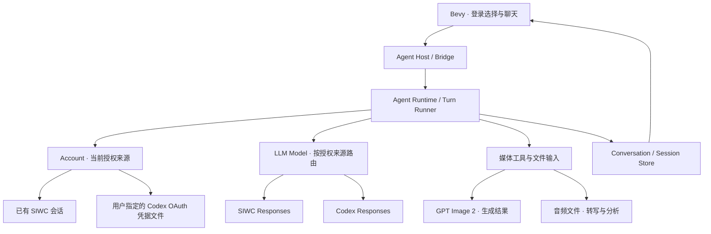

# 订阅认证与媒体能力：从既有执行链路出发

Agentelier 已经具备一个稳定的基本闭环：账号所有者交付凭据，LLM Model 生成冻结的 Responses 请求，Turn Runner 与会话所有者处理 Function Tool，Session Store 保存权威事件和不可变图片结果，Bridge 向 Bevy 界面投影安全状态。`gpt-6.2-sol` 的 `additional_tools` 与 `async: true` 已进入当前源码，不属于本次要重建的功能。

新需求首先改变的是**模型服务可以使用哪一种授权**，随后才改变模型可以调用的媒体能力。一次通过官方 Codex OAuth 凭据开展的独立实验，已经得到普通 Responses 回复、`gpt-image-2` 有效 PNG，以及 `gpt-6-astra` 跨回合异步工具结果交付；目前 Agentelier 本身仍以第三方 Sign in with ChatGPT（SIWC）及 `api.openai.com/v1` 为运行路径。

图中的两种授权来源**只允许显式选定一种参与当前执行**。图片生成依赖已经验证的 Codex 服务路径；音频文件的输入、转写和理解是独立流程，不能因图片生成功能成功而推定其服务授权也成立。账号切换、异步工具、媒体结果持久化继续服从同一会话所有者和存储确认边界。

## 从现有能力到新增能力

- **认证与模型路由**：为已有 SIWC 路径增加一条用户明确选择的 Codex OAuth 凭据来源。先采用已经验证过的本地 `auth.json` 只读方式；不把实验性文件导入自动解释成原生浏览器登录。
- **图片生成**：为 Agent 增加调用 `gpt-image-2` 的 Function Tool。生成的图片既是模型工具结果，也是可以在会话中查看、恢复和导出的持久媒体产物。
- **音频文件理解**：用户提供现成音频文件，Agent 得到与原文件绑定的内容材料并可进行转写、总结、问答。具体音频服务入口须先确认可用授权；声学分析与仅基于文稿的分析要区分。

这三块共享既有的执行、会话与 UI 架构，但不是三套新框架。它们的职责、数据流和需确定的边界分别放在：

1. [凭据来源与模型路由](01-authentication-and-routing.md)
2. [图片生成与结果归档](02-image-generation.md)
3. [音频文件进入会话并被理解](03-audio-file-understanding.md)

相关现状与上游参考汇总见 [来源](sources.md)。

## 已确定的范围

本次只包含登录方式、GPT Image 2 图片生成、音频文件理解。保留现有 GPT-6 原生异步工具系统，不重复开发；不引入麦克风输入、实时语音、语音回答、Computer Use、浏览器自动化、图片编辑或 GIF 生成。原有 SIWC 不自动转换为 Codex OAuth，也不对老会话静默改写工具契约。

实施与验收以 Windows x64 / DX12、Rust Workspace 和当前 Bevy/Widgetry/BRP 工程规则为准。新增界面行为使用实际应用与 BRP 验证，**不生成 Unit Test、Integration Test、Benchmark 或 Example 代码**。
