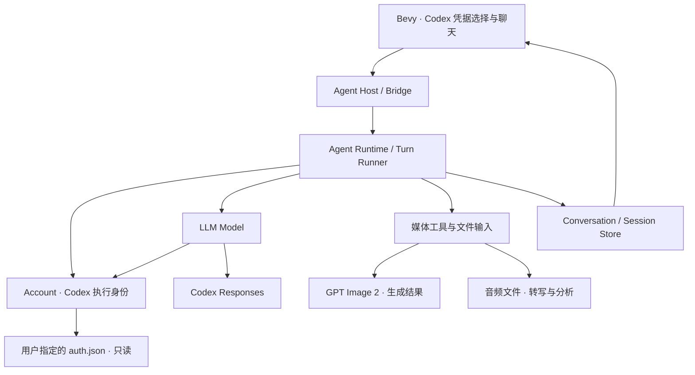

# 订阅认证与媒体能力：从既有执行链路出发

Agentelier 已经具备一个稳定的基本闭环：账号所有者交付凭据，LLM Model 生成冻结的 Responses 请求，Turn Runner 与会话所有者处理 Function Tool，Session Store 保存权威事件和不可变图片结果，Bridge 向 Bevy 界面投影安全状态。`gpt-6.2-sol` 的 `additional_tools` 与 `async: true` 已进入当前源码，不属于本次要重建的功能。

模型服务先从第三方 Sign in with ChatGPT（SIWC）迁移到 Codex OAuth，再接入媒体能力。独立实验已用官方 Codex OAuth 凭据取得普通 Responses 回复、`gpt-image-2` 有效 PNG，以及 `gpt-6-astra` 跨回合异步工具结果。当前应用按所选凭据提供 SIWC 或 Codex 的模型目录、连接验证与 HTTP 对话。新建 Codex `gpt-6-astra` 会话使用 Responses WebSocket 接入原生异步工具。下图是完成迁移后的目标结构。

SIWC 在过渡期继续服务现有任务。Codex 接替模型目录、多轮对话、凭据更新及同步和原生异步工具后，应用下线 SIWC 登录和请求路径，既有存档仍由 Session Store 恢复。图片生成使用已验证的 Codex Images 路径，音频服务授权需要独立确认。账号切换、异步工具和媒体结果持久化沿用同一会话所有者和存储确认边界。

## 从现有能力到新增能力

- **认证与模型路由**采用用户明确选择的本地 Codex `auth.json`。迁移结束后，它是应用唯一的登录来源，签发和更新仍归 Codex 客户端。
- **图片生成**：为 Agent 增加调用 `gpt-image-2` 的 Function Tool。生成的图片既是模型工具结果，也是可以在会话中查看、恢复和导出的持久媒体产物。
- **音频文件理解**：用户提供现成音频文件，Agent 得到与原文件绑定的内容材料并可进行转写、总结、问答。具体音频服务入口须先确认可用授权；声学分析与仅基于文稿的分析要区分。

这三块共享既有的执行、会话与 UI 架构，但不是三套新框架。它们的职责、数据流和需确定的边界分别放在：

1. [凭据来源与模型路由](01-authentication-and-routing.md)
2. [图片生成与结果归档](02-image-generation.md)
3. [音频文件进入会话并被理解](03-audio-file-understanding.md)

相关现状与上游参考汇总见 [来源](sources.md)。

## 已确定的范围

本次范围涵盖认证迁移、GPT Image 2 图片生成和音频文件理解。GPT-6 原生异步工具系统继续沿用，旧会话按保留的模型与工具契约恢复。旧 SIWC 凭据文件留在原位。麦克风输入、实时语音、语音回答、Computer Use、浏览器自动化、图片编辑和 GIF 生成留在本方案范围之外。

认证迁移与媒体接入的顺序见[实施总览](../../../plans/subscription-media/00-overview.md)。

实施与验收以 Windows x64 / DX12、Rust Workspace 和当前 Bevy/Widgetry/BRP 工程规则为准。新增界面行为使用实际应用与 BRP 验证，**不生成 Unit Test、Integration Test、Benchmark 或 Example 代码**。
