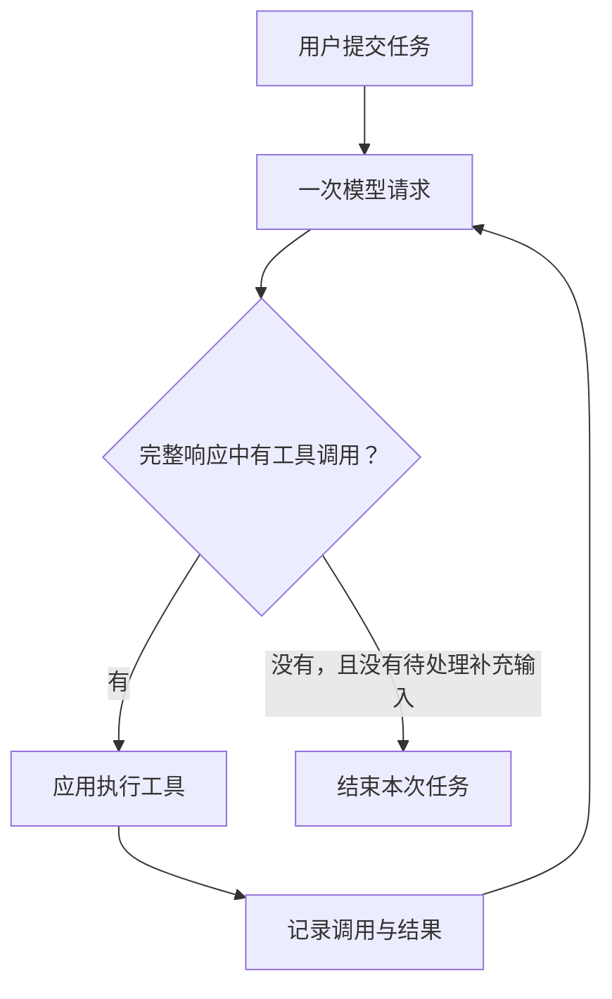
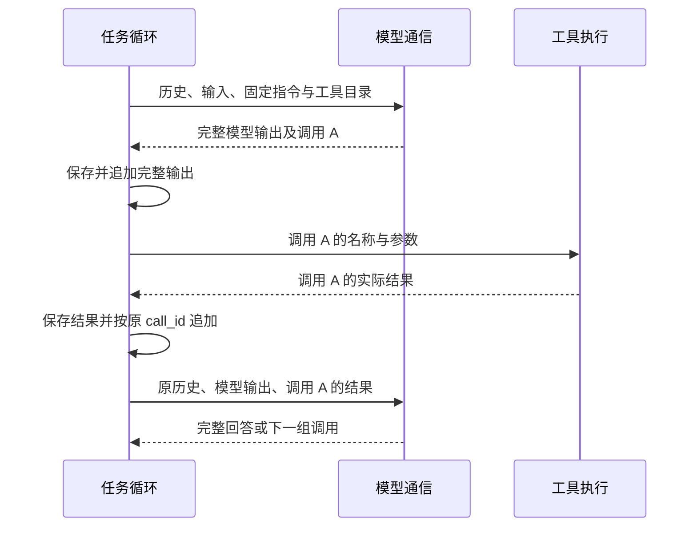
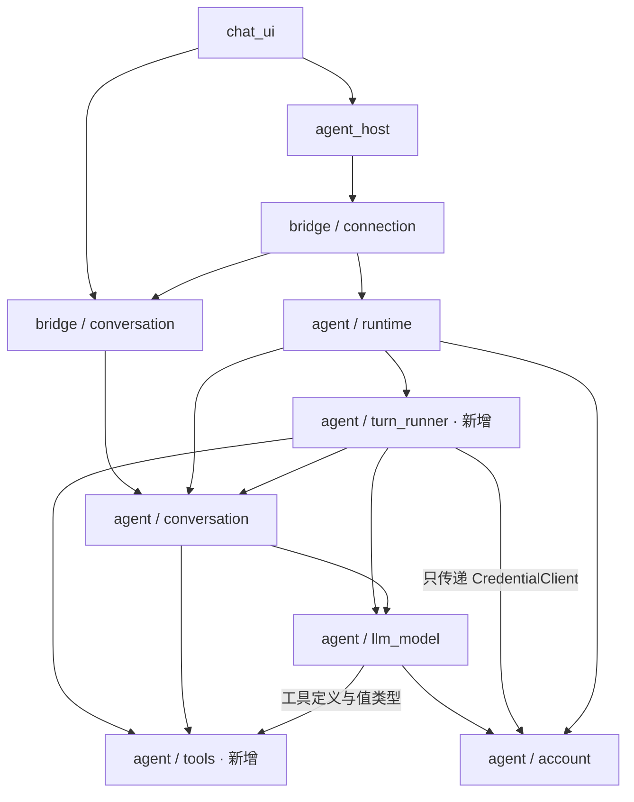
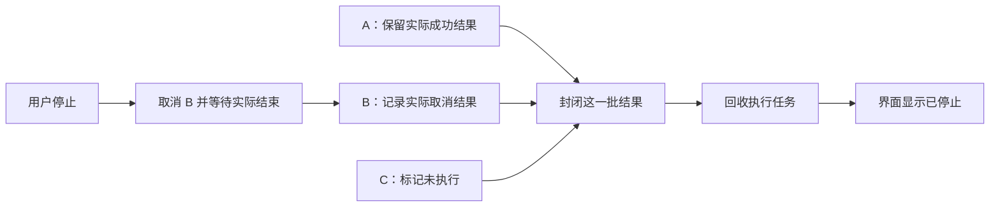
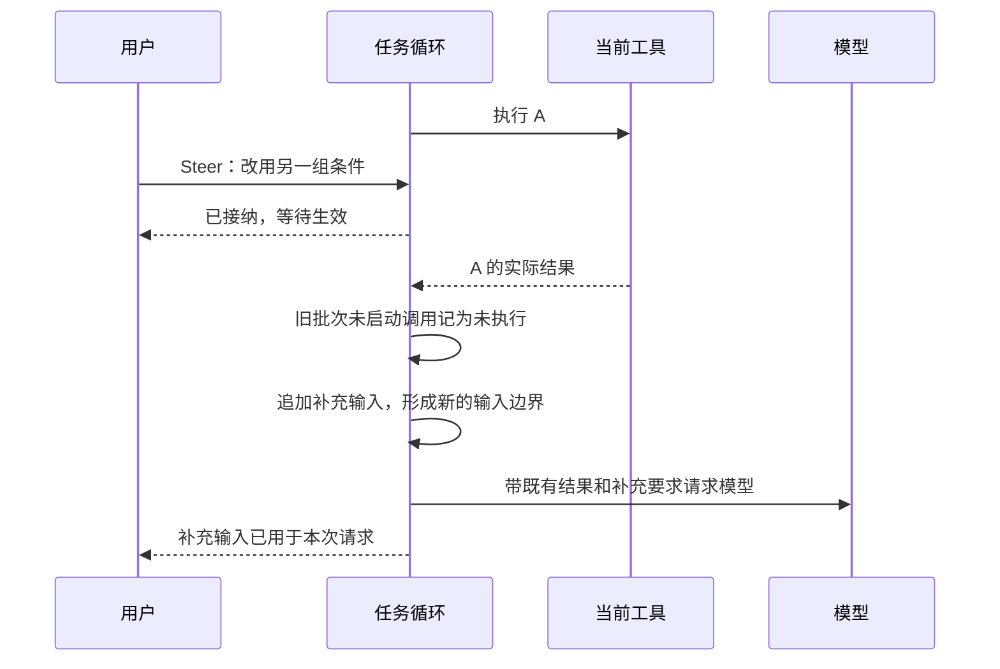

# Direct Mode 工具调用设计

工具调用把聊天推进到这样一个状态：用户提出任务，模型选择工具，应用执行并反馈结果，模型据此继续调用或结束；用户可以看见过程、停止任务，也可以补充当前要求或排队下一条消息。

这里始终使用 Direct Mode。先从一次工具调用理解这条链路，再展开连续调用、状态归属和运行中的用户控制。新增设计以两个后台职责为界：工具执行与任务循环；其余部分继续使用现有的会话、模型通信、Bridge 和界面。

## 从一次回答走到一个任务

`llm_model` 完成一次 Responses 请求，`conversation` 定义并保存会话历史，`turn_runner` 独占活动记录推进任务，`runtime` 等待任务真实回收后归还记录并通知界面结束。一个用户任务可以包含多次模型请求和工具执行。

工具调用多了一次往返。例如模型用 exec_command 执行一条本地命令，应用取得真实输出后还要把结果送回模型，第二次响应才给出答案。

因此要区分三件事：一次用户任务、任务中的一次模型请求、请求产生的一次工具调用。`response.completed` 只结束一次模型请求。只有工具结果已经处理、没有已接纳而待处理的补充输入，任务才可以结束。

普通聊天仍然走同一条路径：模型没有请求工具时，第一次完整响应就可以完成任务。正文、拒绝回答以及无正文完成状态继续按现有方式显示。

## 工具首先是一份可以执行的约定

模型需要知道工具的名称、用途和参数格式；应用需要知道如何按这个名称找到实际实现。这两份信息放在同一份工具登记中，避免“模型看得见，但应用没有实现”的情况。

本阶段采用固定工具集合。新建会话时取得一份只读目录快照，后续模型请求和执行分发使用同一份目录。准备区变化不修改已有会话的模型、指令或工具集合。重复工具名在目录建立时作为配置错误处理。

工具定义包含名称、描述与 JSON 参数 schema。这里采用 `strict=true`，对象关闭额外字段，并把声明的输入字段列入 `required`；具体工具仍负责把参数解码成自身输入，检查类型、未知字段、数值范围和业务条件。只需要一个名称到实现的查找入口，不另外建立多层 Router、Registry、Orchestrator，也不引入插件发现、动态加载或通用 schema 解释器。

### 四个本地开发工具

新会话只登记以下四项，旧的计算和等待诊断工具已删除；旧名称按普通未知工具返回错误，没有隐藏别名。

| 工具 | 职责 |
| --- | --- |
| exec_command | 在固定会话目录或明确 workdir 启动 PowerShell 7，返回退出结果或可继续控制的进程 ID |
| write_stdin | 对同一会话的有效进程写入 stdin、读取新输出、EOF 或终止并回收 |
| apply_patch | 通过严格 JSON 接收文本补丁，完整准备后逐文件提交并保留实际变化日志 |
| view_image | 读取静态 PNG/JPEG，保存不可变图像并通过结构化工具结果交给模型 |
| computer_execute | 通过 Rhai 操作 Windows 桌面，复用会话内脚本状态，支持 UI Automation 根元素和有界树遍历，返回文本和可选的最后一张截图 |

目录仍在会话创建时固定，模型声明与执行查找共用同一份定义。工作目录是路径基准，不构成沙箱。工具参数、取消、调用身份、批次处理、历史封闭和资源回收不随诊断退役改变。

## 从响应中取得调用，而不是从正文里找代码

Direct Mode 使用 Responses 的结构化 `function_call`。`llm_model` 在现有请求中附上工具定义，保留 `store=false`、流式输出、固定会话指令和加密 reasoning 续接方式。常规请求使用自动工具选择，不强制每个问题都调用工具。

本阶段只接入 JSON 参数的 function tools。`custom_tool_call`、程序执行项、模型正文中的 JavaScript，以及工具发现、托管工具等类型不进入本地执行路径；遇到不支持的协议输出时明确结束该次请求。

### 完整响应是执行边界

正文仍然增量显示，工具名称和参数片段也可以更新同一条“接收中”记录。真正执行要等到合法的 `response.completed`，并完成输出身份、调用结构和 reasoning 续接数据检查。

`output_item.done` 与最终 `output` 是同一次调用的不同观察时刻。两者的完整参数、namespace 和异步模式必须一致，相同完成事件合并为一次调用。连接中断或响应未完成时，已经展示的调用保持“未执行”。完整响应经持久确认后才允许执行工具。

这是有意保留现有“完整输出校准”的做法。它比收到一个工具项就提前执行更容易解释断流和取消，也适合当前最小范围。

每次调用同时保留模型输出项 ID 与 `call_id`。前者识别输出项，后者关联执行结果。界面身份还包含会话、任务和模型请求序号：第二次请求的 `output_index=0` 不会覆盖第一次请求的第一个消息。

完整调用缺失名称或 `call_id`、身份冲突、同一会话重复使用已接纳的 `call_id`，都属于协议错误。它们在新工具执行前结束本次任务。同名工具可以使用不同 `call_id` 发起多次调用。

### 当前模型的兼容性在哪里确认

历史 SIWC 会话的 `additional_tools` 声明保存在请求记录中。Codex 新建 `gpt-6-astra` 会话通过 Responses WebSocket 的顶层 `tools` 提供同一类冻结目录。`exec_command`、`view_image`、`search_memory` 和 `read_memory` 声明 `async: true`。补丁、进程输入和记忆修改保持同步，已适配的 MCP 调用可以声明异步并使用独占许可。Extension 默认按同步声明，提供者可以显式声明异步资格。其他 Codex 模型及已保存的 Codex 平铺会话使用同步声明。运行时使用完整调用返回的模式和已登记的并发策略，下一请求只等待同步调用的结果；较早启动的异步调用可以继续执行。

首先使用当前选中的模型和已有账号，在真实应用中确认“声明工具 → 返回 function_call → 接收 function_call_output → 继续回答”成立。模型目录里的 `code_mode_only` 记录不替代这次验证。

如果实际服务拒绝该工具协议，应显示原始错误类别和请求标识，保留普通聊天能力，并停止把该组合视为已验证的工具模式。不要自动加入 JS 环境、改用 Code Mode、换模型或换登录方式。

新原生目录提供同步 `list_async_tasks`、`wait_for_tasks` 与 `cancel_async_tasks`。列表每页最多 64 项，返回真实任务 ID、来源、安全参数大小与保存和交付状态。等待对明确 ID 集合使用 `any` 或 `all`，最长 30 秒。后台调用的结果通过原 `call_id` 入史，随后才保存等待的状态报告。控制路径与普通工具资源准入独立。取消按请求冻结时的任务范围接纳，返回已请求、重复或已结束的状态，工具本身通过自己的终态确认实际结果。

## 工具结果怎样进入下一次请求

`llm_model` 负责协议项的序列化，工具库只返回业务结果。结果通过 `function_call_output` 携带对应 `call_id`，普通文本结果使用有界 JSON 字符串表示成功数据或错误；图片结果使用包含 input_text 与 input_image 的内容数组，不序列化为嵌套 JSON 字符串。

完整模型输出和每个已保存的工具结果分别追加到历史。下一次请求冻结历史范围、本轮输入和所含工具结果集合。公开消息保留阶段及顺序，加密 reasoning 项保留在协议历史。每次请求单独注入固定指令。

工具的普通失败也可以作为结果。未知工具、参数 JSON 无效、参数范围错误、补丁匹配错误、图片读取错误和工具截止都有稳定的错误类别与可读说明。模型可以修正要求，发出一个新 `call_id` 的调用；应用本身不自动重放失败工具。

模型通信失败、历史关系损坏或执行任务异常结束属于任务失败，不能伪装成工具的正常业务结果继续循环。

## 多工具是一个有序批次

一次响应可以提出多个工具调用，先持久确认响应与任务登记，再按冻结契约准入。Runtime 最多运行 8 个普通工具。应用登记的异步只读操作共享许可，shell、修改文件和未知副作用使用独占许可。普通调用按响应顺序等待许可，实际开始前另行确认开始记录。

例如一个响应中有 A、B、C 三个调用，应用先取得 A 的结果，再执行 B、C，然后一次性把这一批结果交给下一次模型请求。返回结果按调用关联，不依赖完成时间猜测归属。

同批调用的参数已经由同一次模型响应确定。B 不会自动使用 A 的结果；需要根据 A 的返回值决定 B 参数时，应由下一次模型请求作出决定。

MCP 调用使用冻结的来源和工具契约匹配当前连接。请求标识由 SDK 关联，工具结果仍用模型 call_id 封闭。Stop 至多等待有界的取消通知发送，连接继续服务其他任务；实际收到的结果按原状态保存。

工具普通错误不阻止同批剩余调用。用户停止、待处理 Steer 或任务预算耗尽可以阻止尚未开始的调用，此时仍给这些调用补上明确的“未执行”结果，保持协议完整。

当前请求使用 `parallel_tool_calls=true` 允许多项输出。运行中的 shell 持独占许可直到整个进程组确认回收且退出记录提交。原进程控制通过专用入口推进。会话有八个运行或未消费的退出登记，查询保留进程来源、阻塞、退出码和截断标记。任务停止可以取消等待准入的调用；终止可以打断同一进程的在途轮询。执行句柄由会话 Runtime 回收，结果由 Conversation 保存并按原调用追加。正常 final 可释放原生会话的前台，旧资源继续由会话收尾。开放调用按执行器的有界结果预留文本、协议封装和可能的图片空间。已取得的结果接管同一份占用，历史图片按附件摘要去重。候选响应和用户材料必须通过余量检查。

## 让每个 crate 只承担自己的职责

后台分开模型通信、会话业务和 Tokio 运行生命周期。工具执行与任务循环由两个 crate 承担：`crates/agent/tools/` 与 `crates/agent/turn_runner/`。两者都有当前必须承担的完整职责，不为未来 Code Mode、MCP 或沙箱创建空接口。

| 位置 | 本阶段职责 |
| --- | --- |
| `agent/tools`，`agentelier_tools` | 冻结的工具登记、输入校验、内置执行器、会话准入、进程资源、可取消执行和业务结果 |
| `agent/turn_runner`，`agentelier_turn_runner` | 推进一个用户任务中的模型请求、工具批次、结果反馈、预算及 Steer 生效 |
| `agent/conversation` | 定义会话、任务记录、协议历史提交规则、稳定身份和会话待办队列 |
| `agent/llm_model` | Responses/SSE 编解码、工具协议项、单次请求和服务错误；不执行工具 |
| `agent/runtime` | 拥有 Tokio 线程和任务句柄，交付控制命令，取消与回收；不实现 Agent 循环或工具细节 |
| `bridge/conversation` | 转换请求、控制回执和安全展示数据，不持有会话或队列权威 |
| `bridge/connection` | 关联操作身份、传递命令与事件、合并进度快照和唤醒，不判断任务下一步 |
| `ui/agent_host` | 继续管理唯一 Connection 与 Winit 唤醒，不另开工具连接 |
| `ui/chat_ui` | 输入、工具记录、补充输入和排队消息的展示与交互；内部按主题分 module |
| `ui/application`、`app` | 保持宿主装配和程序入口职责，不承接工具业务 |

下面的箭头表示 Cargo 依赖，不表示某一次工具执行的先后顺序。

模型、指令、账号身份继续使用会话快照。`account` 持有 Codex 来源和执行身份，`login` 只读解析凭据。工具库不依赖账号、模型通信、运行宿主、Bridge 或 Bevy。

### 谁拥有运行中的记录

`Conversation` 持续持有会话历史、展示状态、Queue 和工具任务登记。Runner 通过 Runtime 在当前 Turn 的借用边界内读取或更新局部状态。模型等待只持冻结的请求，工具等待只持该次执行所需的上下文。

Runner 提交记录意图并等待 Store 回执。原生异步调用的稳定任务 ID 与完整响应一起保存，确认后才发布和派发。每个结果独立保存，以原 `call_id` 在请求边界按保存序号追加。模型给出 final 后，Runner 在本地继续回收剩余工作，Runtime 回收 Runner 后提交并发布终态。

这样会话业务类型仍由 `conversation` 定义，执行算法归 `turn_runner`，线程与 JoinHandle 归 `runtime`。不会因为拆了 crate，反而出现多个“谁说了算”的状态副本。

模型请求、工具等待和循环仍运行在现有 Tokio 环境中。Widgetry JobManager 继续服务应用辅助工作，不承担 Agent 工具任务；也不新增 JS 子进程或第二套 Runtime。

## 停止任务时，已经发生的事要留下

现有纯聊天在失败或取消时不提交当前输入和部分回答。工具任务不能一律这样处理：工具已经执行过，即使下一次模型请求失败，这个结果也应进入后续上下文。

完整合法响应持久确认后进入历史。随后每个工具结果单独确认并关联原调用。当前任务的原始用户输入只在首次接纳完整响应时写入一次，已经随 Steer 保存的输入保持原位置。

生成中的片段只用于展示。取消或断流时，当前未完成模型响应不进入协议历史；此前封闭步骤继续保留。没有形成提交点、也没有应用 Steer 的纯聊天失败，仍维持原有重试与历史行为。

### 一批调用执行到一半时停止

假设 A 已完成、B 正在等待、C 尚未开始：

已经确认完成的工具结果不被迟来的停止改成失败。没有开始的调用不会再启动。停止收尾过程中不发起新的模型请求，但要保留成功、取消和未执行结果对应的 `call_id`。

单次模型连接验证可以在外层取消网络 Future。Agent 任务由 Runner 接收取消信号并完成上述收尾，Runtime 在等待真实结束与回收期间继续处理记录回执。

这套设计不提供回滚。当前 exec_command 已可产生文件或进程副作用；停止会回收所属进程树，但保留已发生的文件变化。

### 重试不等于重新执行整个任务

最近失败或取消的任务，如果尚未形成提交点、也未应用任何 Steer，可以继续使用现有“重试原输入”。

已有提交点的任务不显示原样重试入口。已完成的历史留下来，用户发送新消息继续。这样不会把已经成功执行的工具再自动执行一次，也不新增分支回滚、断点恢复或自动续跑体系。

若运行任务异常退出，无法取得可封闭的活动记录，则显示任务失败并暂停该会话的继续执行，要求重置或新建会话；不猜测调用结果。普通可处理错误与用户停止必须走正常收尾路径。

## 用户怎样看见工具过程

聊天区域继续使用同一个有序内容流。助手正文保留 `commentary`、`final_answer` 等公开阶段，工具调用使用独立的工具记录，不拼成假助手消息。

工具记录显示名称、简短参数摘要、运行状态和结果摘要，可展开查看本次有界参数与结果。状态从“接收中”进入“待执行”“执行中”，再到成功、失败、超时、取消或未执行。临时状态可以被更新合并，最终结果与身份不能丢失。

任务状态单独表达“请求模型”“执行工具”“正在停止”和最终完成、失败、停止或触限。任务内部多次模型响应不会反复触发整轮完成。

每条记录使用稳定的任务、请求及输出项身份更新。切换设置页不取消任务；返回后恢复记录与阅读位置。向上阅读时不被新输出强制拉回底部，输入框不随工具更新重建。

现有“会话与请求核对”增加工具目录名称、模型请求序号、调用与结果的对应关系，以及哪些步骤已经保留。这里只展示必要的运行事实，不增加工具管理后台、调度看板或性能面板。

界面结构使用 BSN；运行状态保存到持久 ECS 组件或资源。TextField 通过 Widgetry 的公开正文 API 更新，不直接修改内部 Editor，也不在生成期间禁用整个输入框。

### 展示通道与控制通道分开

累计快照继续承载正文与工具记录，Bridge 可以替换过时的进度快照。开始、输入接纳、任务结束等回执走可靠事件路径。最终状态之前先交付最终快照。

Stop 保留独立的取消路径，不能被正文更新或输入队列占满挡住。Steer 和 Queue 是活动会话上的控制命令，不使用原本要求全局空闲的普通发送入口；但也不因此开放并行模型任务、并行账号操作或第二个活动会话。

日志使用现有宿主的 `tracing`：记录安全身份、工具名、阶段、耗时和错误类别。原始输入、完整工具参数与结果、模型正文、Token 和加密 reasoning 不进入日志。日志不替代业务事件或界面状态，临时 TRACE 在交付前移除。

## 补充当前任务：Steer

Steer 是把新要求交给当前任务，而不是另起一个任务。界面先确认输入已接纳，再在实际加入下一次模型请求时显示已生效。

本阶段采用步骤边界接纳：正在进行的模型请求或工具执行先取得终态；Runner 在开始下一项工具、下一次模型请求或结束任务前检查待处理输入。它不修改已经发送的 HTTP 请求，也不把“已接纳”显示成模型已经读到。等待模型或工具期间，Runner 仍接收控制消息并及时给出接纳回执；只把要求的实际应用延后到边界。Stop 使用独立路径，始终可以请求取消当前执行。

如果此时还有旧响应产生、尚未启动的工具调用，这些调用标为“因补充输入未执行”，并补齐对应结果。当前执行中的工具自然结束，Stop 仍可主动取消它。随后把补充消息按接纳顺序追加为用户输入，再请求模型依据新要求继续。

补充输入首次真正用于请求时，相关用户输入保留在任务记录和可重放历史中；后续网络失败不会悄悄丢掉已经应用的要求。补充输入不改变会话设置，不重置任务预算。

任务结束与 Steer 接纳由同一执行所有者裁定。任务已经结束时，迟到的 Steer 被拒绝，草稿保留；不自动转换成普通发送或 Queue。停止、账号变化等导致已接纳输入来不及应用时，消息保留为“未生效”，不自动执行。

运行中主发送按钮改为“补充当前任务”，Enter 与它保持一致。Shift+Enter 继续换行，IME 提交帧不触发发送。只有接纳成功且草稿尚未继续编辑，才清除原草稿。

## 接着做下一件事：Queue

Queue 保存尚未开始的用户输入，不改变当前任务。它属于当前内存会话，采用 FIFO 顺序，每条消息有独立输入身份。

排队条目在输入区附近单独显示，支持移除尚未开始的条目。只有正式启动时，才进入聊天记录和模型历史。当前任务正常完成并且 JoinHandle 已回收后，Runtime 按 `Conversation` 的队列状态启动下一条；仍然只有一个活动任务。

失败、用户停止或预算触限会暂停队列。剩余条目保留，界面显示“继续队列”；用户明确继续后才启动下一条。运行任务里的普通工具错误若已反馈给模型，并最终得到正常完成结果，不会单独暂停队列。

队列暂停期间可以发送普通消息检查当前问题，这次对话完成后队列仍保持暂停，只有明确点击“继续队列”才恢复自动推进。已有自动出队决定不会被迟到的普通发送插队；这次发送按忙状态拒绝并保留草稿。

新建或重置会话时，现有记录确认同时说明将清空待办消息；取消确认保留全部内容。账号主体或工作区变化暂停队列并保留旧会话和已提交结果。关闭应用不自动执行剩余消息；本阶段不持久化会话或队列。

现有 `Connection` 统一分配 `operation_id`。排队接纳时先预留未来任务的操作身份，但不占用当前任务槽；正式出队时 Runtime 使用这个身份启动，Connection 通过开始回执更新活动操作。接纳被拒绝时预留身份可以作废，不再复用。不要另设一套后台操作 ID 分配器。旧任务结束与新任务开始事件保持顺序，迟到的旧终态只匹配旧身份。

队列自动出队、移除条目、Stop 和新输入由执行侧串行决定。若移除时条目已经启动，界面明确说明已经开始，并提供现有停止操作，不把它同时当作已移除。排队期间编辑的新草稿继续保留。

Queue 使用明确的“排队”按钮，Tab 保持通常的焦点导航。不会因为按一次 Enter，悄悄把补充要求变成未来任务。

## 用少量边界结束失控循环

本阶段采用集中定义的内部上限，不新增一套限额设置界面：每个任务最多 32 次模型请求、64 次工具调用；补丁与图片采用 15 秒协作式截止，命令使用 0–30000 毫秒等待窗口及持续进程会话；单次工具参数及文字结果各最多 64 KiB，图片另有载荷及完整请求预算；待处理 Steer 与 Queue 各最多 8 条。

这些是本方案选定的初始运行边界，不是从 Codex 继承的默认值。模型流沿用现有 15 秒连接期限、120 秒空闲期限、4 MiB 单事件和 16 MiB 总流限制，不增加固定的整段生成总时长。

每次被接纳的工具调用都计入预算，包括返回业务错误的调用。整批调用超出剩余额度时，不执行该批，给各项写入明确的触限未执行结果，封闭步骤后终止。到达模型请求上限时，不发送下一次请求。Steer 不刷新预算，Queue 启动新任务才使用新的预算。

每会话另有 64 个异步任务交付名额。完整响应确认上一冻结请求中的结果后释放对应名额，再按本响应的调用顺序登记新任务。超出会话交付额度的异步调用产生明确的未执行结果。

参数超限不进入工具；结果超限转换为有界的结果超限错误，不把截断的 JSON 当作完整成功结果。等待达到工具期限时，结束并回收当前执行，再把超时作为工具结果交给模型。通道关闭、身份损坏等执行故障则结束任务。

新增命令通道保持有界；队列满时明确拒绝并保留草稿，不丢弃旧条目。控制命令回执不复用可合并的正文快照。

## 验证跟着真实功能一起完成

工程规则允许实际应用运行、静态检查、调试器和 BRP 自动化，不允许编写或维护 Unit Test、Integration Test、Regression Test、Benchmark、Example 或专门测试基础设施。本阶段按这个边界验证。

### 看见真实的工具往返

在当前账号和数据目录下启动真实应用，重新创建只含四项工具的会话，核对请求声明与界面目录。使用真实命令、补丁和图片检查返回的名称、参数、call_id、执行事实及下一次请求项；结果身份由协议和执行记录核对，不依赖模型最后一句宣告成功。

连续调用用前一次结果决定后一次参数；同批多调用则观察一份完整响应里出现多个不同 `call_id`。模型分成两次响应完成两个工具，不计作同批多调用已经验证。

普通问题应允许直接回答，不为了验收强迫所有消息都使用工具。当前账号或模型不支持 Direct 时，记录实际错误；不以开发工具自身调用成功代替应用链路。

### 看见异常与控制发生的时刻

用 exec_command 的真实持续进程产生可操作的执行窗口，验证停止、超时、生成中补充要求以及连续排队。停止后继续问“刚才已经完成了哪些步骤”，检查模型获得的历史与工具记录一致。

参数业务错误可用无效工作目录、未知进程会话、补丁上下文或图片格式实际触发。畸形 JSON、未知名称、重复调用 ID、断流等无法稳定由正常模型产生的分支，可以在真实进程的调试边界对该次输入或网络进行受控故障注入，再继续实际解析或分发。记录这是调试注入证据，不声称服务真实生成了该错误。不得为这些场景另外编写脚本化模型服务、测试宿主或持久化回归程序。

GUI 验证使用 `bevy_brp_mcp` 操作实际应用：先建立焦点，再输入与点击，结合截图、ECS 安全投影和日志检查状态。BRP 是开发者控制应用的通道，不作为本阶段模型可调用的 MCP 工具。

建立焦点后通过标准 BRP `send_keys` 验证特殊按键和快捷键。原生 IME 行为另外实机检查。完成后释放 Custom Pointer 并确认 `inactive`，正常关闭应用。

验证中保护现有凭据和数据目录，不退出登录、重新授权或换账号。更新职责、依赖、生命周期或重要契约时，同步 `docs/design/architecture.md` 和相关模块、机制设计；方案仍留在 `plans/`，实现完成后才更新当前设计事实。不另建 Feature 文档或功能说明层。

### 增量实施与当前边界

独立运行器、单工具往返、多步循环、同批串行、工具展示、Steer 和 Queue 按[实施方案](<../../plans/Agent 工具调用/00-overview.md>)依次接入。早期增量的两次请求/一次工具上限属于实施阶段边界，当前完整任务采用上述 32 次模型请求与 64 次工具调用预算。

每项增量使用实际应用完成相关行为检查；会话与执行边界见[内存会话与协议历史](modules/conversation.md)，当前模块关系见[总体架构](architecture.md)。

## 本阶段到哪里为止

完成工具注册与描述、结构化调用识别、分发执行、结果反馈、任务循环、运行状态、错误与中断、多工具调用、Steer 和 Queue。

完整审批策略、沙箱、权限升级重试、工具并行、工具动态发现、Code Mode、JS 运行环境、MCP 接入、Skills、多 Agent、长期记忆、上下文压缩和会话持久化均不在这里加入。当前已接入 exec_command 与 write_stdin 的任务级进程会话，读取、搜索与 Git 可由命令完成；补丁和图像工具仍待后续增量。

`bevy_widgetry` 提供 UI 控件和公开状态操作，`bevy_brp` 提供运行验证通道；本次不修改这些库，也不复制它们的控件或测试体系。继续使用当前锁定的依赖组合，不因引用外部文档而升级 Bevy 或上游库。

新增库按现有 Workspace 管理依赖和 lint，使用 Windows x64 编译检查；执行环境为 PowerShell 7。`lib.rs` 只作模块声明与出口，内部按真实职责拆 module，不把全部工具、循环和界面塞进一个 crate，也不为每一个错误或按钮建立新库。

## 本地图像结果

view_image 接收唯一必填 path，按会话目录解释相对路径，按真实字节确认静态 PNG/JPEG。Tools 在可回收阻塞工作中限制原始文件 10 MiB、2500 万像素、发送最长边 2048 和单图编码 4 MiB；保存原始/发送尺寸、格式、源及发送内容 SHA256。图片不可变载荷经 ActiveTurn 封闭至协议历史，UI 只有摘要。会话图片累计 16 MiB、完整序列化请求 32 MiB，超限明确失败，不截断或自动删除旧图。机制见[图像结果](local-development-tools/04-image-results.md)。
