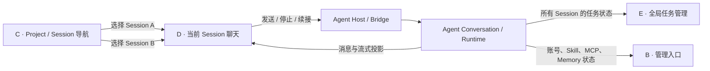
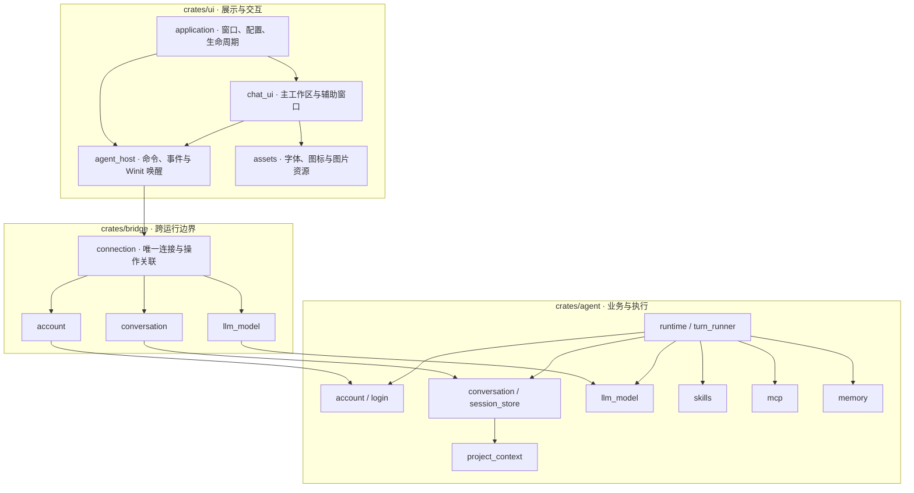
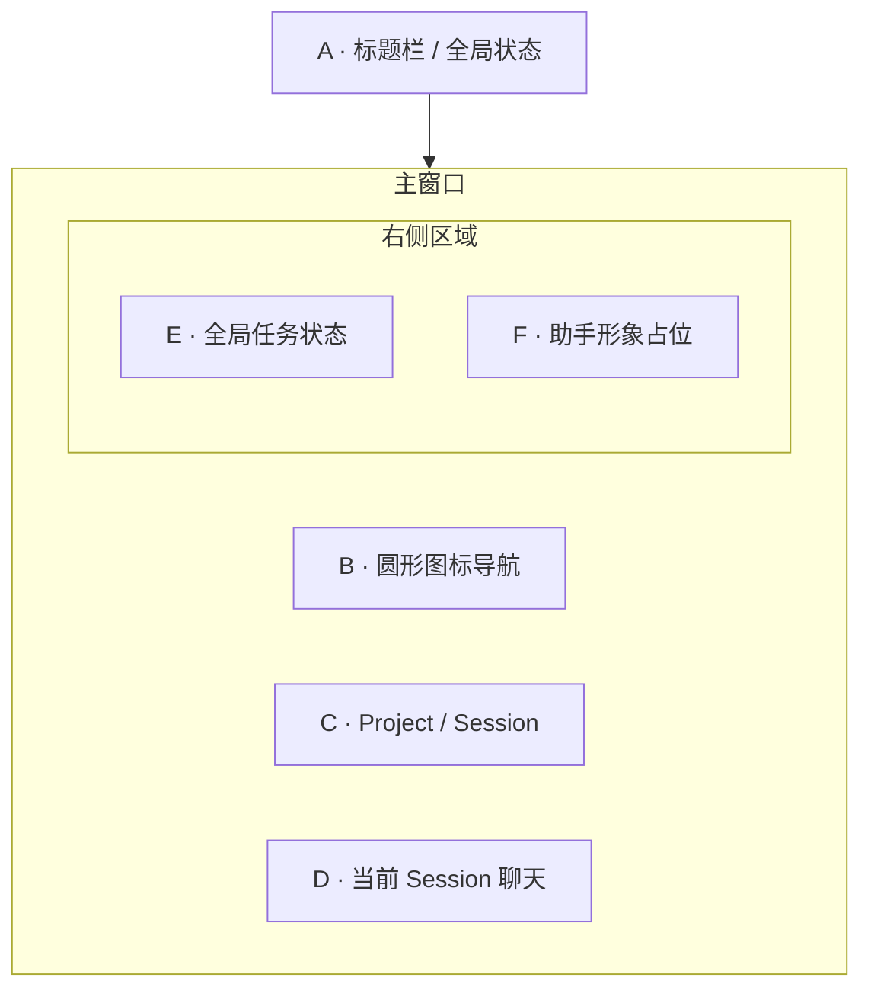
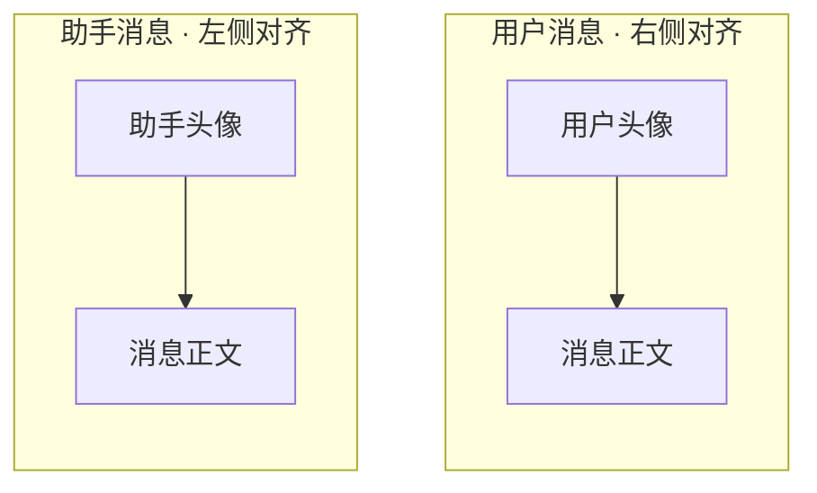

# Agentelier 主窗口与交互体系

Agentelier 的主要工作方式，是在多个 Session 之间持续推进不同主题的工作。用户需要能快速找到某段会话、继续与助手交流，同时又不因为切换聊天而失去对其他后台工作的观察。因此主窗口围绕三个相互配合的部分组织：C 选择当前 Session，D 展示并操作这段 Session，E 观察所有 Session 的后台任务。

Project 为相关 Session 提供组织关系和默认工作目录；它不替代 Session，也不接管项目上下文。B 区集中放置低频管理入口，F 区暂时保留空白。辅助窗口继续使用同一套 Agentelier 控件和 Widgetry 基础能力，不发展成另一套独立工作台。

## 从一个工作场景理解主窗口

假设用户正在 `Agentelier` 项目中讨论 UI 设计，同时另一个 Session 正在执行代码修改。用户在 C 区切换到代码修改 Session 时，D 区应切换到那段会话；原来的后台任务仍然继续运行，E 区仍然同时展示两个 Session 的任务。切回 UI 设计 Session 时，D 区恢复它自己的聊天记录、草稿、模型设置和阅读位置。

C 和 D 共享“当前 Session”这一选择，但 E 不属于当前聊天的附属面板。E 的数据范围始终是全部 Session；用户切换 C 时，E 只更新当前 Session 的轻量标记，不改变任务列表范围。

## 整个应用仍由原有三层协作

UI 负责呈现和收集用户意图，Agent 负责业务事实和执行，Bridge 负责跨运行边界的消息转换与唤醒。主窗口改造不会把任务、会话或记忆的所有权搬进 Bevy ECS。

现有职责继续成立：

- `crates/ui/application` 管理通用应用配置、窗口和插件装配、诊断及整体生命周期。
- `crates/ui/chat_ui` 管理聊天工作区、模型准备、输入和展示投影；它不持有会话历史或执行线程。
- `crates/ui/login_ui` 管理账号界面及其 Bevy / Bridge 衔接。
- `crates/ui/agent_host` 持有共享执行连接、命令投递、业务消息分发和 Winit 唤醒。
- `crates/ui/assets` 统一注册字体、图标和图片资源。
- `crates/agent/conversation` 管理 Session 设置快照、Turn、协议历史和任务登记。
- `crates/agent/session_store` 管理 Session 存档、恢复、提交确认和存储收尾；Project 元数据与 Session 归属也由 Agent 侧持久化所有者管理。
- `crates/agent/runtime` 管理 Tokio 运行环境、跨 Session 后台工作、取消、回收和执行收尾。
- `crates/agent/turn_runner` 推进模型请求与工具调用。
- `crates/agent/account` 管理当前账号状态、凭据请求和执行身份；`crates/agent/login` 管理 OAuth 与凭据持久化。
- `crates/agent/llm_model` 管理模型目录、请求、上下文限制和响应 usage。
- `crates/agent/skills`、`crates/agent/mcp`、`crates/agent/memory` 分别拥有 Skill、MCP 和长期记忆业务事实。
- `crates/agent/project_context` 仍然按 Session 的 `working_directory` 发现 `AGENTS.md` 等项目规则。

跨领域依赖方向保持 `ui → agent`、`ui → bridge`、`bridge → agent`。Agent 不依赖 Bevy、UI 或 Bridge；Bridge 不持有 Agent 业务状态，也不依赖具体界面实现。

## 页面范围

逻辑页面共五个：主页面、设置页面、Skill 页面、MCP 页面和记忆管理页面。登录不是独立页面，而是 B 区登录按钮打开的授权窗口。任务管理属于主页面 E 区，不单独成页；提示词管理不提供页面，已确定的提示词由内部配置和 Session 快照使用。

## 主窗口由六个区域组成

主页面不需要复杂的页面导航。标题栏 A、功能入口 B、Session 导航 C、聊天区域 D、任务区域 E 和助手形象占位 F 构成一个持续存在的工作空间。

### 窗口尺寸与固定区域

主窗口初始尺寸沿用当前程序的 **1920 × 1080**，UI Scale 沿用当前配置机制，默认值为 **1.25**。本次不另行引入一套窗口尺寸与缩放换算规则。

| 区域 | 初始尺寸 | 最小尺寸 | 行为 |
|---|---:|---:|---|
| A · 标题栏 | 高 40px | 固定 | 不参与工作区比例调整 |
| B · 导航栏 | 宽 64px | 固定 | 不参与工作区比例调整 |
| C · Session 导航 | 宽 280px | 220px | 可横向拖动 |
| D · 聊天区域 | 自适应 | 640px | 占用剩余空间 |
| E/F · 右侧区域 | 宽 360px | 320px | 可整体横向拖动 |

A 固定高度，B 固定宽度。窗口边缘继续允许拖动调整尺寸。标题栏右侧只保留最小化和关闭按钮；不显示最大化按钮，双击标题栏也不触发最大化或还原。标题栏空白区域仍可拖动窗口。

当前 A 区使用锁定版本 Widgetry 的 36px 原生标题栏，并在工作区前预留 4px 间距。两条分隔线分别由外层和内层 Widgetry Splitter 管理，E/F 由右栏的等分布局管理。

### C、D、E/F 的空间关系

C 与 D 之间、D 与 E/F 之间各有一条可拖动的竖向分隔条。拖动时实时调整相邻区域，区域达到最小宽度后不再继续压缩。分隔线本身保持纤细，但鼠标命中区域足够宽。

E/F 固定平分右侧区域高度，各占 50%，不提供第三条可拖动分隔线。C、D、E/F 的横向比例会持久化。按初始窗口 1920px、B 区 64px、C 区 280px、右侧区域 360px 计算，默认 C 约占 15.1%，D 约占 65.5%，右侧约占 19.4%；具体配置和设置入口见[设置窗口](#设置窗口与全局配置)及[控件体系](components.md)。

### A · 标题栏状态

标题栏状态区首批显示两类信息：

- **账号额度：**当前 Codex 账号的 5 小时额度和周额度，显示剩余比例及重置时间。
- **上下文占用：**当前 Session 已使用的上下文量和模型上下文窗口上限。

账号额度属于账号级状态，不从某个 Session 的请求用量推算。Codex CLI 的 `/status` 使用账号 Rate Limit Snapshot，其中窗口提供 `used_percent`、`window_duration_mins` 和 `resets_at`。显示标签根据服务端窗口时长识别为 5 小时或周额度，不把 `primary` / `secondary` 的字段位置永久硬编码成两种额度。剩余比例按 `100% - used_percent` 计算。

上下文占用属于当前 Session。现有 `ContextState` 已有 `tokens`、`estimated_tokens`、`ContextLimits` 和响应 usage 锚点。标题栏跟随 C 的 Session 选择更新；当当前窗口尾部由本地增量估算时，显示状态应能区分估算值和服务端 usage 锚点。

Codex CLI 的相关实现参考：
- [Rate Limit Snapshot 的展示映射](https://github.com/openai/codex/blob/main/codex-rs/tui/src/status/rate_limits.rs)
- [账号 Rate Limits 查询](https://github.com/openai/codex/blob/main/codex-rs/app-server/src/request_processors/account_processor.rs)
- [Rate Limit 响应解析](https://github.com/openai/codex/blob/main/codex-rs/codex-api/src/rate_limits.rs)

当前 A 区通过 Account Bridge 接收 5 小时与周额度快照，显示剩余百分比和 UTC 重置时间。额度跟随账号，窗口缺失时显示不可用，刷新失败时保留同一账号的上次快照并标记为过期。[认证运行与凭据管理](../modules/authentication.md#codex-额度快照)

### B · 五个管理入口

B 从上到下固定放置五个圆形纯图标按钮，不显示文字标签：

1. 登录
2. 设置
3. Skill
4. MCP
5. 记忆管理

五个入口统一使用 `AgentelierButton`。登录按钮的图标内容是用户头像；其余按钮使用统一图标样式。

### F · 助手形象占位

F 本阶段只保留空白占位，不放助手头像、立绘、动态形象或状态装饰。助手形象可以用于 D 区消息头像，但 F 的独立展示之后再设计。

## Project 让相关 Session 有组织地放在一起

C 借鉴 ChatGPT 的 Projects / Chats 组织方式，包含两类内容：

- **Project 内 Session：**属于某个 Project，在 Project 节点下展示。
- **单独聊天：**不属于任何 Project，独立展示。

Project 是 Session 的组织容器，不是一种特殊聊天。一个 Session 最多属于一个 Project，也可以没有 Project 归属。Session 的聊天历史、模型、推理强度和工作目录仍然独立。

### 创建 Project 时必须选择文件夹

创建 Project 必须选择一个已经存在的本地文件夹。项目名称默认取文件夹名称，允许自定义。Project 保存稳定 ID、名称、目录路径和所属 Session 关系。

Project 目录是项目内新 Session 的默认工作目录。它不等于 Session 自己的工作目录快照，也不等于 `project_context`：

- 在 Project 中新建 Session 时，默认将 Project 目录写入该 Session 的 `working_directory`。
- Session 创建后仍可独立修改自己的工作目录。
- 修改 Project 目录只影响之后创建的 Session。
- 将已有 Session 移入或移出 Project，不自动改变它原来的工作目录。
- 删除 Project 时，所属 Session 自动转换为单独聊天；Session 历史和外部文件夹均保留。

Project 元数据保存在 Agentelier 应用数据目录，不写入用户选择的项目文件夹。删除 Project 只删除组织关系，不删除项目目录内容。

`project_context` 继续以 Session 的 `working_directory` 为根发现 `AGENTS.md` 等规则。Project ID 不会触发额外项目上下文扫描，也不会恢复已经移除的 Project Skill。

路径显示使用统一路径展示能力，Windows 路径不出现 `\\?\` Verbatim 前缀；文件操作仍使用原始 `PathBuf`。

### Session 切换只改变当前聊天

选择 Session 后，D 加载该 Session 的聊天历史、草稿、模型设置和阅读位置。不同 Session 的这些状态彼此独立。

切换 Session 不停止其他 Session 的后台任务。当前 Session 的前台 Turn、存储提交和资源回收仍由 Conversation / Runtime 决定切换边界；UI 在 Agent 确认打开目标 Session 后才替换 D 区内容。

## D 让用户与当前 Session 交流

D 分为上方消息展示区域和下方输入区域。消息展示由 Agentelier 自己的 `ConversationView` 组合控件负责，输入由 `ChatComposer` 负责。

### 消息头像与正文分成两行

每条消息的头像独占一行，正文从下一行开始：

- 用户头像在右侧，用户正文靠右。
- 助手头像在左侧，助手正文靠左。
- 正文与头像保持同侧对齐。
- 正文不强制使用狭窄的固定宽度气泡；长篇 Markdown、代码和工具结果利用聊天区域的可用宽度。

`ConversationView` 支持普通文本、Markdown、代码块、图片、工具调用与工具结果、历史消息和流式输出。它复用现有 `agentelier_markdown`，不另建 Markdown 解析器。消息身份、公开 Assistant phase 和工具调用顺序继续遵循 Conversation 投影；隐藏 reasoning 和内部 compaction 内容不作为普通消息展示。

流式输出只更新受影响的消息内容，不重建整个消息列表。用户向上阅读时，新内容不强制滚到底部；只有用户原本处于底部跟随状态时才跟随新消息。消息更新不能抢输入焦点、清空草稿或破坏文本选择。

### 输入区只保留模型选择与发送控制

底部输入区只包含：

- 多行消息输入框。
- 当前 Session 的模型选择。
- 发送 / 停止按钮。

不加入附件 `+` 按钮和语音按钮。空闲时显示发送，当前生成期间显示停止。模型选择作用于当前 Session；推理强度不放进首批聊天输入区。

默认模型为 `gpt-6.2-sol`，默认推理强度为 `high`。这两个默认值只在创建新 Session 时注入 `SessionSettings`；已有 Session 保留自己的模型和推理强度。用户在 D 区切换模型只改变当前 Session。

发送、Steer、Queue、Stop、Retry 和结果续接继续走现有 Conversation / Runtime 语义。Composer 不拥有 Turn、任务或协议历史。

## E 观察所有 Session 的后台任务

E 是只读的全局任务状态区域，不是当前 Session 的任务控制台。它展示所有 Session 中仍需要关注的任务，并按所属 Session 分组，不按 Project 分组。C 切换 Session 时，E 的展示范围不变。

每个任务只显示：

- 简短任务名称。
- 当前状态。

不显示工具来源、Turn、参数摘要、执行输出或详细信息；不提供详情展开、取消、终止进程、停止全部、恢复、处理结果或右键菜单。用户只能进入对应 Session，在 D 区通过聊天与助手操作任务。

显示需要关注的状态，包括等待执行、运行中、等待资源、取消中、执行失败和已保存待处理结果。成功完成且结果已交付的任务从 E 移除，Agent 的任务历史仍保留。任务执行、结果保存、结果交付和外部进程退出是不同事实，UI 只展示 Agent 已确认的状态。

### 任务通知只打断真正需要关注的时刻

任务状态发生以下变化时，显示小型非阻塞通知：

- 任务成功。
- 任务失败。
- 任务需要用户进行操作。

普通运行、排队、等待资源和取消过程不弹通知。任务成功通知在 Agent 确认成功终态后产生；任务失败通知在失败终态确认后产生；需要操作通知只在进入明确的用户操作等待状态时产生，不把普通资源等待当成用户操作请求。

通知复用 Widgetry 自定义 Window，不另建底层原生窗口系统。窗口非模态，显示所属 Session、任务名称和准确状态，最长显示 5 秒，用户可以手动关闭。多个通知同时到达时依次排列，避免覆盖；同一 Task ID 的同一终态只通知一次。关闭通知只关闭窗口，不改变任务。

## 辅助窗口提供低频管理能力

B 区入口打开设置、Skill、MCP 和记忆管理窗口。它们仍属于同一个应用工作空间，不发展成独立的主导航页面。

### 登录窗口

登录按钮在未登录时显示默认用户头像；登录后若设置了用户头像则显示该头像，否则继续显示默认头像。

未登录时左键点击，弹出类似 Widgetry MessageBox 的登录窗口，显示浏览器授权链接，供用户复制后自行粘贴到浏览器。应用不自动打开系统浏览器。已登录时左键点击不执行任何操作。已登录时右键点击显示菜单，当前只有“登出”；未登录时右键点击无操作。

登录与登出继续由 `agent/login`、`agent/account` 和现有 Bridge 流程完成。UI 不读取或写入 OAuth 凭据。

### 设置窗口与全局配置

设置窗口分成常规、默认会话、外观和布局四组：

| 分组 | 设置项 | 默认 / 生效方式 |
|---|---|---|
| 常规 | 应用数据目录 | 显示当前目录；更改下次启动生效 |
| 常规 | UI Scale | 默认 1.25；保存成功后立即生效 |
| 默认会话 | 默认模型 | `gpt-6.2-sol`；只影响新 Session |
| 默认会话 | 默认推理强度 | `high`；只影响新 Session |
| 外观 | 用户头像 | 上传方形图片并调整圆形显示区域 |
| 布局 | C 与右侧区域比例 | 与主窗口分隔条双向联动并持久化 |

默认工作目录不放入全局设置。Project 内 Session 默认继承 Project 目录；单独聊天由 Session 创建准备阶段指定。

设置文件继续使用程序目录下的 `config/config.ron`。当前 `AppConfig` 已有 `scale_factor`、`data_directory` 和 BRP 配置，并通过同目录临时文件、同步后替换目标文件。新增设置沿用同一个 ConfigStore：每次更新基于最新完整配置，校验后原子保存；只有落盘成功才更新内存配置。保存失败保留旧配置并向用户显示错误。应用数据目录变更只影响下次启动，不迁移当前运行中的数据环境。

#### 用户头像保留原图，裁剪只保存显示变换

用户上传一张方形图片。头像预览使用圆形 Mask，用户可以在圆形预览范围内调整图片位置和缩放，使需要显示的部分落在圆形区域内。

存入应用数据目录的是用户上传的原始图片，不生成破坏性的裁剪副本。配置只保存图片引用和裁剪变换参数，例如归一化偏移与缩放值。B 区登录按钮和 D 区用户消息头像共用同一份图片及变换。没有头像或图片读取失败时使用默认用户头像。

#### 分隔条比例持久化

C/D 与 D/E-F 两条横向分隔条的比例持久化。拖动结束后保存当前比例；设置窗口中的布局控件也可以修改相同的比例，设置值变化后主窗口立即同步调整。两处共享同一配置，不分别保存两份值。

配置保存的是 C、D、右侧区域在工作区中的归一化比例。窗口尺寸变化时按比例布局，同时受各区域最小宽度约束。E/F 始终固定 50:50，不提供可配置比例。

### Skill 管理窗口

Skill 窗口展示当前可用 Skill，并提供添加和删除按钮。用户 Skill 目录固定为应用数据目录下的 `skills/`。

Skill 来源只保留两种：

- **用户 Skill：**位于用户 Skill 目录，可添加和删除；内容可以通过外部编辑器或聊天让助手维护。管理窗口不提供正文编辑器。
- **内置 Skill：**只保留 `skill-creator`，由应用维护，不可删除。

不再发现或使用项目 `.agents/skills/`。项目中已有的文件保留在原位置，不由 Agentelier 删除。

Skill 数量不会让所有正文自动进入上下文。发现阶段只提供名称、描述等必要元数据；完整 `SKILL.md` 和 references 在实际使用时按需读取。

#### 内置 skill-creator 使用 Rust 与编译期资源

`skill-creator` 不再依赖 Python、PyYAML 或运行时脚本。资源在编译期嵌入程序，不导出到 `.system/<hash>` 或其他磁盘缓存。

模型继续负责理解需求和创作 Skill 内容；Rust 负责确定性操作：名称规范化、目录初始化、生成 frontmatter 与 `agents/openai.yaml` 模板、验证 YAML、检查目录名称和资源引用，以及防止意外覆盖。内置 `SKILL.md` 和 references 通过 Agent Skills 的受控资源读取通道提供，不能把一个不存在的磁盘路径交给 `exec_command`。

保留内置 Skill 的来源说明与 Apache-2.0 许可材料。

### MCP 管理窗口

MCP 窗口展示所有已配置 Server，并提供主动添加、编辑、启用/禁用、删除、连接状态和错误查看，以及 Tools / Resources / Prompts 能力查看。

支持两种传输：

- **STDIO：**命令、参数、工作目录和允许传入的环境变量。
- **Streamable HTTP：**Endpoint URL 和当前支持的认证配置。

添加 MCP 是登记连接配置，不等于安装或下载第三方 Server。本阶段不提供 MCP 商店或自动安装器。

配置状态、启用状态和连接状态分别表达。配置保存成功不代表连接成功；连接失败时保留配置并显示真实错误。MCP Server 启动本身不直接占用模型上下文；进入 Session ToolCatalog 的 Tools 声明会随模型请求发送并产生上下文开销。Resources 和 Prompts 不自动注入，由用户选择、预览并确认后才成为会话材料。

配置变化影响之后创建的 Session；已有 Session 保持创建时冻结的 ToolCatalog。MCP 配置和连接生命周期仍由 `crates/agent/mcp` 管理，UI 不自行启动 Server 或创建第二个 MCP Client。

### 记忆管理窗口使用专用 Session

记忆窗口借鉴 ChatGPT 网页版的记忆摘要体验：

- 顶部显示“记忆摘要”和最近更新时间。
- 中间显示已发布的只读摘要、详细记录和来源。
- 底部显示与助手交流的输入框。

记忆窗口聊天使用专用 Session，不使用 C 区当前选中的 Session。专用 Session 在当前程序运行期间唯一；第一次打开记忆窗口时按需创建，之后重复使用。下次启动程序时创建新的专用 Session。它不出现在 Project / 单独聊天列表中，也不改变用户当前选择的 Session。

记忆摘要、详细记录和来源只读，可选择和复制，不提供手动编辑器、单条删除或“重置长期记忆”。用户通过聊天明确表达添加、纠正、忘记或查询意图，由 Agent 的记忆查询和显式修订能力完成。普通提问只查询，不自动视为记忆修改请求。

专用 Session 为 Memory 修订提供真实的用户原话、Session ID、Turn 和记忆纪元，继续走 Conversation / Runtime / Memory 工具链。修订保存与摘要发布分开显示：修订已保存但等待整合时，界面显示等待状态；只有新摘要发布成功后才更新摘要和更新时间。

专用 Session 的历史作为内部会话保留，不显示在 C 区；下一次程序启动创建新的 Session，不恢复为上一轮运行的活动记忆会话。

## Agentelier 项目级控件建立在 Widgetry 之上

页面不应该到处重新组合 Widgetry 的 Button、颜色、尺寸和状态反馈。高频复用的基础控件先封装成 Agentelier 自己的控件，页面和业务组合控件再使用它们。

### 基础控件

- **`AgentelierButton`：**统一按钮外观和交互状态，提供圆形图标、普通、次要和危险样式。B 区和辅助窗口按钮都复用它。
- **`AgentelierAvatar`：**统一头像尺寸、圆形 Mask、裁剪变换、默认头像回退和资源加载表现。
- **`AvatarCropper`：**设置页面专用的头像调整界面，复用图片预览与变换数据。

### 组合控件

- **`ConversationView`：**聊天消息、头像、Markdown、图片、工具结果、流式更新和阅读位置。
- **`ChatComposer`：**多行输入、当前 Session 模型选择、发送/停止。
- **`SessionNavigator`：**Project / Session 树形导航与选择。
- **`GlobalTaskPanel`：**跨 Session、按 Session 分组的只读任务状态。
- **`TaskToast`：**使用 Widgetry Window 展示的终态通知。
- **`LoginContextMenu`：**已登录时登录按钮的右键登出菜单。

这些控件属于 Agentelier 自己的 UI 层，不是新增 Widgetry Crate，也不要求修改 `bevy_widgetry` 上游。

### Widgetry 公开能力复用

| Widgetry 能力 | Agentelier 用途 |
|---|---|
| Button / ButtonHeadless / Loading | `AgentelierButton` 的交互与自定义外观 |
| Theme / ColorOverrides | 深绿黑与翡翠绿主题 |
| Core Text / Icon / Font | 字体、图标与 Emoji fallback |
| TextField / ReadOnlyTextField | 聊天输入、授权链接和只读记忆 |
| ComboBox | 模型、推理强度和 MCP 传输选择 |
| Tree / ListView | Project / Session、Skill、MCP 和任务列表 |
| Collapsible | Project、任务 Session 分组、记忆详情 |
| ScrollArea | 聊天、列表和记忆内容滚动 |
| Splitter | C/D/E-F 可拖动区域 |
| Window | 设置、Skill、MCP、记忆和 TaskToast |
| MessageBox | 登录说明、确认与错误 |
| FileDialog | Project 目录和 Skill 目录选择 |
| Tooltip | 图标按钮辅助说明 |
| Ui Scale | 配置驱动的应用缩放 |

Widgetry Theme 管理颜色，不负责字体、尺寸、布局或动效。需要项目特化外观时，优先使用公开 Headless、Renderer、Slots、Scene 组合和自定义交互策略。TaskToast 复用 Widgetry 自定义 Window，Agentelier 只管理通知内容、显示时机、队列和自动关闭。

所有 UI 构造遵循项目 BSN 规则：

- UI 结构通过 `bsn!`、Scene 和 SceneList 声明、构造和组合。
- 只有需要独立、持久 ECS 身份时才使用 `SceneComponent`；普通复用结构使用返回 `impl Scene` / `impl SceneList` 的函数。
- Props 只负责 Scene 创建时的初始化；运行期状态保存在持久 Component / Resource 中。
- 调用方提供的 Children 通过 Scene Composition 传入，不用 `spawn_*` / `build_*` Helper 建立替代构造 API。
- 使用 Widgetry 时遵循公开 API 对受管状态的契约，不直接修改其内部 Component。

## 本阶段不包含的内容

- System Tray。
- Splash。
- Agent 自主 UI 操控或自主修改 UI。
- Project Skill。
- 提示词管理页面。
- Skill 商店和 MCP 商店。
- 记忆重置、手动编辑和手动删除。
- 聊天附件 `+` 按钮与语音输入。

## 相关设计与规范

- [总体架构](../architecture.md)
- [账号界面](../modules/account-ui.md)与[认证运行](../modules/authentication.md)
- [Conversation 与 Session 设置](../modules/conversation.md)
- [Session Store](../modules/session-store.md)
- [Project Context](../modules/project-context.md)
- [Skills 设计](../skills/README.md)
- [MCP 设计](../mcp-extension-tools.md)
- [长期记忆设计](../mechanisms/long-term-memory.md)
- [异步任务交互与集成](../native-async-tools/05-interaction-and-integration.md)及[验证清单](../native-async-tools/06-validation.md)
- [架构规则](../../../rules/architecture.md)、[UI 构造规则](../../../rules/ui-composition.md)、[GUI 验证规则](../../../rules/gui-debugging.md)、[项目约束](../../../rules/project-context.md)

`bevy_widgetry` 的公开能力参考：[Theme](https://github.com/slc90/bevy_widgetry/blob/main/docs/features/theme.md)、[Button](https://github.com/slc90/bevy_widgetry/blob/main/docs/features/button.md)、[Window](https://github.com/slc90/bevy_widgetry/blob/main/docs/features/window.md)、[Splitter](https://github.com/slc90/bevy_widgetry/blob/main/docs/features/splitter.md)、[Tree](https://github.com/slc90/bevy_widgetry/blob/main/docs/features/tree.md)、[ListView](https://github.com/slc90/bevy_widgetry/blob/main/docs/features/list_view.md)、[Ui Scale](https://github.com/slc90/bevy_widgetry/blob/main/docs/features/ui_scale.md)。
