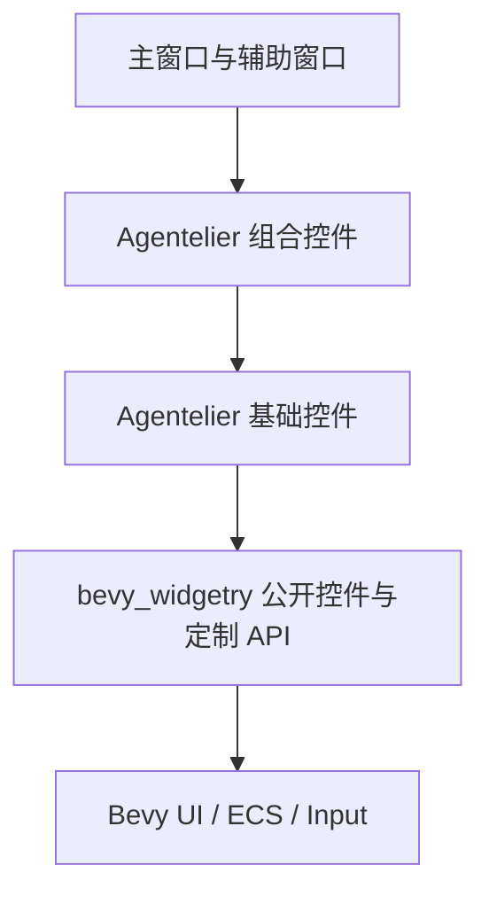

# Agentelier 项目级控件体系

Agentelier 的页面不应到处重新组合 Widgetry 的 Button、颜色、尺寸和状态反馈。高频复用的基础控件先封装成 Agentelier 自己的控件；页面和业务组合控件再使用这些基础控件。这样修改按钮形状、状态颜色或头像显示时，只需要修改一处。

这套控件属于 Agentelier 自己的 UI 层，不是向 `bevy_widgetry` 增加新 Crate，也不要求修改 Widgetry 上游。

## 基础控件与组合控件

### AgentelierButton

`AgentelierButton` 是项目唯一的常规按钮入口。它封装 Widgetry Button 的交互行为和 Agentelier 外观规则，通过样式变体满足不同场景：

- **圆形图标按钮：**B 区五个导航入口。
- **普通按钮：**弹窗中的主要操作。
- **次要按钮：**取消、返回和辅助操作。
- **危险按钮：**删除、登出等有明确后果的操作。

所有变体共享 Normal、Hovered、Pressed、Focus、Disabled 状态反馈和尺寸规则。需要等待状态的场景使用统一 Loading 表现。图标与文字内容由调用方通过 BSN Scene / SceneList 提供，控件不硬编码业务文案。

已实现的基础按钮位于 `agentelier_controls`。变体保存在按钮根实体上，切换时只更新根节点的形状和 Widgetry 颜色覆盖。宿主提供绿色主题，焦点环使用主题的焦点色，Loading 通过 `AgentelierButtonLoading` 使用 Widgetry 的受管等待状态。

底层优先使用 `WidgetryButton` 的公开配置；需要完全控制外观时使用 `WidgetryButtonHeadless`，复用其输入和状态行为。右键菜单不属于普通按钮的默认行为；登录按钮的副键菜单由独立的 `LoginContextMenu` 组合处理。

### AgentelierAvatar

`AgentelierAvatar` 统一显示用户与助手头像，负责尺寸、圆形 Mask、裁剪变换、图片适配和默认回退。

- 用户头像：有配置图片时使用用户上传的原始图片和已保存的裁剪变换；没有配置或图片读取失败时显示默认用户头像。
- 助手头像：使用助手形象素材。
- 图片尚未就绪时保留头像占位尺寸，不推动消息列表或按钮布局。
- 圆形 Mask 只影响显示，不修改用户上传的原始图片。

已实现的头像由 `agentelier_controls` 持有显示尺寸、来源与裁剪参数，`bevy_app_assets` 提供默认用户及助手头像。Bevy ImageNode 渲染原图的正方形取样区域并应用圆角。使用原图归一化中心和相对于短边的缩放计算取样范围。图像等待或无法读取时，固定尺寸的区域使用默认用户头像或背景占位。

设置窗口中的 `AvatarCropper` 是专门的组合控件：在圆形预览区域中移动和缩放方形原图，保存归一化裁剪变换。原始图片存入应用数据目录。

### 组合控件

| 控件 | 职责 | 主要组成 |
|---|---|---|
| `ConversationView` | 当前 Session 消息展示、流式更新和阅读位置 | Avatar、Markdown、ScrollArea、图片和工具结果呈现 |
| `ChatComposer` | 当前 Session 输入与模型选择 | TextField、ComboBox、AgentelierButton |
| `SessionNavigator` | Project / Session 导航和切换 | Tree、ListView、FileDialog、AgentelierButton |
| `GlobalTaskPanel` | 所有 Session 的只读任务状态 | ListView、Collapsible、状态图标 |
| `TaskToast` | 成功、失败和需要用户操作时的通知 | Widgetry Window、AgentelierButton |
| `LoginContextMenu` | 已登录时登录按钮的右键登出菜单 | 副键输入处理、轻量 Popup |
| `AvatarCropper` | 设置页面的头像位置和缩放调整 | 图片预览、圆形 Mask、拖动与缩放 |

组合控件只封装跨页面稳定复用的结构和行为。一次性标题、分隔线或单个列表行不必为了形式统一而抽象成独立控件。

## bevy_widgetry 的复用边界

| Widgetry 能力 | Agentelier 使用方式 |
|---|---|
| Button / ButtonHeadless / Loading | `AgentelierButton` 的交互与自定义外观 |
| Theme / ColorOverrides | 深绿黑与翡翠绿主题 |
| Core Text / Icon / Font | 字体、图标与 Emoji fallback |
| TextField / ReadOnlyTextField | 聊天输入、授权链接和只读记忆 |
| ComboBox | 模型、推理强度和 MCP 传输选择 |
| Tree / ListView | Project / Session、Skill、MCP 和任务列表 |
| Collapsible | Project、任务 Session 分组、记忆详情 |
| ScrollArea | 聊天、列表和记忆内容滚动 |
| Splitter | C/D/E-F 可拖动区域 |
| Window | 设置、Skill、MCP、记忆和 TaskToast |
| MessageBox | 登录说明、确认与错误 |
| FileDialog | Project 目录和 Skill 目录选择 |
| Tooltip | 图标按钮辅助说明 |
| Ui Scale | 配置驱动的应用缩放 |

Widgetry Theme 管理颜色，不负责字体、尺寸、布局或动效。需要项目特化外观时，优先使用公开 Headless、Renderer、Slots、Scene 组合、ColorOverrides 和自定义交互策略。

TaskToast 复用 Widgetry 自定义 Window，不新建底层原生窗口系统。窗口负责自身资源、输入作用域和生命周期；Agentelier 负责通知内容、显示时机、队列与五秒自动关闭。

## BSN 与运行时状态

项目 UI 统一使用 BSN 声明、构造和组合。复用结构采用返回 `impl Scene` / `impl SceneList` 的函数，或在需要独立持久 ECS 身份时使用 `SceneComponent`。

- `SceneComponent` 只在控件需要稳定 ECS 身份、被 Query 识别或持有持续 Widget State 时使用。
- Props 只在 Scene 构造阶段初始化；运行期状态保存在持久 Component / Resource 中。
- 调用方提供的 Children 通过 Scene Composition 传入。
- 不建立以 `spawn_*`、`build_*` Helper 为核心的替代 UI 构造 API。
- 使用 Widgetry 时遵循公开 API 对托管状态的契约，不直接修改其内部 Component。

基础控件可以共享项目级主题和样式配置，但不复制 Widgetry 的业务状态，也不建立第二份与 Widgetry 竞争的长期状态。

## Widgetry 公开文档

- [Core：文本、字体、Icon、Disabled 与 Scene](https://github.com/slc90/bevy_widgetry/blob/main/docs/features/core.md)
- [Button：Button / Headless / Loading](https://github.com/slc90/bevy_widgetry/blob/main/docs/features/button.md)
- [Window：Owned / Borrowed Window、标题栏与 Modal](https://github.com/slc90/bevy_widgetry/blob/main/docs/features/window.md)
- [Splitter：比例、Pane 最小尺寸与拖动](https://github.com/slc90/bevy_widgetry/blob/main/docs/features/splitter.md)
- [Tree](https://github.com/slc90/bevy_widgetry/blob/main/docs/features/tree.md) 与 [ListView](https://github.com/slc90/bevy_widgetry/blob/main/docs/features/list_view.md)
- [TextField](https://github.com/slc90/bevy_widgetry/blob/main/docs/features/text_field.md)、[ComboBox](https://github.com/slc90/bevy_widgetry/blob/main/docs/features/combo_box.md)、[FileDialog](https://github.com/slc90/bevy_widgetry/blob/main/docs/features/file_dialog.md)、[MessageBox](https://github.com/slc90/bevy_widgetry/blob/main/docs/features/message_box.md)
- [Theme](https://github.com/slc90/bevy_widgetry/blob/main/docs/features/theme.md) 与 [Ui Scale](https://github.com/slc90/bevy_widgetry/blob/main/docs/features/ui_scale.md)
