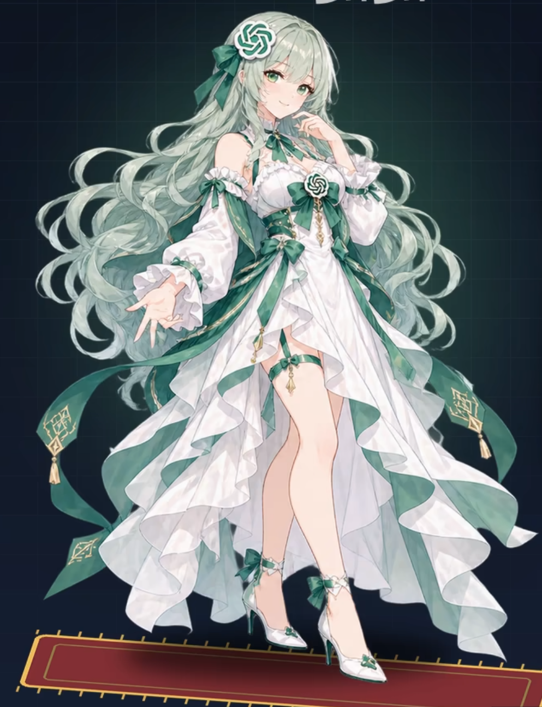

# Agentelier 视觉体系

Agentelier 是个人使用的桌面 Agent，不需要独立品牌色或企业视觉识别。视觉体系以深色基底和绿色层次建立空间关系，文字保持浅色高对比；装饰只作为助手形象的延伸，不与阅读内容争夺注意力。

## 色彩体系

色彩角色参考 `bevy_widgetry` 的 `WidgetryTheme` 语义：窗口背景、Surface、Elevated Surface、Hover / Pressed、Border、Text、Primary、Focus、Selected 和 Danger。Agentelier 使用自己的深绿配色覆盖 Widgetry 默认 Dark Theme 中的蓝色主色与蓝色选中状态。

| 语义 | 颜色 |
|---|---|
| 最深背景 | `#071A12` |
| 主背景 / 深层 Surface | `#0D261B` |
| 面板 Surface | `#143526` |
| 次级面板 | `#1B402D` |
| 提升面板 | `#244C36` |
| 主文字 | `#F3F8F4` |
| 次级文字 | `#D1E3D6` |
| 辅助文字 | `#A6C5B0` |
| Primary | `#176D49` |
| Primary Hover | `#1D8054` |
| Primary Pressed | `#125A3C` |
| Focus | `#67D39A` |
| Border | `#2B503B` |
| Subtle Border | `#1E3A2A` |
| Selected Surface | `#16452F` |
| Selected / Hover Accent | `#286A49` |

主要内容区域使用深色面板，文字使用浅色；不采用白色内容面板配绿色文字。避免偏蓝背景和不喜欢的深灰绿。少量淡金色只用于助手形象相关的装饰细节，不进入普通按钮和状态色系统。

主题负责颜色，不负责尺寸、字体、布局或动效。Widgetry 的 `WidgetryTheme` 与控件 ColorOverrides 提供颜色状态映射；Agentelier 通过项目主题值覆盖默认配色。

## 字体与排版

- **UI 字体：**更纱黑体 UI SC。
- **代码、路径与终端：**Sarasa Mono SC。
- **Emoji：**Noto Color Emoji 作为独立 fallback，避免主 UI 字体缺少彩色 Emoji 时出现方框或错位。

| 场景 | 字号 / 行高 |
|---|---:|
| 小型元数据 | 12 / 18 |
| 次级文字 | 14 / 21 |
| 常规界面文字 | 16 / 24 |
| 聊天正文 | 18 / 29 |
| 区域标题 | 20 / 28 |
| H1 | 30 / 42 |
| H2 | 26 / 36 |
| H3 | 23 / 32 |

路径、命令和其他特殊文字使用等宽字体。Windows 路径显示使用统一路径展示能力，盘符路径与 UNC 路径不显示 `\\?\` Verbatim 前缀；显示转换不能改变文件操作使用的原始路径。

字体资源由 UI Asset Owner 统一注册，普通文字和 Emoji fallback 通过 Widgetry Core 的字体能力接入。不要在每个控件中单独硬编码字体资源路径。

## 形状、空间与密度

- 常用圆角：4px、6px、8px、12px。
- 普通边框：1px；焦点环：2px。
- 阴影只用于弹层、菜单和悬浮窗口，不给所有面板叠加阴影。
- 基础间距单位：4px。
- 采用舒适密度；不提供全局紧凑 / 舒适切换。
- 常用按钮高度：36px 或 40px。
- 面板内距：16–20px。

圆角随层级和面积递增，不把所有元素统一做成大圆角胶囊。圆形只用于已经确定的 B 区图标按钮和头像。分隔条保持细线外观，但保留足够的交互命中宽度。

## 交互反馈与动效

| 动效类型 | 时长 |
|---|---:|
| 普通交互反馈 | 100–180ms |
| 页面 / 区域切换 | 180–280ms |
| 大面板展开与收起 | 250–350ms |

采用淡入淡出、小幅位移和少量缩放。避免弹跳、闪烁和强发光。交互状态及时、稳定地反馈 Hover、Pressed、Focus、Disabled 和 Loading，不用夸张动效代替状态表达。

装饰动效低频、幅度小，不干扰阅读和任务状态观察。动画不能造成聊天正文跳动、滚动位置改变、输入焦点丢失或分隔条拖动迟滞。

## 装饰语言

装饰以提供的助手形象参考图为母题：浅薄荷绿长发、翡翠绿眼睛、白色服装、绿色蝴蝶结与丝带，以及少量淡金色细节。装饰应从形象中提取色彩和形状，不把整张角色图铺满普通工作面板。

参考图中的结饰标志必须使用 OpenAI 官方 Logo 资产，不自行绘制或改造近似图案。OpenAI Logo 与绿色蝴蝶结、丝带是不同装饰元素，不能混成一个图形。

助手头像在 D 区消息中使用形象素材；F 区本阶段保持空白占位，不因有参考图就提前添加角色展示、动态立绘或状态面板。

