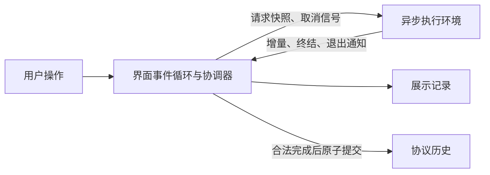

# T-004 · 技术文档 · 长篇 · 四轮

- 条件：A0
- 模型：gpt-6.1-sol
- 推理强度：high
- 执行状态：已完成
- 会话 ID：4

评价：和T-003一样，也有明显的防御性表达

## 第 1 轮

### 用户输入

为一个单进程桌面聊天客户端写一份约 2500～3500 字的技术设计文档。已知条件：界面使用事件循环，模型请求在独立异步执行环境中完成；同一时刻只能有一个活动生成任务；支持多轮对话、流式文本、停止生成、失败后重试和新建会话；只有合法完成的输入与输出会提交到下一轮协议历史；界面展示记录可以保留失败和取消的部分结果；模型、推理强度与提示词配置在创建 Session 时固定。文档要解释整体职责、会话与轮次状态、请求和结果流向、历史提交条件、停止与重试的区别、能观察到的行为和边界。使用清晰的 Markdown 标题，可以有一张简短 Mermaid 图；不要写具体 Rust API 或代码实现。

### 模型回答

#### final_answer

# 单进程桌面聊天客户端技术设计

## 1. 目标与约束

客户端在单一进程内提供多轮聊天、流式输出、停止生成、失败重试和新建会话。界面由事件循环驱动，模型请求在独立的异步执行环境中运行，网络等待与流解析不得阻塞界面。

系统必须保持以下不变量：

- 全进程同一时刻最多存在一个活动生成任务，包括正在取消但尚未退出的任务。
- 界面展示记录与模型协议历史分离；前者允许保留失败、取消和未完成内容，后者只包含合法完成的输入输出对。
- Session 创建后，其模型、推理强度与提示词配置不可变；修改配置必须创建新 Session。
- 异步结果只能影响所属的 Session、轮次和执行尝试，不能污染后续请求。

本设计以单分支文本对话为范围，不包含工具调用、历史消息编辑和自动重试。若未来扩展，应继续遵守历史原子提交与任务隔离原则。

## 2. 整体职责

### 界面与状态协调器

界面负责输入、消息展示、状态提示和操作入口。状态协调器运行于界面事件循环中，是会话状态和协议历史的唯一写入者，负责：

1. 校验发送、停止、重试和新建会话操作。
2. 创建请求快照并分配身份标识。
3. 接收异步事件，更新展示内容。
4. 裁决完成与取消竞争，决定是否提交历史。
5. 管理全局活动任务名额。

所有状态变化都通过事件循环串行处理，避免界面回调与后台任务直接竞争修改同一对象。

### 异步执行环境

异步侧负责请求组装、连接建立、流式读取、协议校验和资源释放。它只能使用请求快照，不能直接读取可变界面状态或修改协议历史。

异步侧向协调器发送开始、文本增量和终结事件，并响应取消信号。每次执行必须产生唯一终结结果：成功、失败或取消。执行退出还必须被监督；即使发生异常，也不能永久占用活动任务名额。



## 3. 会话、轮次与执行尝试

### Session

Session 保存唯一标识、固定配置、协议历史和展示记录。提示词配置作为不可变的协议前缀；后续历史只追加成功轮次。

新建 Session 会建立新的配置快照和空对话历史，不继承旧 Session 的失败内容或已提交消息。旧记录可在本地保留用于查看，但不自动进入新会话上下文。

### 轮次与尝试

一个逻辑轮次表示一次用户提问，包含输入文本、历史基线版本和一个或多个执行尝试。失败重试复用该轮次输入，但创建新的尝试标识。

每次尝试独立保存状态、部分输出、错误信息及结束原因。重试不得覆盖或拼接旧尝试的部分输出；界面可将旧尝试折叠，但必须明确区分。

轮次的主要状态为：

| 状态   | 含义                           |
| ------ | ------------------------------ |
| 待处理 | 输入已接受，尚未启动请求       |
| 生成中 | 正在建立请求或接收输出         |
| 停止中 | 已接受停止操作，等待后台退出   |
| 已完成 | 合法结果已提交历史             |
| 已失败 | 请求或协议处理失败，未提交历史 |
| 已取消 | 用户取消，未提交历史           |
| 已放弃 | 不再继续该轮次，保留展示记录   |

“正在连接”和“正在输出”可作为生成中的展示子状态。失败或取消轮次只有满足重试条件时才能重新进入生成中；已完成轮次不能直接重试。

## 4. 请求与结果流向

用户发送输入后，协调器先检查：输入有效、当前 Session 可用、没有活动任务。若存在未解决的失败轮次，发送新问题意味着显式放弃该轮次。

通过检查后，协调器创建包含以下内容的不可变请求快照：

- Session、轮次、尝试标识；
- 固定的模型、推理强度和提示词配置；
- 当前已提交协议历史及其版本；
- 本轮用户输入。

本轮输入此时只进入展示记录，不提前写入协议历史。这样，请求失败后不会留下没有合法回答的孤立用户消息。

异步侧根据快照发起请求，将文本增量发送回界面。每个事件携带完整身份标识和单调递增序号。协调器只接纳当前尝试的有效事件，忽略重复、过期或已经终结后的增量。

流式内容首先写入尝试的临时输出缓冲，并同步展示。最终成功事件应携带完整结果，或提供可核对的最终文本，确保展示节流、事件合并不会影响提交内容。协议错误、连接异常和缺少合法结束标记，都必须产生失败结果。

## 5. 历史提交规则

协议历史采用“整轮原子提交”，而非按文本增量追加。只有同时满足以下条件，协调器才追加本轮用户输入和最终助手输出：

1. 请求正常完成，且返回符合模型协议的最终结果。
2. 输出通过产品校验；本设计将空文本结果视为失败。
3. Session、轮次、尝试身份与请求快照一致。
4. 请求引用的历史版本仍然有效。
5. 该尝试未被停止、放弃或先前的终结事件结束。
6. 本轮尚未提交。

提交时，输入与输出一并追加，并递增历史版本。不存在“先提交输入、稍后补输出”的中间状态。下一轮请求只能从提交后的历史构造上下文。

已经展示的部分文本不等于已完成回答。失败、取消或被放弃的尝试即使看起来内容完整，也不进入协议历史。重复成功事件不能造成重复提交。

## 6. 停止、失败与重试

### 停止生成

停止表示用户主动撤销当前尝试，而非接受已有部分结果。协调器接受停止后立即将状态设为“停止中”，阻止该尝试提交，并向异步侧发送取消信号。

异步侧停止读取、关闭请求并释放资源。取消期间收到的尾部增量不再追加；已有文本保留并标记为“已取消”。远端可能无法立即停止计算，本地只能保证不再采纳其结果。

停止按钮并不立即释放活动任务名额。只有确认后台执行退出，才能启动下一任务；取消超时也不能被误当作任务已经退出。

完成与停止的竞争以协调器处理顺序为准：若成功结果已先完成提交，随后停止无效；若停止先被接受，则后来到达的成功结果不得提交。

### 失败与重试

失败表示本次执行未获得可提交结果，例如连接失败、服务拒绝或协议不完整。界面保留部分输出与可理解的错误原因，不修改历史。

重试是一次全新执行，不是继续旧连接，也不是从旧输出末尾续写。它使用相同用户输入、Session 配置和已提交历史基线，重新生成完整回答；结果可能与上次不同。

本设计允许失败或取消后手动重试，但要求该轮次仍是最近未解决轮次、历史版本未变化，且旧任务已经退出。若已发送其他问题或切换 Session，旧尝试仅供查看，不再提供原位重试。用户修改输入后发送，应视为新轮次。

## 7. 新建会话与迟到事件

新建会话立即切换界面状态，并冻结新 Session 配置。如果旧 Session 正在生成，协调器先将旧尝试标记为放弃并请求取消；旧部分结果可以保留在原记录中。

新界面可以立即显示，但发送入口必须等待旧任务退出后才启用，以维持全局单任务约束。旧任务迟到的增量、成功或失败事件均不能修改新 Session，也不能使旧轮次重新提交。

事件处理需区分两个问题：

- **结果归属**：身份不匹配的内容事件直接丢弃。
- **任务生命周期**：即使结果已过期，后台退出通知仍需用于释放对应的活动名额。

不能因切换 Session 而忽略退出通知，也不能让旧任务的退出通知释放新任务的名额。活动名额必须绑定具体执行标识。

## 8. 可观察行为与边界

用户可以观察到以下稳定行为：

- 发送后立即出现用户消息和生成状态，随后逐步出现文本。
- 生成期间重复发送被禁用或明确拒绝，不隐式排队。
- 停止后立即显示“停止中”，后台退出后显示“已取消”并恢复可操作状态。
- 失败和取消的部分结果仍可查看，但下一轮模型上下文不包含它们。
- 重试产生独立结果，不与上次输出拼接。
- 新建会话不会受到旧请求迟到结果的影响。
- 更换模型、推理强度或提示词只对新 Session 生效。

文本增量不保证与字符、单词或界面帧一一对应。界面可以合并刷新，但不得改变最终文本顺序。上下文超过模型限制时，应在发送前拒绝或明确报错；本设计不静默删改历史。

关闭应用时应请求取消并进行有界等待；进程被强制终止时，不能保证远端立即停止。若提供持久化，必须分别存储已提交历史与展示记录，恢复时不得把部分结果当作成功轮次。

## 9. 验证重点

测试应覆盖正常多轮、输出前失败、流中断开、重复终结事件、连续点击停止、停止与完成竞争，以及新建会话后的迟到事件。

验收重点不只是按钮是否响应，还包括：活动任务数始终不超过一；每轮最多提交一次；历史只增长完整输入输出对；失败和取消内容不进入后续请求；任何旧事件都不能污染新尝试；后台异常退出后，活动名额最终能够释放。

## 第 2 轮

### 用户输入

我主要想让新同事理解“展示记录”和“协议历史”的区别。请仅重写原文中解释这两者关系的部分，并加入一个取消生成后继续追问的完整流程例子。其他章节不重发。

### 模型回答

#### final_answer

## 展示记录与协议历史

客户端维护两份用途不同的数据：**展示记录回答“用户在界面上看到了什么”，协议历史回答“下一次请求会把什么作为已完成对话发给模型”。** 二者不能直接等同，也不能每次都从聊天界面的消息列表重建模型上下文。

| 对比项                   | 展示记录                                                         | 协议历史                                 |
| ------------------------ | ---------------------------------------------------------------- | ---------------------------------------- |
| 用途                     | 展示交互过程与结果                                               | 构造后续模型请求的对话上下文             |
| 包含内容                 | 用户输入、流式文本、成功结果、失败或取消的部分结果，以及状态提示 | 合法完成轮次的用户输入与最终助手输出     |
| 更新时间                 | 输入被接受、收到文本增量或状态变化时                             | 一轮合法完成并通过提交校验时             |
| 失败或取消后             | 可以保留已有内容，并明确标记状态                                 | 不追加该轮次的输入和输出                 |
| 能否直接作为下一轮上下文 | 不能                                                             | 可以，与固定提示词及本轮输入一起构造请求 |

### 从展示到提交的关系

用户发送问题时，输入立即出现在展示记录中；模型返回的文本也随流式事件逐步展示。但此时，**本轮输入与输出都尚未进入协议历史**。

只有请求合法完成、结果通过校验，且该尝试没有被停止或放弃，协调器才将本轮用户输入与最终助手输出作为一对消息，原子追加到协议历史。不能先提交输入，也不能把输出增量逐段提交。

如果生成失败或被取消，展示记录可以保留输入和部分输出，方便用户查看发生了什么；协议历史则保持不变。即使部分输出已经很长、看起来像完整答案，也不能仅凭文本外观判定为成功。

因此，界面中“看得见”的内容不一定是模型下一轮“记得”的内容。失败或取消的结果应带有明确标记，避免用户误以为它已成为后续对话的共同上下文。

### 完整例子：取消生成后继续追问

以下示例省略每次请求都会携带的固定提示词。

**第一步：完成一个正常轮次。**

用户发送：

> 给我一个周末两天的杭州行程。

模型合法完成：

> 第一天游览西湖，第二天参观灵隐寺。

此时展示记录包含这组问答，协议历史也提交了这组问答：

```text
用户：给我一个周末两天的杭州行程。
助手：第一天游览西湖，第二天参观灵隐寺。
```

**第二步：发送修改要求，但在生成途中取消。**

用户发送：

> 把第二天改成适合带孩子的安排。

模型开始流式输出：

> 第二天上午可以去自然博物馆，下午……

用户点击停止，且停止操作在成功提交前被协调器接受。界面先显示“停止中”，后台任务退出后显示“已取消”。

此时，展示记录仍可保留：

```text
用户：把第二天改成适合带孩子的安排。
助手：第二天上午可以去自然博物馆，下午……
      [已取消，未加入后续对话上下文]
```

但协议历史仍然只有第一步的完整问答。第二步的修改要求与部分回答都没有提交。

**第三步：等待取消结束后，发送新的追问。**

用户不重试第二步，而是继续问：

> 还是按最初方案，第二天遇到下雨怎么办？

旧任务退出后，客户端才允许启动新请求。该请求的对话内容为：

```text
已提交历史：
用户：给我一个周末两天的杭州行程。
助手：第一天游览西湖，第二天参观灵隐寺。

本轮输入：
用户：还是按最初方案，第二天遇到下雨怎么办？
```

请求中**不包含**被取消的亲子路线要求，也不包含自然博物馆的部分回答。本轮追问虽然已经显示在界面上，但仍要等回答合法完成后，才能与回答一起提交。

**第四步：追问完成，提交新的一轮。**

假设模型合法回答：

> 可以缩短灵隐寺的户外游览时间，雨势较大时改为室内活动。

协议历史此时包含第一步和第三步的完整问答；展示记录则额外保留第二步的取消过程。

这一差异也构成使用边界：如果用户在取消后只说“接着刚才那段写”，模型通常无法接续那段部分输出，因为它没有进入请求上下文。若要利用其中内容，用户需要在新输入中明确引用；客户端不能为了让对话“看起来连贯”，擅自把取消内容补进协议历史。

## 第 3 轮

### 用户输入

再检查一下原设计：如果某次流式请求已经输出了部分正文，随后网络断开，这次尝试应该如何影响当前界面、协议历史和“重试最近尝试”的行为？请补写一个能直接放进文档的章节，不要重写其他章节。

### 模型回答

#### final_answer

## 流式输出后断网的处理

一次流式请求即使已经输出部分正文，只要尚未收到并校验合法完成信号，就不能视为成功。若此时网络断开，该尝试应以失败结束，而不是将已有正文作为完整回答提交。正常结束标记已被确认后的连接关闭，不属于此类失败。

### 对当前界面的影响

协调器保留已收到的正文，将该尝试从“生成中”改为“已失败”，并显示明确提示，例如：

> 连接中断，回答未完成；此内容未加入后续对话上下文。

本轮用户输入也继续保留在展示记录中。部分正文不能仅因长度较长或语义看似完整而显示为成功回答；失败后到达的迟到增量也不得继续追加。

失败状态与活动任务名额需要分别处理：界面可以先显示失败，但只有确认后台执行退出、资源清理完成后，才允许启动重试或其他请求，避免同一时刻存在两个活动任务。

### 对协议历史的影响

本次失败不改变协议历史：**本轮用户输入与部分助手输出均不提交**，历史版本保持不变。

后续新请求仍从失败前最近一次成功提交的历史构造上下文，不会自动携带这次失败的提问或部分正文。展示记录中的失败标记必须保留这一含义，不能让用户误以为模型下一轮能够接续该片段。

### 对“重试最近尝试”的影响

“最近尝试”应按实际执行顺序确定，不能跳过本次失败，转而重试更早的成功轮次。当本次失败所属轮次仍是最近未解决轮次、历史基线未变化、Session 未切换，且旧任务已经退出时，可以启用重试。

重试时：

1. 保留原失败尝试及其部分正文，创建新的尝试标识和独立输出缓冲。
2. 使用原用户输入、Session 固定配置，以及原请求使用的已提交历史快照。
3. 从头发起完整请求，不把失败正文拼入上下文，不从中断位置续传，也不覆盖旧尝试。
4. 只有新尝试合法完成后，才原子提交该轮用户输入与新尝试的最终回答。

例如，第一次尝试输出“建议分三步，第一步……”后断网；重试可能生成完全不同的组织方式。界面可以折叠第一次尝试，但必须让两次结果保持可区分，不能将它们拼成一份回答。

如果重试再次失败，“重试最近尝试”应指向最新失败尝试，仍使用同一逻辑轮次的输入与有效历史基线。如果用户已发送其他问题、放弃该轮次或新建 Session，则旧失败记录仅供查看，不再允许原位重试；如需再次提问，应创建新的轮次。

## 第 4 轮

### 用户输入

把前面两处修订整合进初稿，输出一篇可独立阅读的完整终稿。保持其他已确定的行为不变，不要额外添加新的功能。

### 模型回答

#### final_answer

# 单进程桌面聊天客户端技术设计

## 1. 目标与约束

客户端在单一进程内提供多轮对话、流式输出、停止生成、失败重试和新建会话。界面由事件循环驱动，模型请求在独立异步执行环境中运行，网络等待与流解析不得阻塞界面。

系统保持以下不变量：

- 全进程最多存在一个活动生成任务，包括正在取消但尚未退出的任务。
- 展示记录与协议历史分离；只有合法完成的输入输出对才能进入协议历史。
- Session 创建后，模型、推理强度与提示词配置不可变；修改配置必须新建 Session。
- 异步结果只能影响所属的 Session、轮次和执行尝试。

本设计仅覆盖单分支文本对话，不包含工具调用、历史消息编辑和自动重试。

## 2. 整体职责

### 界面与状态协调器

协调器运行于界面事件循环，是会话状态和协议历史的唯一写入者，负责校验操作、创建请求快照、接收异步事件、更新展示、裁决停止与完成的竞争，以及管理全局活动任务名额。

所有状态变化经事件循环串行处理。界面回调与后台任务不能直接竞争修改同一对象。

### 异步执行环境

异步侧负责请求组装、连接建立、流式读取、协议校验、取消响应和资源释放。它只使用不可变请求快照，不读取可变界面状态，也不直接修改协议历史。

异步侧发送开始、文本增量和终结事件。每次尝试只能有一个终结结果：成功、失败或取消。执行退出还需受到监督，确保异常不会永久占用活动任务名额。

## 3. Session、轮次与尝试

Session 保存唯一标识、固定配置、协议历史和展示记录。提示词作为不可变协议前缀，后续历史只追加成功轮次。新 Session 使用新的配置快照和空对话历史，不自动继承旧会话内容；旧展示记录可以保留供查看。

一个逻辑轮次对应一次用户提问，保存输入文本、历史基线版本和多个执行尝试。重试复用该轮次输入，但创建新的尝试标识、状态和输出缓冲，不能覆盖或拼接旧尝试的部分正文。

主要状态如下：

| 状态   | 含义                     |
| ------ | ------------------------ |
| 待处理 | 输入已接受，尚未启动     |
| 生成中 | 正在连接或接收输出       |
| 停止中 | 已接受停止，等待后台退出 |
| 已完成 | 合法结果已提交           |
| 已失败 | 执行失败，未提交         |
| 已取消 | 用户取消，未提交         |
| 已放弃 | 不再继续该轮次           |

已完成轮次不能直接重试。失败或取消轮次只有满足重试条件，才能创建新尝试。

## 4. 展示记录与协议历史

**展示记录回答“用户看到了什么”，协议历史回答“下一次请求会把什么作为已完成对话发给模型”。** 两者不能等同，也不能直接从界面消息列表重建模型上下文。

| 对比项       | 展示记录                                 | 协议历史             |
| ------------ | ---------------------------------------- | -------------------- |
| 内容         | 输入、流式正文、完整结果、错误和取消状态 | 合法完成的输入输出对 |
| 更新时间     | 输入被接受、增量或状态到达时             | 整轮合法完成并提交时 |
| 失败或取消后 | 可保留输入及部分正文                     | 不追加该轮内容       |
| 用途         | 呈现交互过程                             | 构造后续请求上下文   |

用户发送后，输入立即进入展示记录；输出增量也逐步展示，但本轮输入输出均未进入协议历史。

只有请求正常完成、协议结果合法、输出通过产品校验，且身份与历史版本匹配、尝试未被停止或放弃、轮次尚未提交，协调器才原子追加输入与最终输出，并递增历史版本。本设计将空文本结果视为失败。

不能先提交输入、稍后补输出，也不能逐段提交正文。失败或取消的内容即使很长、看起来完整，也不构成合法回答。重复成功事件不能重复提交。

因此，“界面中看得见”不等于“模型下一轮记得”。失败和取消结果必须明确标记其未进入后续上下文。

## 5. 请求与结果流向

发送前，协调器检查输入有效、Session 可用且没有活动任务。若存在未解决的失败或取消轮次，发送新问题意味着放弃该轮次的后续重试。

通过检查后，协调器创建不可变快照，包含：

- Session、轮次和尝试标识；
- 固定模型、推理强度与提示词；
- 当前已提交历史及版本；
- 本轮用户输入。

异步侧使用快照发起请求。返回事件携带完整身份标识和递增序号；协调器忽略重复、过期或终结后的增量。正文先进入当前尝试的临时缓冲，再更新界面。

成功事件应包含完整结果，或提供可核对的最终文本，避免界面节流影响提交内容。协议错误、连接异常或缺少合法完成信号均导致失败，不能仅凭收到正文判定成功。

## 6. 停止生成与完成竞争

停止表示撤销当前尝试，而非接受部分结果。协调器接受停止后立即进入“停止中”，禁止该尝试提交，并发送取消信号。

异步侧停止读取、关闭请求并释放资源。停止后到达的尾部增量不再追加；已有正文保留并标记“已取消，未加入后续对话上下文”。远端可能无法立即停止计算，本地只保证不再采纳结果。

停止不会立即释放活动名额。只有确认后台执行退出，才能启动下一任务；取消超时不能视为已退出。

竞争以协调器处理顺序为准：成功已先提交，则随后停止无效；停止先被接受，则迟到的成功结果不得提交。

## 7. 流式断网与重试

### 已输出部分正文后断网

若尚未确认合法完成信号，网络断开必须使尝试失败。正常完成已确认后的连接关闭不属于此类失败。

界面保留本轮输入和已收到的正文，将状态改为“已失败”，提示“连接中断，回答未完成；此内容未加入后续对话上下文”。失败后的迟到增量不再追加。

协议历史完全不变：本轮输入和部分输出均不提交，历史版本不增长。后续请求仍以失败前最后一次成功历史为基线。

界面可以先显示失败，但重试和其他请求必须等待后台任务退出、活动名额释放，不能因已显示错误而并发启动新任务。

### “重试最近尝试”的含义

“最近尝试”按实际执行顺序确定，不能跳过最新失败而重试更早的成功轮次。失败或取消后允许手动重试，但必须满足：

- 所属轮次仍是最近未解决轮次；
- 历史基线未变化，Session 未切换；
- 旧任务已经退出。

重试是全新请求，使用原输入、固定配置和原已提交历史快照，从头生成完整回答；不续传旧连接，不将失败正文加入上下文，也不从中断位置续写。

旧尝试及部分正文继续保留，新结果独立展示。只有新尝试合法完成，才提交本轮输入与新回答。若再次失败，重试入口指向最新失败尝试。

如果用户已发送其他问题、放弃该轮次或新建 Session，旧记录仅供查看，不再允许原位重试。修改输入后发送也属于新轮次。

## 8. 完整示例：取消后继续追问

以下省略每次请求都会携带的固定提示词。

**第一步：成功完成一轮。**

用户问：“给我一个周末两天的杭州行程。”

模型合法回答：“第一天游览西湖，第二天参观灵隐寺。”

展示记录与协议历史均包含这组完整问答。

**第二步：提出修改要求，随后取消。**

用户问：“把第二天改成适合带孩子的安排。”

模型输出：“第二天上午可以去自然博物馆，下午……”用户点击停止，且停止先于成功提交被接受。

界面先显示“停止中”，后台退出后显示“已取消”，保留提问和部分正文。协议历史仍只有第一步问答，不包含修改要求或自然博物馆片段。

**第三步：等待取消结束后继续追问。**

用户不重试，而是问：“还是按最初方案，第二天遇到下雨怎么办？”

新请求的对话内容是：

> 已提交历史：  
> 用户：给我一个周末两天的杭州行程。  
> 助手：第一天游览西湖，第二天参观灵隐寺。
>
> 本轮输入：  
> 用户：还是按最初方案，第二天遇到下雨怎么办？

被取消轮次的输入输出均不在其中。本轮追问此时也只是请求输入，尚未提交历史。

**第四步：追问合法完成。**

模型回答：“可以缩短灵隐寺的户外游览时间，雨势较大时改为室内活动。”

协调器提交第三步输入与该回答。协议历史包含两组成功问答；展示记录则额外保留取消过程。

如果第三步只问“接着刚才那段写”，模型通常无法接续被取消片段，因为请求未携带它。用户需要在新输入中明确引用；客户端不能擅自补入取消内容。

## 9. 新建会话与迟到事件

新建会话立即切换界面并冻结新配置。旧任务若仍在运行，协调器将旧尝试标记为放弃并请求取消；旧部分正文可保留，但不得再提交。

新界面可以立即显示，发送入口须等待旧任务退出后才启用。旧任务迟到的正文、成功或失败事件不能修改新 Session。

结果归属与任务生命周期应分开处理：过期内容事件丢弃，但旧任务的退出通知仍需释放其活动名额。名额必须绑定具体执行标识，防止旧退出通知误释放新任务名额。

## 10. 可观察行为、边界与验证

用户发送后立即看到输入与生成状态，随后逐步看到正文。生成期间重复发送被禁用或明确拒绝，不隐式排队。停止后先显示“停止中”，后台退出后才恢复发送与重试能力。

界面可以合并文本刷新，但不能改变最终顺序。上下文超限应提前拒绝或明确报错，不静默删改历史。关闭应用时请求取消并有界等待；强制终止不能保证远端立即停止。若持久化，须分别保存展示记录与已提交历史，恢复时不得将部分结果当作成功轮次。

验证重点包括正常多轮、输出前失败、流中断网、重复终结、连续停止、完成与停止竞争、连续重试，以及新建会话后的迟到事件。验收必须确认：活动任务最多一个，每轮最多提交一次，历史只增长完整问答，失败和取消内容不进入后续请求，旧事件不能污染新尝试，后台异常退出后活动名额最终可释放。
