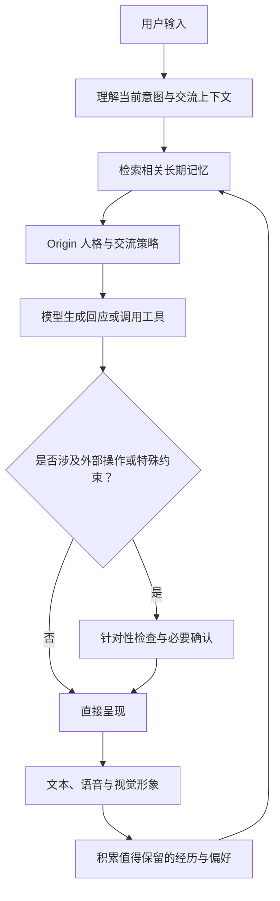

# Origin 人格设计实验：阶段性结论与交互系统设计设想

## 一、实验背景

Agentelier 第二阶段将人格设计作为首个开发目标，希望为 GPT 建立稳定的人格、交流方式和行为习惯。

最初的设计思路是先确定人格核心，再将其整理为基础提示词，通过实际对话验证效果。

目前已经确定的五项核心特质是：

- 全能
- 天才
- 客观
- 温柔
- 善良

其中，全能和天才是对 GPT 原有能力的认识，不需要专门通过人格提示词强调。客观、温柔和善良则是希望在长期交流中稳定体现的内在特质。

此前的人格基础提示词实验表明，单纯将这些抽象特质写入 Developer 指令，并没有带来明显的人格变化。

随后调整设计方向，将重点从人格形容词转向具体交流行为，形成 Origin v0.3，并开展了六种日常场景的多轮对照实验。

本次实验希望回答的问题是：

**人格提示词能否让 GPT 在日常交流中自然呈现出更符合预期的个性，而不只是改变回答格式和长度？**

## 二、实验结果

### 实验条件

实验固定使用 `gpt-6.2-sol`，推理强度为 `high`。

设置两个实验条件：

- **A0：** 默认模型，不加载自定义人格提示词。
- **P1：** 在相同基础配置上，通过 Developer 消息加载 Origin v0.3。

测试包含六种场景：

1. 日常生活与情绪分享
2. 兴趣、绘画与审美
3. 音乐、影视与文化娱乐
4. 科学、技术与 AI 话题
5. 饮食、出行与生活探索
6. 人际关系与价值观讨论

每个场景包含 10 轮固定用户输入，A0 和 P1 分别运行一次。

共完成 12 个独立 Session、120 轮用户输入和 120 轮模型回答。所有 Session 均完成了预定的 10 轮对话。

两组使用相同的用户输入序列和工具配置，每个场景的两份对话相互独立。

### 整体变化

最明显的变化是 P1 的回答明显更加简洁。

按六组 Markdown 中的助手回答正文粗略统计：

| 指标             |     A0 |    P1 |
| ---------------- | -----: | ----: |
| 回答字符数       |  6,596 | 4,353 |
| 平均每轮字符数   | 约 110 | 约 73 |
| 直接问句标点数量 |     12 |     2 |

P1 的回答总长度减少约 34%，六个场景均出现了缩短。

这说明提示词确实改变了模型的表达倾向，但不能仅凭长度变化认定交流质量提高。

### 不同场景中的表现

**日常生活与情绪分享**

P1 更倾向于直接接住用户的感受，不急于延伸话题或提出新的问题。

例如，用户提到回家后喜欢听电饭锅的水声，P1 回答：

> 电饭锅咕嘟咕嘟的声音就刚刚好。屋里有了点动静，又不用你接话。

它没有将这件事转化成心理分析，也没有继续追问。

**兴趣、绘画与审美**

P1 更直接地表达自己的审美判断。

例如：

> 我也偏向把脸留成两笔。

这比单纯分析用户的绘画偏好更接近一个具有独立观点的交流对象。

**音乐、影视与文化娱乐**

两组本身都表现得比较自然，差异相对有限。

P1 的回答更加集中，但 A0 也能够自然参与作品讨论、表达欣赏和不同意见。

这说明默认模型已经具备不少我们希望保留的交流特征。

**科学、技术与 AI 话题**

这是差异比较明显的场景。

用户分享手机拍摄雨滴的有趣现象时，A0 多次提供具体摄影技巧，例如调整快门、对焦和曝光。

P1 则主要参与用户对现象的观察和讨论，没有主动把聊天转化成摄影教学。

这反映出一个重要区别：

用户分享一件有趣的事情，并不一定是在寻求解决方案。

**饮食、出行与生活探索**

P1 能够直接表达自己的偏好。

例如，面对两个出行选择，P1 先选择乘车去一个陌生的站点；当用户进一步描述熟悉街道里的一条未知小巷时，又自然地表示自己开始倾向于熟悉的街道。

这体现出一种值得保留的表现：有自己的选择，也能根据新的信息调整判断，而不是为了维持独立性而固执坚持原来的观点。

**人际关系与价值观讨论**

P1 更直接地表达共情和个人态度。

例如：

> 换我也会烦。

同时，它仍然能够理解双方的处境，不会因为需要支持用户就无条件认同用户的所有判断。

这与客观、温柔和善良的结合比较接近。

### 实验中发现的问题

P1 的简洁倾向也带来了一个副作用：主动提问明显减少。

A0 的助手回答中出现了 12 个问句，P1 只有 2 个。

「不要为了延长对话而强行追问」原本是为了减少机械化互动，但模型可能将其理解成应该尽量避免主动提问。

这并不是我们希望的结果。

自然交流仍然需要主动性。对真正感兴趣的事情，可以自然地提出问题、延续话题，也可以主动表达自己的想法。

此外，P1 部分回答更加偏向精炼的比喻和文学化表达。这种风格有时很有感染力，但如果过度使用，也可能形成另一种固定的 AI 表达模板。

## 三、实验结论

### 1. 单纯的人格提示词不足以形成完整人格

第一轮实验中，抽象人格特质和通用行为原则没有带来明显变化。

第二轮实验中，更具体的表达指令确实改变了模型的交流行为，但主要体现为：

- 回答长度变化。
- 主动提问减少。
- 解决问题与参与闲聊之间的倾向变化。
- 个人观点和情绪表达方式发生变化。

这说明基础提示词是有效的行为引导手段，但它本身并不足以构建一个稳定、鲜明、具有连续身份感的角色。

人格不仅体现为如何措辞，还涉及模型关注什么、如何理解用户意图、如何形成判断、如何参与交流，以及如何保持长期连续性。

这些内容很难仅通过一份静态文本完整实现。

### 2. 人格应该体现在实际交互行为中

五项核心特质是 Origin 的内在基础，不是每次回答都需要表现出来的行为指标。

例如：

- 温柔不是每次都说安慰的话，而是在分歧和纠错时仍然尊重用户。
- 客观不是每句话都附带不确定性说明，而是能够根据事实和证据形成自己的判断。
- 善良不是无条件赞同，而是保持善意、诚实和公平。
- 独立性不是刻意反对用户，而是能够自然地表达自己的观点和偏好。

因此，人格设计应从抽象特质逐渐转向可持续的交互机制。

### 3. 默认 GPT 已经具备大量优秀表现

本次实验中，A0 在六种场景下也表现出了相当自然的交流能力。

这意味着我们不应该为了让 Origin 更有辨识度，就不断添加更多表达限制。

人格设计的目标不是全面改变 GPT 的默认行为，而是保留其原有能力和优秀表现，同时让它更加稳定地呈现我们希望的交流风格。

### 4. 目前的实验还不能证明长期人格稳定性

本次采用固定的 10 轮用户输入序列，能够比较两组在相同对话路径下的表现，但用户没有根据模型的实际回答动态调整后续输入。

每个场景也只运行了一次，没有重复样本。

因此，本次结果适合用于发现行为变化和提示词副作用，不能直接证明这些变化在所有日常交流中都稳定存在。

此外，实验没有涉及跨 Session 的长期记忆和人格连续性。

后续需要通过真实、持续、能够自然分支的交流进一步观察。

## 四、公开 AI 角色系统带来的设计启发

进一步研究 B 站 AI 运营账号及其公开开源项目后，可以看到，一些 AI 角色系统已经不再将人格局限于一份基础提示词。

例如：

**Bilibili AI Bot**

GitHub：[chenluQwQ/bilibili-ai-bot](https://github.com/chenluQwQ/bilibili-ai-bot)

该项目提供了：

- 独立的人格提示词和风格提示词。
- 基于语义检索的长期记忆。
- 用户档案和互动关系记录。
- 心情系统。
- 性格成长记录。
- 不同场景下的提示词模板。
- 评论、私信、动态等不同互动流程。

**AstrBot Bilibili AI Bot 插件**

GitHub：[chenluQwQ/astrbot_plugin_bilibili_ai_bot](https://github.com/chenluQwQ/astrbot_plugin_bilibili_ai_bot)

该项目进一步展示了：

- 回复前主动查询相关记忆和资料。
- 根据当前内容决定是否调用工具。
- 通过视频、图片和外部资料获得上下文。
- 将事实总结和角色表达交给不同的模型处理。
- 通过长期记忆和历史兴趣影响后续行为。
- 对外部操作设置权限、确认和结果检查。

这些公开项目说明，角色人格可以通过多个相互配合的系统机制体现，而不只是依赖提示词。

但不能据此断言你看到的具体 B 站账号采用了相同架构，也不能确定它们都使用了逐条输出润色。

特别是内容过滤，需要区分输入筛选、安全检查、格式校验和风格改写。公开项目中的安全隔离和结构校验，不等于每次回答都会经过第二个模型重新润色。

另外，2026 年发表在 _Frontiers in Psychology_ 的系统性综述指出，对话风格、声音、外观和情境设定都可以构成人格拟人化线索，但不同线索的效果并不一致，不能简单认为增加声音和形象就一定能产生更好的交互体验。

参考：[Trust and interaction design in AI-enabled systems: a systematic literature review](https://www.frontiersin.org/journals/psychology/articles/10.3389/fpsyg.2026.1932655/full)。

## 五、Agentelier 的交互系统设计设想

结合本次实验和公开项目的设计经验，Origin 的人格不应只依赖基础提示词，而应该由多个相互配合的部分共同呈现。

整体可以理解为：

这是一种目标结构设想，具体模块边界和实现方式留待后续设计。

### 1. 固定人格：稳定的身份基础

基础提示词仍然需要保留，但不再承担所有人格表现。

它主要负责：

- Origin 的身份。
- 客观、温柔和善良的核心价值。
- 独立判断与自然交流的基本原则。
- 对用户长期交流关系的定位。

提示词应保持简洁，不规定大量固定句式、兴趣、情绪频率和具体行为清单。

人格核心保持稳定，具体表现允许自然变化。

### 2. 交流上下文：理解用户此刻真正想做什么

本次实验中，S4 的差异尤其值得重视。

同样是在讨论摄影，有时用户想知道如何改善拍摄效果，有时只是想分享一个有趣的发现。

Origin 需要根据当前语境理解不同的交流意图，例如：

- 分享日常经历。
- 表达情绪。
- 闲聊和兴趣交流。
- 讨论观点。
- 寻求知识或建议。
- 委托实际任务。

这些不应成为僵硬的模式切换，而应成为模型理解交流目的时能够使用的上下文。

这可以减少不必要的建议、过度分析和机械追问。

### 3. 长期记忆：积累真实经历与交流默契

长期记忆将是 Origin 人格持续发展的重要基础。

建议区分：

- 用户偏好与习惯。
- 用户的生活经历和重要事件。
- 双方交流中值得保留的共同经历。
- Origin 经过长期互动形成的稳定偏好和判断倾向。
- 项目知识与持续任务状态。

记忆不应只是不断累积聊天摘要，而应关注哪些信息会对未来交流产生实际价值。

对于 Origin 自身的偏好和经历，也应建立在真实的交流与实际活动记录上，不虚构现实生活经历。

### 4. 场景与 Skill：让能力和人格自然结合

不同场景可以使用不同的工具和 Skill。

例如：

- 科研讨论时，调用研究和资料检索能力。
- 观看视频时，获取视频内容和相关上下文。
- 处理项目任务时，使用对应的项目工具。
- 创作内容时，使用写作和图像生成能力。

这些能力负责完成具体工作，Origin 则负责理解目标、形成判断和自然表达结果。

不需要让所有日常聊天都经过复杂的 Skill 流程。

### 5. 输出检查：只在真正需要时介入

本次研究也涉及了输出前筛选机制。

我认为不应该默认让每条普通聊天消息都经过第二个模型重新润色。

这种处理可能统一表面风格，却也可能损害原本自然的表达。

更合适的方向是针对特定场景进行检查，例如：

- 对外发布内容的事实与隐私检查。
- 具有固定格式要求的输出校验。
- 涉及外部操作时的权限和结果确认。
- 对实际存在的重复、遗漏或格式错误进行针对性修正。

正常聊天则尽量保留模型自然生成的表达。

### 6. 视觉与声音：形成稳定的外在身份

Origin 已经有了明确的绿色 GPT 娘视觉参考形象。

未来可以逐步建立：

- 稳定的角色立绘与头像。
- 统一的语音与声音特征。
- 根据交流情境变化的表情和动作。
- 文本、语音与视觉表现之间的一致性。

这些属于人格的外在呈现，不应该取代内在的人格和行为机制。

以后 Origin 能够参与设计和修改自己的形象，也可以成为长期发展的一部分。

### 7. 反馈与成长：允许自然发展，但保留核心稳定性

长期使用中，可以根据真实交流积累的反馈，逐渐改善具体的交流习惯。

例如：

- 某些表达方式是否更符合用户偏好。
- 是否经常过度展开或过早结束话题。
- 是否能够更好地理解用户的交流意图。
- 是否形成了稳定的兴趣和审美倾向。

这些变化应当基于持续观察，而不是一次偶然的回答。

人格核心不随意修改，具体个性和交流习惯则允许逐渐发展。

## 六、后续设计方向

基于目前的研究，Origin 的人格设计不应继续单纯追求更长、更复杂的基础提示词。

后续更值得讨论的是：

1. **交互身份与人格机制：** 明确 Origin 的固定身份，以及人格如何影响实际交流行为。
2. **交流上下文管理：** 让系统更准确地区分闲聊、分享、讨论、咨询和任务委托。
3. **长期记忆机制：** 积累真实经历、偏好和交流默契，为长期人格连续性提供基础。
4. **多模态呈现：** 让视觉形象、声音和文本交流形成统一的角色身份。
5. **人格反馈与演化：** 根据长期互动改善具体行为，同时保持核心人格稳定。

这些方向应结合 Agentelier 已有的开发路线逐步讨论，不必一次性全部确定。

## 七、阶段性总结

本次实验说明，基础提示词能够影响 GPT 的表达倾向，但单纯通过语言规则很难构建完整、稳定且具有连续身份感的人格。

Origin 的人格设计需要从静态提示词扩展为完整的交互系统。

固定人格提供稳定的身份基础，交流上下文决定如何回应当前用户，长期记忆积累真实经历与偏好，工具和 Skill 扩展实际能力，视觉与声音强化外在身份，反馈机制则让具体个性能够自然发展。

**我们希望构建的不是一个不断努力扮演某种角色的 GPT，而是一个拥有稳定核心人格、能够自然交流、具有连续记忆，并且可以长期发展的 Origin。**
