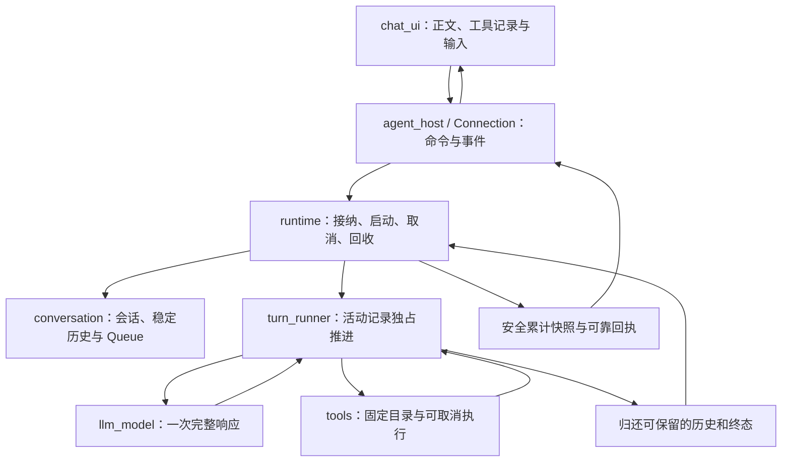
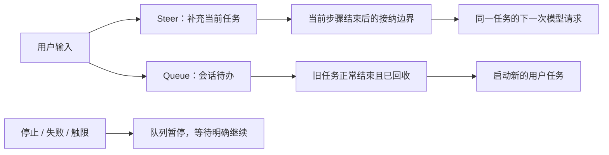

# 工具调用与运行中交互的整体设计

这些增量把单次聊天请求扩展为一个可持续推进、可停止的用户任务。模型通信负责取得完整响应，工具执行负责产生实际结果，任务运行器决定是否继续；会话保存可重放历史和输入顺序，界面只展示与提交操作。

Direct Mode 是本阶段唯一入口。工具仍是名称、参数约定与实际实现的配对，不建立 Code Mode、动态插件目录或完整审批调度框架。

## 两个新增职责放进现有边界

`agent/turn_runner` 承载模型—工具—结果反馈循环；`agent/tools` 承载固定目录、参数校验、实际工具执行与业务结果。现有 `llm_model` 继续负责 Responses/SSE，`conversation` 定义历史与任务记录，`runtime` 管理 Tokio、任务句柄和回收。

这张图表示运行协作，不能当作 Cargo 双向依赖。实际依赖保持单向：Runtime 调用 Runner；Runner 使用 Conversation 定义的活动记录和模型、工具能力；Conversation 不依赖 Runner。模型层只使用工具描述和值类型，不执行工具。账号凭据继续由原有 Account 管理，工具不获得凭据能力。

开始任务时签出活动记录，执行期间只有 Runner 修改其工作历史。Runtime 等任务真实回收后，将记录交还会话并发布终态。Bridge 与 UI 的快照不成为第二份执行权威。

## 从单次往返增加到连续行动

一次工具往返需要同时形成声明、解析、执行、结果关联和下一次请求。起步先完成这个小闭环，暂时限定两次模型请求与一次工具执行。随后放宽为多步循环，再接纳同一响应中的多工具批次。

多步循环表示“根据上一步结果作新的模型决定”；同批串行表示“执行同一次响应已经给出的多个调用”。二者是不同的行为，不能用两个分开的模型响应冒充同批调用验证。

每个完整模型响应与其工具结果形成封闭步骤。历史保存真实消息阶段、不透明 reasoning、调用与匹配结果，不从 UI 气泡重建。取消时保留已完成结果，给未启动调用明确结果，当前未完成模型片段只保留展示。已有提交点的任务不再提供原样重试，以免重做已经发生的动作。

## 运行状态与两种后续输入

工具时间线按稳定任务、请求及调用身份更新，任务状态独立于单次响应。累计进度可合并；接纳、启动和终态等回执可靠交付，Stop 不依赖正文通道。

Steer 在安全边界生效，区分已接纳与已经用于请求，不刷新任务预算。Queue 在启动前不进入模型上下文，使用 FIFO 与明确暂停语义。两者都复用现有会话和控制路径，不开放并行模型任务。

## 验证方式属于每个增量

固定目录中的 `diagnostic_calculate` 与 `diagnostic_wait` 是实际运行时诊断能力，用于观察计算、等待、随机执行回执及停止过程。验证走真实应用、当前账号和模型；GUI 通过 BRP 实际输入和截图、状态核对，不由开发工具代为计算后冒充应用结果。

每份方案保留对应的异常与边界验证。项目不维护测试代码、Benchmark、Example 或模拟服务，难以稳定由模型产生的异常使用真实进程的受控调试检查并单独标明证据性质。状态保护、登录保护、Widgetry 公共 API 和现有依赖组合贯穿相关增量。

## 唯一实施顺序

以下编号是交付顺序。工具展示与多工具能力的联系是观测已有调用记录；Steer 和 Queue 分别控制当前任务与后续任务，不因编号相邻就合成同一种输入。

1. [把单次聊天迁入独立任务运行器](01-isolate-turn-runner.md)
2. [接入一次真实工具往返](02-single-tool-roundtrip.md)
3. [连续推进工具决策并保留已完成步骤](03-repeat-tool-decisions.md)
4. [同一响应内的多工具串行执行](04-serial-tool-batches.md)
5. [把工具轨迹放进聊天界面](05-observable-tool-timeline.md)
6. [运行中补充当前任务](06-steer-active-task.md)
7. [让后续消息按顺序启动](07-queue-followup-messages.md)
