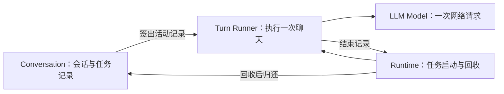

# 把单次聊天迁入独立任务运行器

本方案先解决执行职责的归属：把当前聊天任务的推进逻辑从 Runtime 中分离，同时保持现有单次请求、多轮聊天、取消和重试行为。交付的是可以运行现有聊天的 `agentelier_turn_runner`，不是一个等待以后填充的空模块。

这里画的是所有权交接与调用关系。会话业务依然由 `conversation` 定义，Runner 推进活动记录，Runtime 拥有线程和 JoinHandle。三个位置不会同时修改同一份运行历史。

## 活动任务记录从哪里来

当前 `crates/agent/conversation/src/conversation.rs` 同时维护会话、展示记录和已提交协议历史。开始一次聊天时，它产生 `GenerationRequest`；`runtime/model_task.rs` 直接调用模型通信，并在结束后回到会话提交结果。

调整后由 `conversation` 定义一个可签出的活动任务记录。它携带会话与任务身份、`operation_id`、原输入身份、固定模型和指令快照、账号主体、已有协议历史，以及当前展示内容。`Conversation` 保留稳定会话状态和该任务的占用身份，活动记录交由 Runner 独占推进。

任务结束时，Runner 返回活动记录和明确结局，Runtime 回收 JoinHandle、处理最后进度，再把记录归还给原会话。身份不匹配的结果不能覆盖当前会话。执行期间新建或重置继续被拒绝，账号自然续期仍沿用同一个主体。

此处先维持纯聊天规则：完整成功响应提交输入和输出一次；失败或取消的部分正文仅用于展示，不进入后续上下文。重试最近失败输入仍复用原输入、固定设置和此前成功历史，并保留正在编辑的新草稿。

## Runner 与 Runtime 各自做什么

新增 `crates/agent/turn_runner/`，包名 `agentelier_turn_runner`。它依赖 `conversation`、`llm_model` 和 `account`；对 `account` 只使用已有 `CredentialClient`，不管理账号状态或读取凭据文件。本增量尚未接入工具库，不为它增加空依赖。

Runner 使用现有模型通信能力完成一次请求，消费流式事件并更新活动记录。模型目录与“验证模型连接”仍是独立模型操作，不改造成聊天任务，也不自动注入工具或会话指令。

Runtime 保留现有 Tokio current-thread 环境、跨业务队列、任务句柄、取消信号及真实回收流程。它不再自己解释模型增量或判断下一步业务；新增库也不创建第二个 Runtime、线程或 Widgetry Job。

取消信号必须交给 Runner 处理。Runner 可以取消正在等待的模型请求，但必须返回已经掌握的活动记录，不能由 Runtime 的外层选择直接丢掉整个业务 Future。这样后续加入工具后，已经发生的结果也有明确归还路径。

任务异常退出、无法归还可信记录时，显示执行失败并关闭该会话的继续执行入口，要求重置或新建会话。正常停止、网络失败和服务错误必须作为受控结局返回，不使用异常退出表达普通失败。

## 展示仍通过现有连接

复用 `bridge/conversation`、`bridge/connection` 与 `ui/agent_host`。不创建第二条工具或聊天连接。Conversation Bridge 转换安全投影，Connection 继续关联操作、合并累计快照与唤醒；UI 不读协议历史拼上下文。

正文进度可以合并，开始与结束回执不能合并丢失。最终快照在终态前交付，最终终态只在实际回收后发布。新一轮仍要等旧任务真正回收；迟来的停止不能回滚已经确认的成功结果。

日志由原宿主安装的 `tracing` 接收，记录操作身份和生命周期，不记录模型正文、原始输入、Token 或加密 reasoning。无需为拆库增加日志系统或通用事件框架。

## 用现有聊天确认迁移没有改变行为

本增量的运行证据全部来自实际应用。使用现有账号和数据目录完成一次流式回答、一次承接前文的追问、一次生成中停止及最近尝试重试；检查原输入只出现一次，重试没有清除新草稿，失败正文没有进入后续上下文。

生成期间切换设置页再回来，核对输出继续推进、原记录和阅读位置恢复。再正常关闭应用，确认网络任务和 Tokio 结束后才释放数据目录；不以退出登录替代普通关闭。

通过 `bevy_brp_mcp` 操作真实界面，使用 Pointer 建立输入焦点，以截图及安全 ECS 状态核对“正在停止”到“已停止”的变化。特殊按键必要时通过 `world.write_message` 提交完整 `KeyboardInput`，不直接改写输入框状态；原生 IME 另外实机核对。完成后释放 Pointer 并确认 `inactive`，避免同时开启多个争用 Render 端口的 BRP 实例。

新 Workspace 成员需要执行清单解析、相关编译、格式与 Clippy 检查，依赖按根 `Cargo.toml` 统一管理。GUI 保持现有 BSN 组合和 Widgetry 公开正文 API，不改上游控件。

本增量的完成结果是：原有聊天通过独立 Runner 正常工作，Runtime 只管理运行生命周期，活动记录只有一个写入者，界面和协议历史的既有语义没有被拆库改变。

## 边界和后续关系

新增库遵循 Windows x64 编译期检查、当前依赖锁定和 Workspace lint；`lib.rs` 只放模块声明、出口与必要装配，内部按执行与结果职责组织，不建立领域总包。

实施按 `rules/development.md` 维护本任务的临时进度记录，结果只记录实际完成的检查。禁止新增测试、Benchmark、Example、模拟模型服务或测试辅助依赖。保护账号，不重新授权、不清除凭据、不换数据目录。仅同步受影响的架构与模块文档；未实现工具能力不提前写入当前设计文档。

下一份方案是[接入一次真实工具往返](02-single-tool-roundtrip.md)。它在这个 Runner 内加入工具调用，不再扩大 Runtime 的业务职责。
