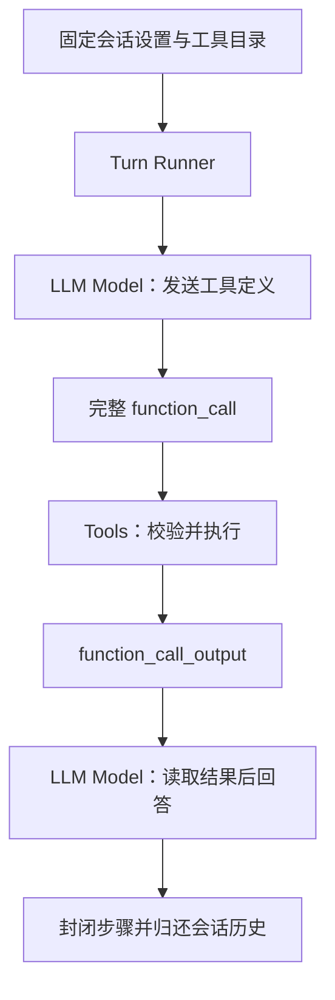

# 接入一次真实工具往返

本方案让一次用户输入真正经过“模型提出调用 → 应用执行 → 结果返回模型 → 模型回答”。它接在[独立任务运行器](01-isolate-turn-runner.md)之后，建立最小的端到端工具链，而不一次完成任意长度的 Agent 循环。

这个增量最多允许两次模型请求和一次工具执行。第二次响应若仍请求工具，按触限收尾，给尚未执行的调用补上明确结果。这里的临时上限让最初闭环有清楚的完成范围，后续方案才把它推广为连续决策。即使服务在一次响应中返回多个调用，也先对完整集合检查临时预算；超出额度时整批标记未执行并触限结束，不截取其中一项悄悄执行。

## 固定工具目录与实际执行能力

新增 `crates/agent/tools/`，包名 `agentelier_tools`。目录、描述、参数校验、具体处理和业务结果都在这个库内按 module 分开；两个诊断工具放在内部诊断模块，不另建测试 crate。

工具登记绑定唯一名称、用途、JSON 参数 schema 与真实实现。新会话固定目录快照，请求声明和执行分发使用同一目录；重复名称在会话建立前明确报错。只需固定集合与名称查找，不照搬多层路由、注册、审批编排或插件机制。

模型定义使用 `strict=true`；参数对象关闭额外属性，声明字段均列入 `required`。执行侧仍用具体输入类型检查未知字段、数值范围和业务条件，不用模型输出的合法 JSON 代替本地校验，也不新增通用 schema 引擎。

两项实际能力如下：

| 工具 | 输入和结果 |
| --- | --- |
| `diagnostic_calculate` | 两个有限数与加减乘除操作；成功返回有限结果和执行时生成的随机 `receipt`；除零、溢出成非有限值或非法操作返回业务错误 |
| `diagnostic_wait` | 0–30000 毫秒；在现有 Tokio 中异步等待，返回实际耗时和随机 `receipt`；支持取消，单次执行期限为 15 秒 |

工具不访问文件、网络、Shell、账号或凭据。它们是应用的运行时诊断能力，不是测试桩；使用与后续工具相同的执行路径。计算不解析脚本，等待不启动持久后台任务。

工具库不依赖 Runner、模型库、账号、Runtime、Bridge 或 Bevy。Runner 依赖工具库推进执行，`llm_model` 只使用它的定义和值类型进行协议映射，`conversation` 使用它保存目录快照和必要的结果摘要。

## 在模型协议中增加调用与结果

扩展 `llm_model` 的请求、SSE 处理和协议历史，保留当前账号获取方式、固定指令、`store=false`、流式输出和 `reasoning.encrypted_content`。工具使用自动选择；本增量设置 `parallel_tool_calls=false`，不让一次响应主动产生多个待执行调用。

接入 JSON 参数的 `function_call` 以及返回模型的 `function_call_output`。结果正文是有界 JSON 字符串，至少能区分成功数据和错误类别、说明，并携带原 `call_id`。加密 reasoning 与完整助手协议项按原顺序保留，指令仍在每次请求前单独注入，不重复累计到历史。

函数调用参数在流式接收期间只更新展示。等待合法 `response.completed`，校准最终输出、身份和 reasoning 续接内容后才执行。`output_item.done` 与最终 `output` 不重复执行，断流和不完整响应不会触发工具。

调用必须有有效名称和 `call_id`。模型项 ID、输出索引和调用 ID 各守自己的用途；展示键包含会话、任务和模型请求序号。复用过的 `call_id` 或冲突身份作为协议错误，在新执行前结束任务。同名同参数但新 ID 的调用不属于重复事件。

未知工具、参数 JSON 无效、本地类型校验失败、除零、超时等是可反馈的工具错误；协议损坏、网络失败和服务拒绝结束任务。`custom_tool_call`、JavaScript、程序项及未支持工具类型不能进入本地执行；不从助手正文提取代码运行。

## 一次往返也需要正确的历史与停止

由 `conversation` 定义的活动记录仍由 Runner 独占推进。一次完整模型输出和对应工具结果组成封闭步骤；原用户输入在首次形成提交点时记录一次。后续模型失败时，已完成工具步骤保留，当前未完成正文只保留展示。

停止发生在工具等待期间，要取消并回收该执行，再记录实际取消结果；已完成结果不被迟到停止覆盖。尚未开始的调用给出“未执行”结果。停止不再发新模型请求，Runner 返回可保留历史，Runtime 回收后发布终态。不得在 Runtime 外层直接丢掉整个 Runner Future。

没有提交点且未应用补充输入的失败仍允许原样重试；已有提交点后禁用原样重试，用户通过新消息继续，避免已执行工具自动重复。任务异常退出导致没有可信活动记录时，关闭会话继续执行入口，要求新建或重置。

单次参数与结果正文各限 64 KiB。参数超限不执行，结果超限返回有界错误而非截断的成功 JSON。保留模型已有连接、空闲和流大小上限。本增量的请求与工具计数上限暂为 2 和 1，触限时显示任务触限，不冒充正常完成。

## 从真实应用取得兼容性与执行证据

在已有账号和数据目录下，使用当前模型发送“请使用工具计算 123 × 456，并原样返回工具给出的 receipt”。应观察到真实 function_call、应用执行结果 `56088`、运行时生成的 receipt、携带对应 `call_id` 的结果项，以及模型读取结果后的回答。receipt 只辅助核对，应用的调用记录和下一次请求项才是主要证据。

现有“会话与请求核对”先提供目录、请求序号、调用及结果对应关系和保留状态；完整工具卡片在后续展示方案中完成。本阶段不为了验证另建管理面板或手动工具控制台。

模型目录中的 `tool_mode=code_mode_only` 不直接作为本应用的模式开关，也不是 Responses 请求参数。必须确认当前实际账号、模型和端点能完成上述 Direct 往返。若服务拒绝，记录实际错误并保留普通聊天，不自动换模型、登录方式或接入 JS。该真实链路不成立时，不能把工具往返记为通过。

正常不需要工具的问题仍应直接回答；空正文完成与拒绝正文延续原有显示。等待工具在执行中停止，核对取消和任务回收；请求等待 20000 毫秒时，应在 15 秒执行期限结束后返回超时结果，不能继续留下计时任务。除零应返回可读错误，并由模型读取后回应。

对未知名称、畸形参数、重复 ID 和断流，使用真实进程调试边界或网络条件进行受控故障注入；标明这是注入验证，不冒充真实模型输出。不创建测试代码、模拟模型服务器、Benchmark 或 Example。

GUI 通过 BRP 输入与点击，结合截图、安全 ECS 投影和现有日志核对结果；不由开发者自身的工具执行替代应用执行。特殊按键使用已知的完整 KeyboardInput 路径，原生 IME 另行核对，结束后释放 Pointer 至 `inactive`。不并发启动争用 Render 端口的 BRP 实例。

## 本增量的工程边界

两个新增业务库均在现有 Workspace 内，沿用 Windows x64、PowerShell 7、锁定依赖和 lint；不增加第二个执行运行时、工具线程、Widgetry Job、MCP、审批或沙箱。工具登记和结果类型按真实职责组织，不按每个类型建 crate。

累计进度复用现有快照路径，接纳和终态走可靠事件；最终快照先于回收后的终态。日志只记录安全身份、工具名、状态、耗时和错误类别，不记录完整内容、凭据或 reasoning，不新增 Subscriber，清理临时 TRACE。

实施结果记入按 `rules/development.md` 建立的临时进度记录，静态检查按改动范围执行。同步已实现的功能、架构和相关模块文档，不提前写入后续功能。保护现有账号和数据目录，不改 Widgetry 或 BRP 上游。

下一份方案是[连续推进工具决策并保留已完成步骤](03-repeat-tool-decisions.md)，它复用本方案的真实往返、错误结果和停止收尾，不重建另一套调用机制。
