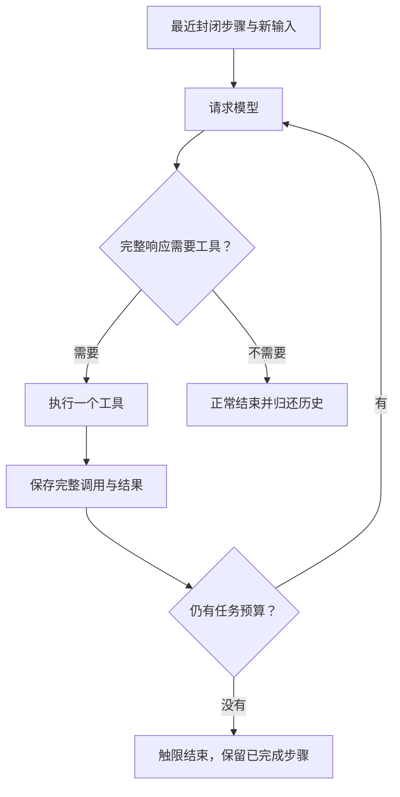

# 连续推进工具决策并保留已完成步骤

本方案在[一次真实工具往返](02-single-tool-roundtrip.md)之后，把 Runner 的有限两次请求推广为连续的模型—工具循环。一个工具结果可以让模型决定下一次调用，直到没有后续工具要求，或任务停止、失败、触限。本增量仍让每次模型响应至多产生一个工具调用，同批多调用留给下一份方案。

重点是让“模型的一次响应完成”和“用户任务完成”成为不同的边界。模型请求次数增加，不增加后台 Runtime、活动会话或并行任务。

## 工作历史沿着实际结果增长

任务继续使用创建时的模型、推理设置、指令快照、账号主体和固定工具目录。每次调用 `llm_model` 都使用当前工作历史；模型库负责一次 Responses 请求，工具库只负责具体执行。

历史的顺序是原用户输入、完整模型输出、匹配的工具结果，再进入下一次模型请求。公开 phase、原始输出项身份和续接所需加密 reasoning 保留；指令仍单独注入，不加入累计历史。

Runner 推进由 `conversation` 定义并独占持有的活动记录。每完成一个模型输出及其结果，就推进一个封闭提交点。若第一次计算成功、第二次请求断流，第一次调用与结果仍可交还会话，第二次不完整响应只在界面留下失败的部分内容。

首次形成提交点时写入原用户输入，后续步骤不重复追加。任务正常完成、停止或失败时都返回最新可保留记录；Runtime 真实回收后归还会话并发布终态。UI 的“失败内容未进入上下文”提示改为按步骤区分，不能把整个有工具历史的失败任务都标成未保留。

## 错误可以引出下一次决策

工具普通错误用 `function_call_output` 返回，关联原 `call_id`。包括名称未注册、参数 JSON 或类型无效、未知字段、数值范围错误、除零及执行超时。模型可以读错误后换参数，再发出新 ID 的调用。

应用不代替模型做自动工具重试，也不根据工具名或相同参数跳过正常新调用。只有同一接收事件的 done 与最终完成视图需要避免重复；任务中重复使用既有 `call_id` 的响应按协议错误处理。

网络错误、服务拒绝、不完整模型响应、缺失必要 reasoning、身份冲突或协议关系损坏结束任务，不把它们包装成计算工具失败继续执行。HTTP 认证恢复仍由现有模型通信与 Account 处理；不在 Runner 里另造重试策略。上下文超限显示实际错误并保留记录，不静默压缩、裁剪或改写历史。

没有工具的完整响应结束当前任务。拒绝正文正常显示；没有正文时也能按完整响应结束，不因找不到 final 文本而空转。后续 Steer 接入后，结束判断还要检查待处理补充输入，本增量不提前增加对应 UI 或空处理器。

## 预算属于整个任务

将初始闭环的两次请求、一次工具上限扩展为每任务最多 32 次模型请求和 64 次工具调用。计数不因为工具失败而回退，不在同一用户任务的下一次模型请求中重新计数。

发出下一次模型请求前检查请求预算。接纳工具调用时计入调用预算；无法执行的触限调用返回明确的“因限额未执行”结果，封闭关系后以触限结束。不要把本地限额伪装成服务错误或正常完成。

工具执行期限保持 15 秒，参数与结果正文各限 64 KiB。结果过大转为有界错误，不默默截断成成功 JSON。模型通信继续沿用 15 秒连接期限、120 秒空闲期限、4 MiB 单事件与 16 MiB 总流边界，不增加全局固定生成总时长或限额设置页面。

以后 Queue 启动的新任务获得新预算，Steer 仍属于原任务，不刷新预算。这里先把预算归属定清楚，不提前实现两种输入控制。

## 停止与重试要以执行事实为准

用户 Stop 取消当前模型等待或工具执行，并阻止下一次请求。当前工具真正结束后记录实际结果；已确认成功的结果不会因为取消信号晚到而改成取消。Runner 必须完整返回活动记录，不能由 Runtime 丢弃整个 Future。

未形成提交点且未应用补充输入的最近失败尝试，仍允许原样重试。已经形成提交点时，不再提供“把整个原输入重新跑一遍”的重试；用户可以发送新消息继续，模型会看到已经完成的步骤。

本阶段没有外部副作用工具，也不增加回滚或断点恢复。若任务异常退出而拿不到可信记录，显示失败并要求重置或新建会话。普通关闭应用仍只停止执行并保留账号，不能用退出登录完成验证。

## 用有依赖的真实调用验证循环

在真实应用中要求模型先用计算工具算 `123 × 456`，再用第一次结果加 `12`，最后报告结果与两个 receipt。应出现两次不同模型请求、两个不同 `call_id`、第二次参数承接 `56088`，最终结果为 `56100`。模型心算出正确值而没有实际执行，不算通过。

再让模型在取得工具业务错误后修正参数，核对错误结果进入下一次请求，新调用不会复用旧 ID。普通问题仍可在一次模型请求内结束，拒绝或无正文完成不引发额外请求。

在已有计算结果之后进入等待工具，使用 BRP 点击停止，再发新消息询问之前计算结果。应看到先前工具步骤仍在上下文，等待步骤以实际取消结束，原计算没有自动重做。无提交点的纯聊天失败则保留原重试行为与草稿。

预算与协议错误用实际进程的调试边界进行受控故障注入；可以在发请求之前把当前任务计数置于上限附近，观察是否停止发新请求。注入证据单独记录，不增加自动测试、脚本化模型服务、Benchmark 或 Example。不可观察的分支保持未验证，不能用编译结果替代运行结果。

## 与现有工程的衔接

循环算法和计数留在 `turn_runner`，记录与提交规则留在 `conversation`，工具校验留在 `tools`，协议编解码留在 `llm_model`。Runtime 只提供运行、控制与回收。继续复用唯一 Connection、累计快照、可靠接纳与终态事件；最终快照先于回收后的终态。

安全日志记录任务、请求与调用身份、工具名、状态、耗时和错误类别，不记录完整输入、输出、凭据或加密 reasoning，也不保留临时 TRACE。会话核对增加请求序号和步骤保留信息，但不另建执行管理界面。

静态检查按相关 crate 的修改范围执行，保持 Windows x64、PowerShell 7、当前锁定依赖和 Workspace lint。实际 GUI 验证使用 BRP 输入、截图与安全状态查询；特殊按键按既有 logical_key 限制处理，原生 IME 实机验证。释放 Pointer 至 inactive，避免多实例 Render 端口冲突。保持原账号和数据目录，不改上游库。

实施期间维护 `rules/development.md` 要求的临时进度记录，随本增量同步已实现行为与设计文档。下一份[同一响应内的多工具串行执行](04-serial-tool-batches.md)只扩展一次响应的调用数量，复用这里的循环和历史边界。
