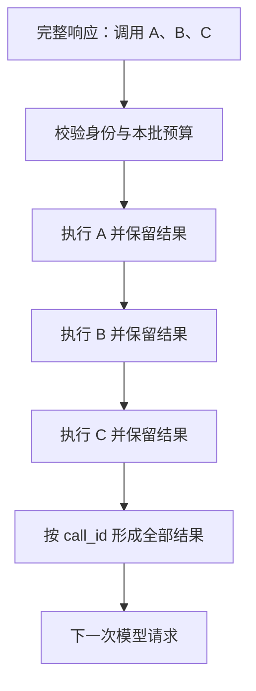
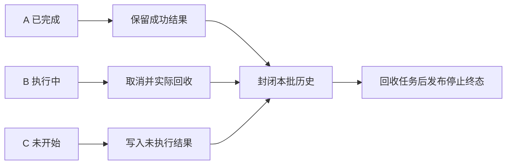

# 同一响应内的多工具串行执行

本方案接在[连续工具决策](03-repeat-tool-decisions.md)之后，支持一份模型响应中的多个工具调用。交付目标是完整接纳、逐项串行执行、正确关联每项结果，然后让模型继续；不增加工具并发调度。

图中只有一批已经生成的调用。每个调用的参数来自同一次模型响应，B 不会自动读取 A 的返回值；存在数据依赖时仍由下一次模型请求产生新的参数。

## 允许多项输出，执行仍然串行

请求不再固定 `parallel_tool_calls=false`，而是允许模型输出多个 function calls。这个协议能力只影响模型可以返回几项，不改变应用的串行执行策略。

Runner 在合法 `response.completed` 后取得最终工具项集合。按最终输出数组中的顺序执行所有工具，普通工具错误也形成结果，然后继续同批下一项。全部调用都有结果后，才发起下一次模型请求。

多个调用可以具有相同名称或参数，只要 `call_id` 不同，就按各自请求执行。执行前核对本批及本任务已有调用身份；缺失 ID、同批重复 ID、跨请求重用已有 ID 或冲突输出项使本次请求失败，不能先执行部分调用再发现身份错误。

流式参数仍只作展示。done 事件、最终 output 校准与展示快照合并都不能新增第二份执行。每个工具记录的身份带模型请求序号，两个响应重复使用相同 `output_index` 不会覆盖。

## 批次封闭与结果反馈

协议历史先保留原模型输出及 reasoning，再追加匹配的 `function_call_output`。每个结果有唯一 `call_id`，包含实际成功数据、业务错误或明确未执行原因。错误信息不会覆盖另一项成功结果。

一次模型响应及其全部结果是一个封闭步骤。原用户输入仍只在首次提交时写入；固定指令每次请求单独注入。未完成响应不产生执行，前面已经封闭的步骤在后续失败时继续保留。

`diagnostic_calculate` 和 `diagnostic_wait` 继续使用同一个固定目录，执行时产生真实 receipt。工具库不负责批次顺序，Runner 不负责各工具的参数业务规则，模型库不执行工具。

## 批次中间停止与触限

停止时可能出现“前面的已成功、中间的正在等待、后面的未开始”。保留已完成结果，取消当前执行并等待实际结束，后面的项全部标记未执行。补齐全部结果关系后归还历史，不再发起模型请求。

迟来的停止不回滚已确认成功的结果。不能仅取消模型网络 Future 而让工具继续运行，也不能丢弃整个 Runner 的活动记录。

每任务仍最多 32 次模型请求和 64 次被接纳的工具调用，成功和普通错误都占用额度。若整批超过剩余调用预算，则整批不执行，给各调用补上触限未执行结果，封闭后结束任务。避免执行一半后才发现这一批本来无法完成。

单工具期限 15 秒，参数和结果各 64 KiB；超时作为工具错误，通常不阻止同批后续项。Stop 或协议/执行故障才结束任务。所有结果均有界，结果超限不能变成半截成功 JSON。

已有提交点的失败或取消任务不提供原样重试，后续用新消息继续。任务异常退出、没有可信可封闭记录时要求重置会话，而不是猜测哪些项已经执行。

## 真实批次的完成条件

使用真实应用与当前模型请求一组互不依赖的计算，核对一份完整响应包含多个不同 `call_id`，应用逐项执行，下一次请求包含全部结果，最终回答引用实际返回数据。

仅观察到两轮分别调用一个工具，不算验证了同一响应的多调用。遇到模型选择分轮时，可以调整任务表达重试；仍未得到多项响应就记录该场景尚未取得真实模型证据，不通过人工气泡伪装批次。

批次中包含两个等待工具时，通过安全运行记录观察前一项结束后后一项才开始。一个计算项除零时，后面的合法项仍执行，各自结果都反馈给模型。相同参数但不同 ID 的调用执行两次；相同 ID 在流式 done 和最终响应中只对应一次执行。

在 A 成功、B 等待、C 未开始时点击停止，检查三项各自结果和后续上下文。靠近调用预算时接纳超额批次，应看到所有项未执行，且下一次模型请求没有发出。

身份冲突和边界计数用真实进程的调试注入检查，标明注入证据；不创建模拟模型服务器、自动测试代码、Benchmark 或 Example。验证跨 UI 的部分仍通过 BRP 真实输入、截图与安全状态查询，不能直接改 ECS 业务状态冒充交互。

## 改动边界与交付

本增量修改 Runner 的批次推进、Conversation 的结果封闭和模型请求的多调用声明；工具执行不增加并发原语、依赖图或统一调度框架。既有库职责和依赖方向保持不变，不增加新 crate。

复用累计快照与可靠生命周期事件，最终快照先于回收后的终态。日志只记录安全身份、顺序、状态、耗时和错误类别，不落完整输入输出或加密 reasoning；不增加 Subscriber，不保留临时 TRACE。

继续使用 Windows x64、PowerShell 7、当前锁定依赖与 Workspace lint，按实际改动执行编译、格式和 Clippy。验证保护登录和数据目录；BRP 特殊按键使用完整 KeyboardInput，原生 IME 另行检查，释放 Pointer 至 inactive，不同时启动冲突的 BRP Render 实例。界面沿用 BSN 与 Widgetry 公开 API，不改上游。

运行结果保存在 `rules/development.md` 要求的临时进度记录，随功能更新相关当前文档。下一份[把工具轨迹放进聊天界面](05-observable-tool-timeline.md)完善已有批次记录的呈现；它不是新一套执行机制。
