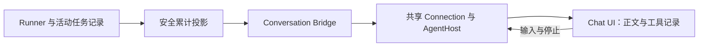

# 把工具轨迹放进聊天界面

前面的方案已经完成真实调用、连续决策和[同批串行执行](04-serial-tool-batches.md)。本方案让用户在聊天区域看清这些行为：模型正在请求什么工具、工具有没有开始、结果是什么，以及停止后哪些步骤仍然保留。

界面消费执行侧事实，不根据文字内容猜测工具调用，也不建立第二份协议历史或工具状态权威。此处完善呈现，不改变已经形成的执行顺序和历史规则。

## 同一个内容流，保留不同的内容类型

把任务展示从单纯的助手消息集合扩展为有序的正文与工具记录。助手正文继续保留原 phase、原始 Markdown、消息身份和服务顺序。工具记录显示在对应调用位置，执行结果更新该记录，不生成假助手气泡。

记录身份包含 Session、Turn、模型请求序号、输出项 ID；工具记录另外保留 `call_id`。一个用户任务中第二次响应的第零项与第一次响应的第零项是不同内容。`output_item.done` 和最终响应校准更新同一项，不能重新插入一条工具记录。

工具卡片默认显示名称、简短参数摘要和状态，展开时提供本次有界参数与结果。正文中的命令或 JavaScript 只是文本，不产生按钮执行或隐式工具调用。结果详情使用现有只读正文能力，不引入工具管理后台、调度面板或新 UI 框架。

## 工具状态与任务状态分别表达

| 对象 | 需要可观察的状态 |
| --- | --- |
| 工具项 | 接收中、待执行、执行中、成功、失败、超时、取消、未执行 |
| 整个任务 | 请求模型、执行工具、正在停止、完成、失败、已停止、触限 |

“接收中”说明模型还在发送参数，“待执行”说明完整调用已经被接纳。只有执行侧实际开始后才显示执行中。正常超时与业务错误保留各自说明；未执行项说明是用户停止、补充输入或预算造成，不能显示成工具已运行失败。

瞬间完成的计算不保证每个中间状态都能绘制出来；仍须保留准确的终态和身份。需要观察运行状态的场景使用实际等待工具，不通过强制延迟每个普通调用美化界面。

一个模型响应完成而后续仍需工具或模型请求时，整轮保持运行。只有 Runner 结束、活动记录归还且任务真正回收后才显示最终状态。

## 已保留历史与未完成内容要分开看

取消或失败之后，部分正文和工具详情继续可看。已经封闭的模型—工具步骤标明保留，当前未完成响应标明未纳入后续上下文。不能把整个失败任务统一标成“未进入上下文”。

已有提交点的任务不提供原样重试，用户发送新消息继续。没有提交点且没有已应用 Steer 的最近失败尝试保留原重试入口。任务异常退出而没有可信记录时，显示需要重置会话，不提供仍会使用不完整历史的发送入口。

“会话与请求核对”沿用既有页面，增加固定工具名称与说明、模型请求序号、调用与结果的匹配关系及已保留步骤。只提供安全摘要与有界详情，不展示原始凭据或加密 reasoning，不把 UI 投影用于构造请求。

## 控件与通道保持稳定

聊天输入仍使用现有多行 TextField。工具输出增长时复用对应行和内容实体，不重建编辑器，不清空正在输入的新草稿，也不在生成期间禁用整个输入区域。

BSN 负责创建和组合。持续状态留在 ECS Component 或 Resource，Props 只初始化一次。修改正文使用 `WidgetryTextFieldHeadless` 等公开 API，不给根增加第二份 EditableText，也不直接改写内部 Editor。

滚动行为保持原样：在底部时跟随，向上阅读后保留位置，“回到底部”恢复跟随。切换设置页不会取消执行，返回时恢复当前记录与阅读位置；新增工具卡片不破坏 Markdown 原文、代码块复制或表格独立横向滚动。

累计快照可以合并过时进度，但终态必须存在于最新快照。接纳和结束等回执走可靠事件路径，最后快照先于任务终态。Stop 不等待正文通道。通道关闭或回执交付失败必须显示执行连接错误，不能用静默丢弃掩盖状态不一致。

## 以实际交互验证可观察行为

通过 `bevy_brp_mcp` 启动真实应用，保留当前账号与数据目录。发出连续计算和同批调用任务，分别核对模型请求序号、调用顺序、每项参数与结果、最终回答和随机 receipt。查看详情前后，执行侧历史应保持不变。

执行等待工具时观察接收、等待或运行及最终状态，随后点击停止，确认先显示正在停止，再在工具和任务实际回收后显示已停止。前面成功的计算仍显示成功，后面的未启动调用显示未执行，后续追问得到的历史与界面一致。

生成期间在输入框继续编辑，展开工具详情、滚动上方历史，再切页返回。草稿、焦点允许保留的状态与阅读位置不应被流式更新重置。继续核对 Enter、Shift+Enter 和 IME 的原有规则，下一份方案才改变运行中 Enter 的发送语义。

所有 GUI 行为用 BRP 真实 Pointer/Keyboard/Scroll 与截图、ECS 安全投影共同验证。当前 `send_keys` 的特殊逻辑键限制需要时改用 `world.write_message` 提交完整 KeyboardInput，不直接设置业务组件冒充输入；原生 IME 单独实机验证。Pointer 结束后释放并确认 inactive，不同时启动争用固定 Render 端口的实例。若遇到已有静态文字偶发未绘制，不以逐帧重写文字或修改上游源码掩盖。

## 本方案只承担展示职责

改动主要归 `chat_ui` 及 `bridge/conversation` 的安全投影。Chat UI 内按工具记录、详情与输入控制等实际主题划分 module，暂不为一个专用卡片新建 crate。执行算法、工具实现和历史提交仍归各自 Agent 库；Agent 和 Bridge 不依赖 Bevy。

日志沿用原宿主，记录安全身份、状态、耗时和实际错误类别，不记录完整输入输出、Token 或 reasoning，不增加 Subscriber，交付前移除临时 TRACE。

保持 Windows x64、PowerShell 7、当前锁定依赖、Workspace lint 与 BSN 规则，静态检查随实际改动执行。禁止测试、Benchmark、Example 和验证专用框架；运行结果保存在 `rules/development.md` 要求的临时进度记录，并同步已实现的聊天行为与相应设计文档。不退出登录或更换数据目录，不修改 Widgetry/BRP 上游。

下一份[运行中补充当前任务](06-steer-active-task.md)增加 Steer，复用本方案的工具轨迹、任务状态和稳定输入区域，增加“已接纳”与“已生效”的区别。
