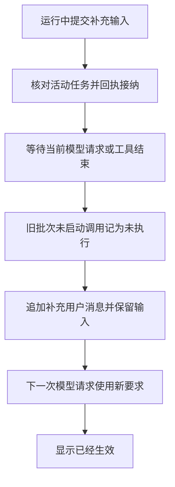

# 运行中补充当前任务

本方案在[工具轨迹界面](05-observable-tool-timeline.md)之后增加 Steer：用户在模型或工具运行期间提交新要求，当前任务在下一处执行边界采用它。它延续当前任务，不创建新的任务，也不排队到当前任务结束以后。

“已接纳”表示任务保存了这条消息，“已生效”表示它已经用于一次新的模型请求。界面和内部记录都保留这个区别。

## 输入接纳属于当前任务

补充命令携带会话、任务、当前操作身份和独立输入身份。它不走要求全局空闲的普通 `Send` 接纳入口，也不占用第二个模型任务槽。

复用共享 Host 与 Connection，增加面向活动任务的有界控制路径。Connection 负责请求关联和转交，Runtime 把命令交给对应 Runner，Runner 根据自身活动状态确认接纳或拒绝。Runner 在等待网络或工具时仍须处理控制接纳，不能等长请求结束后才把早已显示的“已接纳”补成事实。

Stop 继续使用独立取消信号，不受 Steer 队列是否已满或正文更新频率影响。最多保留 8 条尚未应用的 Steer，满时明确拒绝并保留草稿；不覆盖旧输入。接纳回执走可靠事件，不能被进度快照替换。回执交付故障显示连接错误，不自动重复提交同一消息。

## 在下一处边界改变后续行为

正在执行的工具先取得终态，正在进行的模型请求先得到完整响应或失败。补充输入不修改已发出的 HTTP 请求，也不自动杀掉当前工具；需要立即停止时使用 Stop。

Runner 在开始下一项工具、下一次模型请求或确认任务结束前检查已接纳的补充输入。存在新输入时，旧响应中尚未启动的工具调用不继续执行，给每项补齐“因补充输入未执行”的结果。保留已执行工具的真实结果，封闭旧批次后，按接纳顺序追加补充用户消息，再请求模型重新判断。

例如旧响应要求先等待再计算，等待期间收到“不要继续计算，改为解释已有结果”。等待自然结束后，原计算调用成为未执行结果，模型从保留的等待结果和新要求继续，而不是旧批次照跑完才看到要求。

若旧响应本来已经给出最终正文，接纳在先的 Steer 仍使当前任务继续。原正文保留自己的 phase，不能因此提前发布任务完成。任务完成和输入接纳必须由同一执行所有者裁定。

## 补充要求不能在后续失败中丢失

补充输入首次真正用于模型请求时，写入任务记录及可重放输入边界；原始任务输入尚未保留的，也只补入一次。下一次请求断流时，已应用的补充要求仍留在后续上下文，不回退到旧要求。

多条补充消息保留原文和顺序，不拼成丢失身份的一条指令，也不改写为 developer 消息。固定模型、推理设置、账号主体、工具目录和指令快照不受 Steer 改动。

任务预算仍是最多 32 次模型请求、64 次工具调用，单工具 15 秒，参数与结果各 64 KiB。Steer 不重置计数；已到模型请求上限时不能靠补充输入继续无限执行，应显示触限，未应用消息保留为未生效。

未形成提交点且未应用任何 Steer 的最近失败才允许原样重试。已有工具步骤或已应用 Steer 后，用新消息继续，不能自动从原输入重跑。任务异常退出而活动记录不可信时要求重置会话。

## 结束、停止和接纳的竞态

如果任务完成裁定在先，迟到 Steer 被拒绝并保留草稿；不能自动改成普通发送或 Queue。如果 Steer 已接纳但 Stop、账号主体变化或执行故障先到，使它没有应用机会，消息保留为未生效，不自动转给其他任务。

Stop 的结果仍以真实执行收尾为准：当前工具取消回收，已完成结果保留，未启动项不启动，Runner 归还可保留历史，Runtime 在 JoinHandle 回收后发布终态。模型自然完成与迟到停止相遇时，不回滚已经确认的结果。

可靠回执关联输入身份，累计展示快照关联任务与请求身份；旧任务的迟到结果不能把新任务的补充输入标成生效。

## 输入框保留原有编辑行为

空闲时主按钮与 Enter 仍发送新任务；运行时主按钮显示“补充当前任务”，Enter 提交 Steer。Shift+Enter 换行，IME 预编辑和候选提交帧不触发发送。后续 Queue 使用单独按钮，Tab 保留焦点导航，本增量不增加 Queue 控件。

提交前保存草稿内容和编辑身份，只有接纳成功、且用户没有继续编辑该草稿，才清除原内容。拒绝不清空；等待回执期间继续编辑的新文字也不能被旧回执删掉。

继续使用现有 BSN、Widgetry TextField 公开 API 和稳定 ECS 状态，不重建输入框，不用 Props 镜像运行状态。工具记录和普通 Markdown 的滚动、复制、切页恢复行为保持不变。

## 真实运行中验证“接纳”与“生效”

让模型先调用短等待工具，再按原要求计算。等待期间通过 BRP 输入改变要求，检查先出现接纳回执、随后在边界跳过旧的未执行调用，再出现包含新消息的模型请求；模型的后续行为应依据新要求。

在模型生成期间补充要求，观察当前请求并未被伪装成可修改请求；完整响应后才进入新边界。连续输入两条要求，核对顺序；接纳后立即编辑新草稿，旧回执不得清除新内容。

在任务完成附近提交 Steer，允许结果由真实接纳顺序决定，但必须清楚地得到“接纳并继续”或“拒绝且保留草稿”，不能丢输入、转成 Queue 或启动第二任务。接纳后再 Stop，应看到未应用条目仍可回看。必要的队列满、预算临界和竞态分支使用调试器控制真实运行时机，标记注入证据。

验证已应用补充输入后的请求失败，随后正常追问仍能看到补充要求。核对错误、取消和正常结束都没有自动重放工具。

## 交付与限制

本增量扩展 Runner 的输入接纳与边界检查、Conversation 的输入记录、现有 Bridge 控制回执及 Chat UI。不要把输入队列转成通用事件总线，不引入 Code Mode、实时请求改写、工具抢占式调度、持久化或多任务并行。

验证使用真实应用、真实模型与 BRP，不编写测试、Benchmark、Example、模拟模型服务或持久化验证程序。特殊按键通过完整 KeyboardInput 处理已知限制，原生 IME 实机核对，完成后释放 Pointer 至 inactive，避免多 BRP Render 实例冲突。登录状态和原数据目录保持不变。

遵循 Windows x64、PowerShell 7、当前锁定依赖与 lint，日志只记录安全关联、阶段和错误，不记录输入正文或 reasoning，不新增 Subscriber，清理临时 TRACE。按 `rules/development.md` 保留临时进度与真实证据，随本增量同步已实现的交互和设计文档，不修改上游库。

下一份[按顺序启动排队消息](07-queue-followup-messages.md)新增会话级 Queue。它与 Steer 的消息目标不同，但复用这里建立的控制接纳和可靠回执路径。
