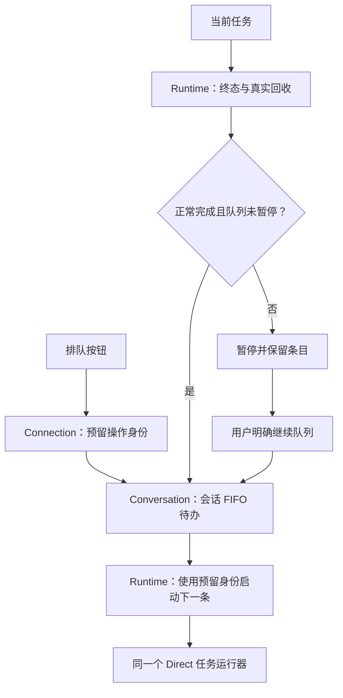

# 让后续消息按顺序启动

Queue 接收用户准备交给下一轮的任务。它与 Steer 的区别发生在接纳时：Steer 交给正在执行的任务，Queue 留在会话待办中，当前任务结束后才有机会启动。这个增量交付排队、移除、自动启动和暂停后的明确继续。

前一增量是[补充正在执行的任务](06-steer-active-task.md)。这里复用其控制接纳与草稿保护，但队列的内容和状态由 `conversation` 管理，不放进 Runner 的待处理补充消息中。

图中的循环是多个用户任务依次启动，不是一个任务内部的多次模型请求。模型请求、工具批次、Steer 和预算仍属于各自的任务。

## 待办消息还没有进入上下文

队列绑定当前 Session，按接纳顺序先进先出。每条条目保存独立输入身份、原始正文和预留的未来操作身份；已有会话的模型、推理强度、账号与指令快照继续用于启动任务。调整准备区不会改变这些排队任务的会话设置。

排队成功时，消息只出现在输入区附近的待办区域。正式出队并创建任务时，它才进入聊天记录和模型上下文；原始输入只写入一次。前一个任务不能看到尚未启动的排队内容。

最多保留 8 条尚未开始的消息，活动任务不占这 8 个位置。满队列明确拒绝新输入，不覆盖旧条目。输入非空检查、接纳回执和草稿修订核对沿用现有规则；用户在等待接纳期间继续编辑的新草稿不会被清掉。

支持移除尚未启动的条目。不增加编辑、重排、优先级、跨会话队列、持久化或后台自动化任务。这些能力不是当前顺序交互所必需的。

## 谁决定下一条什么时候开始

`Conversation` 保存队列和暂停状态；Runtime 在旧任务真实结束、JoinHandle 回收、活动记录归还之后，按会话规则申请出队并启动。Runner 只执行已经交给它的一个任务，不自行抢占下一条。

当前任务正常完成且队列未暂停时，自动开始下一条。任务中的工具业务错误若已经反馈模型，随后任务正常完成，仍可以继续队列。

用户停止、任务失败或预算触限会暂停队列，剩余消息保留。界面显示“继续队列”，只在当前没有活动任务、会话可继续且运行环境可用时接纳。任务异常退出而没有归还可靠历史时，保留失败状态并要求新建或重置，不能靠继续队列绕开历史问题。

队列暂停期间，用户可以发送新的普通消息处理当前问题；这个任务的正常完成不解除暂停。只有明确点击“继续队列”才恢复自动推进。已有自动出队决定也不会被一次迟到的普通发送插到前面；该发送按现有忙状态拒绝并保留草稿。

例如 A 正在等待，用户排队 B、C。A 完成后先运行 B，再运行 C。若 A 被停止，B、C 都保持待办。用户发消息检查 A 的已完成步骤，得到回答后 B、C 仍然不启动，直到用户明确继续。

## 延续现有操作身份，不建立第二套调度

`Connection` 已经统一分配 `operation_id`。Queue 接纳前从这套序列预留未来任务身份，尚不占用活动任务槽；执行侧拒绝接纳时，这个身份可以作废，不复用。正式启动时 Runtime 使用预留身份，Connection 根据开始回执更新唯一活动操作。

运行中的 Queue 提交走会话控制入口，不调用要求全局空闲的普通 `allocate` 路径。预留身份与放宽业务互斥是两回事：仍然只有一个活动任务，账号操作和模型连接验证继续遵循原有接纳限制。

旧任务结束、新任务开始按确定顺序交付。旧任务的终态只释放与它身份匹配的占用，不能把已经启动的新任务清为空闲。累计正文快照可以合并，接纳、移除、暂停、启动和终态回执不能静默丢失；回执通道故障按执行故障处理，不能让界面误以为操作没有发生而再次提交。

自动出队、移除、停止及新输入在执行侧串行裁定。移除请求到达时条目若已启动，返回“已经开始”，继续显示对应活动任务并允许用户使用 Stop；不同时显示已移除。Stop 始终匹配 Session、Turn 和 operation 身份，迟到的旧停止不影响下一条。

## 队列怎样与停止、历史和预算协作

Queue 不改变既有任务收尾：正在执行的工具收到取消并真实结束，已完成结果保留，未启动调用补齐未执行结果，完整步骤归还到会话。停止不回滚，也不自动重做先前成功工具。

队列启动的是新用户任务，因此取得独立任务预算：32 次模型请求、64 次工具调用。单工具仍为 15 秒，参数和结果各最多 64 KiB。Steer 仍归当前任务，待处理补充上限 8 条，不借 Queue 清零当前预算。每个任务继续使用完整协议历史、固定工具目录和会话指令，指令不累计写入历史。

无提交点且无已应用 Steer 的失败任务保留原输入重试；已形成提交点则通过新消息继续，Queue 也不能把原任务变成隐式重放。暂停时显式启动下一条待办，是提交用户事先排队的新输入。

## 界面把两种输入意图分清

运行中 Enter 与主按钮仍表示“补充当前任务”；独立“排队”按钮提交后续任务。空闲时 Enter 是普通发送。Shift+Enter 换行，IME 提交帧不发送，Tab 保持焦点导航。

待办区域显示顺序、正文摘要、移除入口及暂停状态。排队时保持输入框、选择和阅读位置；工具更新和新任务启动不重建整个编辑器。跨页返回恢复内存中的队列与活动记录，保持原有底部跟随规则。

采用现有 `chat_ui` 内部模块与 BSN 组合，正文使用 Widgetry 公开 API。Queue 不需要新的 UI crate、第二个 Connection 或调度管理页面。运行状态仍由后台权威驱动，UI 不依据本地计时推断任务完成。

## 会话替换与应用关闭

新建、重置会话在已有确认中同时说明待办消息将被清空；取消确认保留记录、队列和草稿。活动任务未回收时继续禁止替换会话。

账号主体变化清除旧会话与队列，正常 Token 续期保留它们。关闭应用先禁止新任务接纳和自动出队，再取消当前任务、等待回收及必要凭据提交，最后退出。普通关闭保留登录；下次启动没有本阶段的聊天或队列恢复。

验证这些规则时不主动退出账号、重新授权、重置凭据或更换数据目录。账号身份变化的边界采用现有合法状态路径检查，不为验收破坏当前登录环境。

## 在真实应用中确认任务顺序

用 `diagnostic_wait` 建立可观察的活动窗口，通过 BRP 实际输入并排队两条有不同计算结果的任务。检查待办消息在启动前不出现在当前请求历史中；旧任务回收后，两个新 operation 和 Turn 依序启动，工具执行记录与随机 `receipt` 对应，没有并行生成。

用停止、普通失败和触限分别确认队列暂停。暂停后提交一条普通消息，确认完成后仍不启动待办，再点击继续。移除中间待办后检查后续顺序不变；接近自动启动时移除首项，依据后台回执确认只有“已移除”或“已经开始”其中一种结果。

填满 8 条后再排队，检查拒绝和草稿保留；接纳过程中继续编辑草稿，检查新内容不丢失。确认 Steer 修改当前任务而 Queue 不修改当前任务，取消会话替换确认保留待办，普通关闭不再自动启动下一条。操作身份、调用结果和历史归属通过安全核对视图、截图及日志共同确认，不把界面气泡出现当作实际执行证据。

这一增量完成时做一次与本阶段整体结果对应的连贯检查：普通无工具聊天；单工具往返与随机回执；依赖结果的连续调用；同一响应中的多工具串行执行；执行中停止与后续历史；Steer 生效；Queue 顺序与暂停。已被前序实际证据覆盖且未受修改影响的细节不机械重验；本增量改变的接纳、回收和跨任务交接要重新验证。

GUI 验证使用实际 `app/` 与 `bevy_brp_mcp`，先建立焦点再操作。特殊逻辑键按已知限制使用完整 `KeyboardInput`；原生 IME 另外实机确认，不改 ECS 业务状态冒充交互。释放 Custom Pointer 并查询至 `inactive`，不同时运行多个启用 BRP 的实例。受控调试注入证据与真实模型输出分开记录；不创建测试代码、Benchmark、Example、模拟服务或回归程序。

## 完成时留下的内容

运行于既有 Windows x64、DX12 和 PowerShell 7 环境，保持 Workspace 依赖与 lint 规则；只做与本增量相关的编译、格式和 Clippy 检查。`conversation`、`runtime`、对应 Bridge 与 `chat_ui` 各自保留职责，工具仍经独立工具库和任务运行器执行。

同步队列、停止、重试及多轮交互涉及的模块设计和设计关系。实际实施期间按项目规则维护临时进度记录，记录验证事实，完成提交前清理该临时文件。日志只含安全身份、阶段、耗时与错误类别，沿用宿主 subscriber，清理临时 TRACE，不记录凭据、完整正文或加密 reasoning。

这一增量仍只提供 Direct Mode。不给队列附加持久化、后台守护、跨会话任务、工具并行、MCP、Code Mode 或新的权限体系，也不修改上游控件与 BRP 源码或升级锁定依赖。
