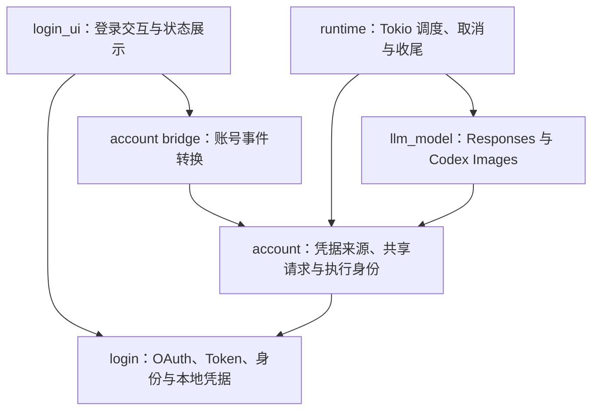
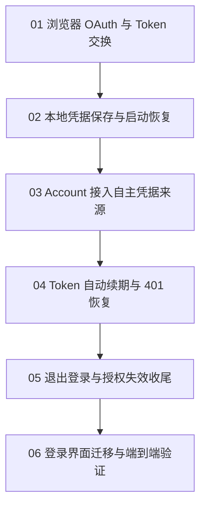

# Agentelier Codex OAuth 认证改造

Agentelier 当前通过用户选择外部 Codex `auth.json` 获得 ChatGPT OAuth 凭据。目标是移除这项外部文件依赖，由 Agentelier 自己发起与 Codex CLI 相同路线的浏览器 OAuth 登录、取得并管理 Token，同时继续使用现有 Account 凭据分发机制和 Codex 模型 / 图片接口。

本次采用已经完成真实授权与图片生成实验的路线：`https://auth.openai.com`、Codex OAuth Client ID、本地回环回调、Authorization Code + PKCE S256。授权请求增加 `prompt=select_account`，并将 `originator` 统一为 `agentelier`。OAuth URL 与 Codex API 请求 Header 都使用这个 Originator。图片生成继续走 Codex 专用 Images API，不切换到 Sign in with ChatGPT（SIWC）。

## 整体职责

`Login` 负责 OAuth 协议、凭据值、本地保存与续期；`Account` 仍是账号来源、凭据分发和执行身份的所有者；`Runtime` 继续负责后台任务调度、取消及旧任务收尾；`Bridge` 只转换账号事件和安全展示摘要；`login_ui` 负责浏览器登录入口和状态展示；`llm_model` 通过现有 `CredentialClient` 使用凭据，不自行保存第二份账号状态。

改造不引入新的总控 Crate，也不把 Codex 的 `AuthManager`、TUI 或存储抽象整体搬入 Agentelier。

## 方案之间的关系

这条顺序反映实施所需的真实前置关系：先取得凭据，再保存和恢复；Account 接入新的凭据来源后，才能将刷新、退出和界面操作纳入现有账号生命周期。各方案中的编译、运行及针对性验证均属于对应功能交付，不另设纯验收阶段。

## 实施方案

1. [浏览器 OAuth 登录与 Token 交换](01-browser-oauth.md)
2. [本地凭据保存与启动恢复](02-credential-persistence.md)
3. [Account 接入自主 OAuth 凭据来源](03-account-integration.md)
4. [Token 自动续期与 401 恢复](04-token-refresh.md)
5. [退出登录与授权失效收尾](05-logout.md)
6. [登录界面迁移与端到端验证](06-login-ui.md)
