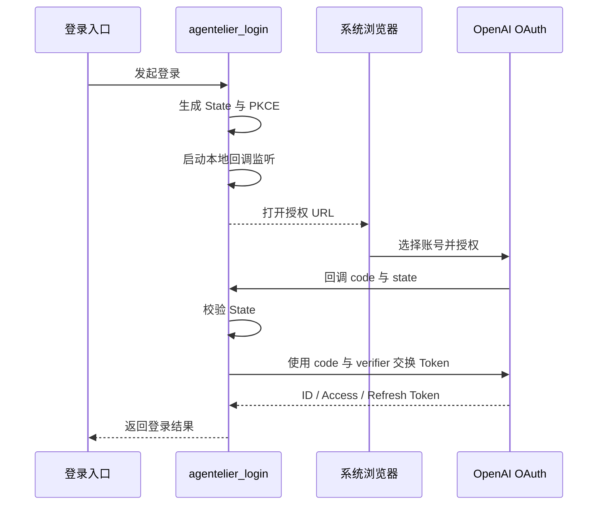

# 浏览器 OAuth 登录与 Token 交换

## 目标

在 `agentelier_login` 中提供 Agentelier 自己发起的 Codex OAuth 浏览器登录能力。用户点击登录后，应用启动本地回调服务并打开系统默认浏览器；用户选择 ChatGPT 账号并授权后，Agentelier 接收回调并交换 Token。

该方案只负责一次登录操作及 Token 交换，不在本阶段引入持久化、自动刷新或 UI 完整状态管理。

## 授权流程

使用 Authorization Code Flow 与 PKCE S256。每次登录生成新的随机 State 和 PKCE verifier，授权 URL 携带 challenge；回调必须匹配本次 State，并且只接受一次有效授权结果。授权码交换使用本次登录生成的 verifier 和实际使用的 Redirect URI。

## OAuth 服务与参数

- Issuer：`https://auth.openai.com`
- Authorization Endpoint：`https://auth.openai.com/oauth/authorize`
- Token Endpoint：`https://auth.openai.com/oauth/token`
- Client ID：`app_EMoamEEZ73f0CkXaXp7hrann`
- 默认回调端口：`1455`
- 备用回调端口：`1457`
- 回调路径：`/auth/callback`
- Redirect URI 使用实际监听端口构造，并与授权码交换时使用的值完全一致。

授权请求包含 `response_type=code`、`client_id`、`redirect_uri`、`scope`、`code_challenge`、`code_challenge_method=S256`、`state`、`prompt=select_account`、`id_token_add_organizations=true`、`codex_cli_simplified_flow=true` 和 `originator=agentelier`。

Scope 沿用当前 Codex OAuth 登录流程：`openid profile email offline_access api.connectors.read api.connectors.invoke`。不传 `id_token_hint` 或 `login_hint`，避免跳过账号选择或预选账号。

`originator=agentelier` 只用于标识实际客户端，不使用 `codex_cli_rs` 或 `opencode` 冒充其他应用。后续发往 Codex API 的请求也统一使用 `originator: agentelier`。

## 本地回调服务

回调服务只在登录期间存在。优先监听 `127.0.0.1:1455`；端口无法绑定时按 Codex CLI / OpenCode 已采用的备用端口策略尝试 `1457`。授权 URL 必须使用最终成功绑定的端口，不能在备用端口启动后仍使用默认端口的 Redirect URI。

服务接收 `/auth/callback`，读取授权码、State 或 OAuth 错误。State 不匹配、缺少授权码、用户拒绝授权、Token 交换失败都应作为本次登录失败返回，不得把错误回调视为成功。登录完成、取消或失败后关闭监听服务。

用户取消登录时，应结束等待并释放本地监听。一次登录操作结束后，迟到的回调不能再次完成该操作。登录服务应有明确的等待期限，避免回调永远悬挂。

浏览器自动打开失败时，登录操作仍应保留可供用户手动打开的授权 URL，并向调用方返回可观察的打开失败状态；不要因系统浏览器启动失败而丢弃仍可继续的本地回调服务。

## Token 交换结果

成功交换后，保留服务返回的 `id_token`、`access_token`、`refresh_token` 及有效期信息，解析 ID Token 中的账号身份摘要，形成 Agentelier 自己的 OAuth 凭据值。账号主体、ChatGPT Account / Workspace 标识和 Email 作为身份展示与后续执行绑定所需信息；Token 本身不得交给 UI 或 Bridge。

当前实验已经证明备用端口 `1457`、真实授权回调、Token 交换及 Codex Images 请求能够成功。正式登录实现应保留实验中已经跑通的协议行为，并将其归入 `agentelier_login` 的正式职责，而不是再依赖实验入口或外部 `auth.json`。

## 完成条件

- 用户触发登录后，应用能打开系统默认浏览器。
- 每次授权请求都携带 `prompt=select_account`，并且不携带 `id_token_hint` / `login_hint`；实际页面展示账号选择界面。
- 1455 正常工作；1455 被占用时，1457 能正确启动并完成回调，Redirect URI 与实际端口一致。
- PKCE S256 与 State 校验通过；无效 State、拒绝授权、缺少 code、交换失败及取消均能结束本次操作并显示失败原因。
- 成功取得 ID Token、Access Token、Refresh Token 和账号身份摘要。
- 登录结束后本地监听服务被释放，迟到回调不能污染后续登录。
- 不依赖 Codex CLI、外部 `auth.json` 或 SIWC。

## 参考实现

- [Codex CLI OAuth 回调服务](https://github.com/openai/codex/blob/main/codex-rs/login/src/server.rs)：本地回调、PKCE、授权 URL、授权码交换与备用端口行为。
- [Codex CLI 登录入口](https://github.com/openai/codex/blob/main/codex-rs/cli/src/login.rs)：启动浏览器登录服务的调用方式。
- [OpenCode Codex OAuth](https://github.com/anomalyco/opencode/blob/dev/packages/core/src/plugin/provider/openai.ts)：相同 Client ID、1455 / 1457 端口策略、`codex_cli_simplified_flow` 与独立 Originator 的实际使用。
