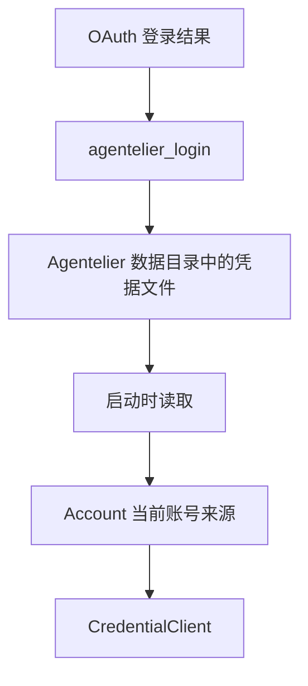

# 本地凭据保存与启动恢复

## 目标

让 Agentelier 保存自己通过 OAuth 取得的凭据，并在后续启动时恢复登录状态。凭据属于 Agentelier 当前数据环境，不再通过应用配置引用 Codex 客户端的 `auth.json`。

本项目是个人使用的 Windows x64 桌面应用，不需要复制 Codex 的多后端凭据存储体系。采用数据目录内简单的本地凭据文件即可，不引入 Keyring、DPAPI、加密 Secrets 容器或额外的跨平台存储抽象，也不专门增加复杂的 ACL 管理。

## 凭据归属

数据目录仍由现有 `DataEnvironment` 管理。凭据文件放在该数据环境内部，由 `agentelier_login` 负责读写；应用配置不再保存外部凭据路径。凭据文件只承载 Agentelier 自己取得的 OAuth 凭据，不复用 Codex `auth.json` 格式作为应用间共享契约。

凭据数据至少包含 ID Token、Access Token、Refresh Token、有效期或过期时间，以及账号主体、ChatGPT Account / Workspace 标识和 Email 等身份摘要。保存格式保持简单，能直接恢复同一套凭据值即可；不为了兼容 Codex 的其他认证模式而加入 API Key、Device Code、Bedrock 或多后端字段。

## 保存与恢复行为

登录成功后，将完整新凭据写入 Agentelier 数据目录，保存成功后才向 Account 发布已登录状态。保存失败时，本次登录不能显示为持久登录成功；应向界面返回实际保存错误。写入过程应避免留下半份凭据文件，采用同目录临时文件完成后替换目标文件即可。

应用启动并接管当前数据环境后，Login 读取本地凭据并形成账号状态。没有凭据文件时为未登录；文件无法读取、格式不正确或缺少必要 Token 时，显示不可用状态和原因，不将损坏文件解释为已登录。根据 Token 有效期判断是否需要续期，具体刷新行为由后续 Token 生命周期方案接入。

用户更改下次启动的数据目录设置，不应改变当前正在使用的数据环境或当前账号。凭据随其所属的数据目录存在；应用不会把账号 Token 写入全局配置，也不会从旧 Codex `auth.json` 自动迁移或导入。

## 与现有数据生命周期的关系

数据目录的独占锁、会话、记忆和其他本地数据继续由既有机制管理。OAuth 凭据是同一数据环境中的独立材料；退出登录只清除凭据，不删除会话、记忆、附件或其他应用数据。应用正常关闭不等于退出登录，正常关闭时保留凭据供下次启动恢复。

## 完成条件

- OAuth 登录成功后，凭据写入当前 Agentelier 数据目录。
- 保存成功后重新启动应用，能够恢复相同账号和 Workspace 身份。
- 没有凭据、文件损坏、读取失败及凭据字段缺失均形成明确状态。
- 凭据文件不依赖 Codex `auth.json` 的位置或结构。
- 更改下次启动的数据目录不会切换当前账号或搬运凭据。
- 正常关闭应用后凭据仍然存在；本阶段不实现退出登录清理。
- 不引入 Keyring、DPAPI、多后端存储抽象或复杂 ACL 维护。

## 参考实现

- [Codex TokenData](https://github.com/openai/codex/blob/main/codex-rs/login/src/token_data.rs)：ID Token、Access Token、Refresh Token 与账号身份摘要的字段参考。Agentelier 只借鉴必要凭据内容，不复用完整 `auth.json` 存储结构。
