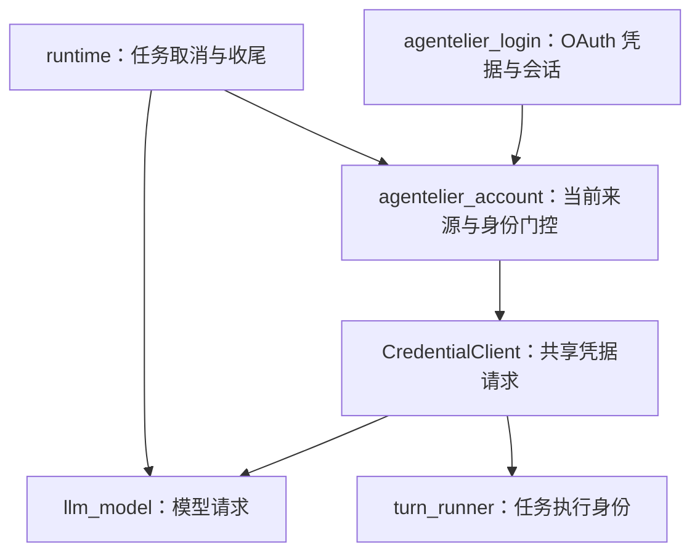

# Account 接入自主 OAuth 凭据来源

## 目标

将 `agentelier_account` 当前基于外部 Codex 文件路径的来源模型，改为基于 Agentelier 自己的 OAuth 会话。保留 Account 作为账号状态、凭据分发和执行身份门控的唯一所有者，继续使用现有 CredentialClient、ExecutionIdentity 和 Runtime 收尾机制。

## 当前职责与改造后关系

当前 `SourceSettings` 持有可选的外部文件路径，Account 通过 Login 读取 `auth.json`，再把凭据交给 CredentialClient。改造后，Login 持有 OAuth 凭据与持久化能力；Account 管理当前登录会话是否可用，并通过 CredentialClient 向模型任务交付凭据。

Account 不负责 OAuth HTTP 协议，不直接打开浏览器，也不读写凭据文件。Login 不负责任务调度、Bevy 状态或模型请求。Runtime 仍拥有 Tokio 线程、队列、取消令牌、JoinHandle 和真实回收信号。

## 凭据分发与执行身份

保留 CredentialClient 对同类并发凭据请求的合并行为。模型目录、连接验证、聊天、长期记忆及 Codex Images 仍通过同一 CredentialClient 获取当前可用凭据，不允许各消费者自行读取 Token 文件或缓存另一份账号状态。

保留 ExecutionIdentity 固定主体、Workspace 和授权生命周期的职责。每个任务取得执行身份后，后续凭据请求必须仍属于相同主体和 Workspace。Access Token 刷新可以改变凭据版本，但只要账号主体与 Workspace 没变，原执行身份仍然有效；退出登录或切换账号则使旧执行身份失效。

账号来源变化时，沿用现有来源结算语义：暂停新凭据分发，使旧任务停止并回收工具及进程，等待已接纳结果和必要会话记录完成收尾，再发布新的账号状态并恢复接纳。不能在旧任务尚未收尾时直接替换凭据并让旧任务继续执行。

## 模型层与图片生成

`agentelier_llm_model` 继续通过 Account 获取 OAuth Access Token。Responses HTTP/SSE、WebSocket 与 Codex Images 都使用相同的当前凭据和账号身份，不在模型层新增认证文件读取或独立 Token 管理。

Codex Images 继续使用 Codex 专用 API Base URL `https://chatgpt.com/backend-api/codex`，图片生成路径为 `/images/generations`，图片编辑路径为 `/images/edits`。Codex API 请求的 `originator` Header 使用 `agentelier`。已有图片生成流程不因认证来源迁移而切换到 SIWC 或公开 Images API。

本阶段应将实验中已经成功的图片请求接入正式 Account 凭据分发路径，证明图片功能使用的是 Agentelier 自己保存和恢复的 OAuth 凭据，而不是实验临时变量或外部文件。

## 完成条件

- Account 不再以外部文件路径作为账号来源。
- Account 从 Login 获取 Agentelier 自己的 OAuth 凭据和账号身份。
- CredentialClient 仍合并同类并发请求，并作为模型消费者取得凭据的统一入口。
- ExecutionIdentity 仍固定账号主体、Workspace 和授权生命周期。
- 来源变化仍先暂停新请求并等待旧执行收尾，再发布新来源。
- LLM Model 不直接读取凭据文件，不建立第二份账号状态。
- Responses 与 Codex Images 使用同一账号凭据；图片生成继续走 Codex 专用接口。
- 不因改造认证来源而重做 Runtime、Bridge Connection 或模型请求执行架构。
