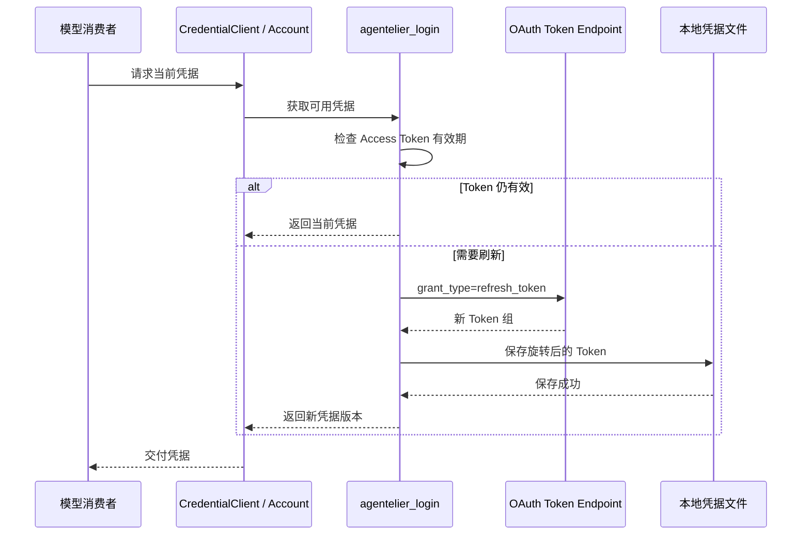

# Token 自动续期与 401 恢复

## 目标

由 Agentelier 自己管理 OAuth Access Token 的有效期和 Refresh Token Rotation，使已登录账号在正常使用期间能够自动续期。刷新过程归 Login 实现，Account 继续负责并发请求合并、凭据交付和执行身份校验。

## 刷新流程

Login 在凭据请求时检查 Access Token 的有效期。需要刷新时，使用当前 Refresh Token 调用 `https://auth.openai.com/oauth/token`，携带 `grant_type=refresh_token` 和相同 Client ID。成功响应可能同时返回新的 ID Token、Access Token 和 Refresh Token；应以响应中实际提供的新值更新凭据，不能继续使用已轮换的旧 Refresh Token。

刷新后的凭据必须先成功保存到 Agentelier 的本地凭据文件，再交付给请求方。网络请求期间不应持有文件写入锁；保存时应核对当前存储的凭据仍属于本次刷新所依据的登录，避免较晚完成的刷新覆盖另一次登录或更新后的凭据。

## 并发与请求恢复

同一登录会话中的并发刷新请求应合并为一次刷新操作。等待者共享同一刷新结果；某个等待者取消，不应中止已经开始且仍需完成持久化的 Token Rotation。

继续保留 `AuthenticatedRequest` 的一次 401 恢复预算：只允许在输出开始前恢复一次；已经开始输出的请求不能重放。恢复必须取得与原请求相同主体和 Workspace 的新凭据版本。若账号身份已经改变，原请求停止而不是使用新账号继续。

Refresh Token 失效、过期、重复使用或撤销等永久失败，应将账号状态转为需要重新登录，并向调用方提供明确原因。网络超时、连接失败等临时故障应与永久授权失效区分；临时故障不能被伪装成用户已退出登录。

## 与现有运行机制的关系

CredentialClient 继续负责并发凭据请求合并。Runtime 继续调度 Account 命令和模型任务，不把 OAuth 刷新网络逻辑放进 Runtime。LLM Model 只请求当前凭据并执行一次有界恢复，不自行刷新 Token。Token、Refresh Token 和完整 ID Token 留在 Agent 执行侧，不进入 Bridge 或 Bevy。

## 完成条件

- 未过期 Access Token 可直接交付，不进行无意义刷新。
- Token 需要刷新时，使用 Refresh Token 成功取得新凭据。
- Refresh Token Rotation 后的新 Token 保存成功才交付给消费者。
- 同一账号并发刷新合并为一次操作。
- 等待者取消不会遗失已开始的刷新结果或阻止其持久化。
- 刷新期间若账号已被替换，旧刷新结果不能覆盖新账号凭据。
- 401 只在输出开始前恢复一次；输出开始后不重放请求。
- 恢复后的主体与 Workspace 必须与原执行身份一致。
- 永久授权失败与临时网络故障形成不同的账号状态和错误反馈。

## 参考实现

- [Codex AuthManager](https://github.com/openai/codex/blob/main/codex-rs/login/src/auth/manager.rs)：Refresh Token Rotation、刷新失败分类、并发刷新与凭据持久化一致性处理。
- [OpenCode Codex OAuth](https://github.com/anomalyco/opencode/blob/dev/packages/core/src/plugin/provider/openai.ts)：独立客户端使用 Codex Client ID 交换及刷新 Token 的实现参考。
